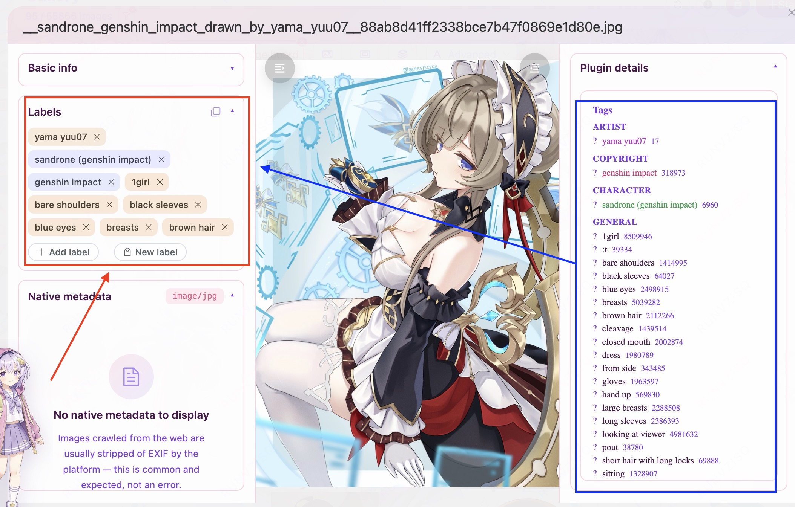
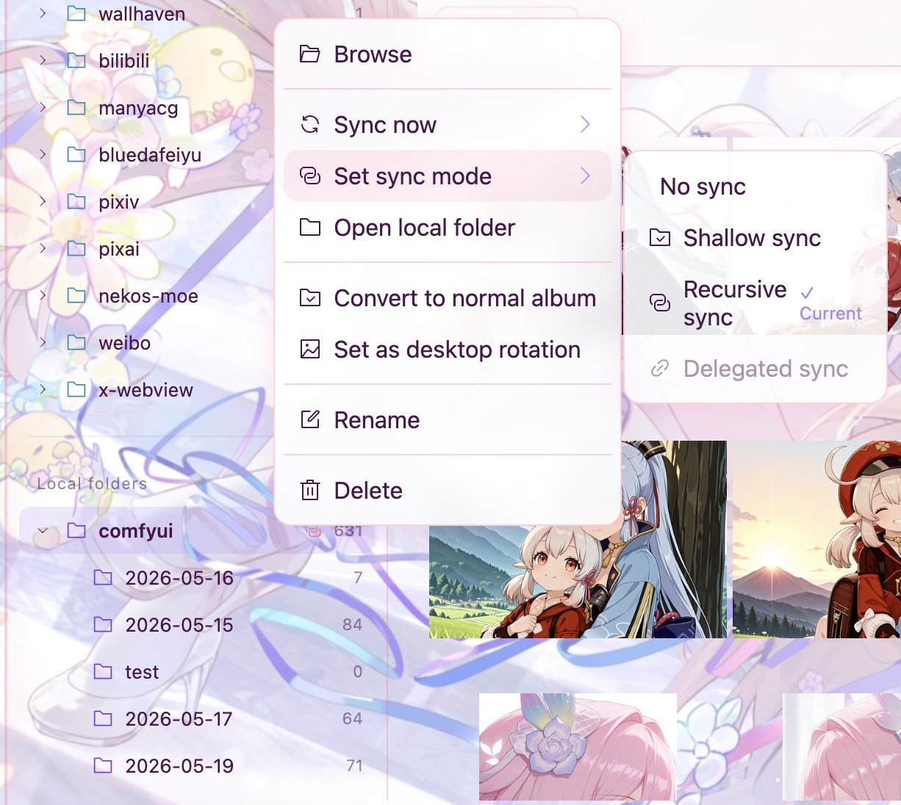
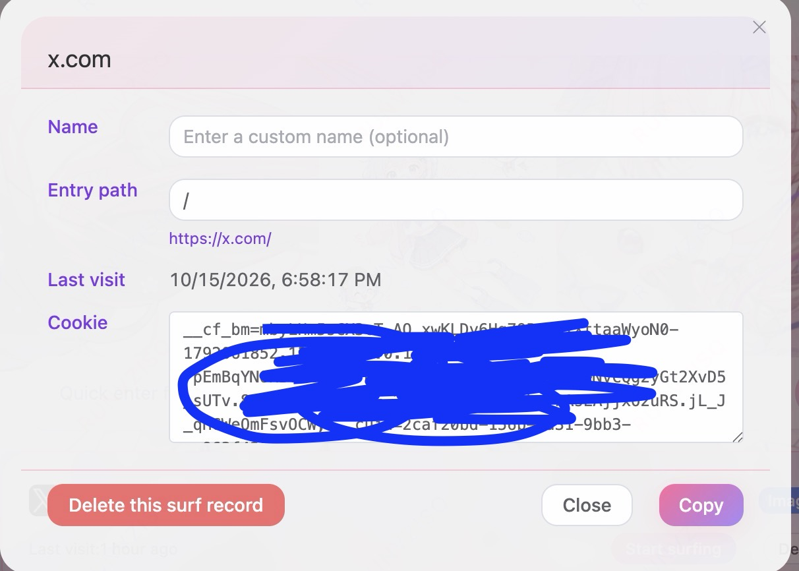
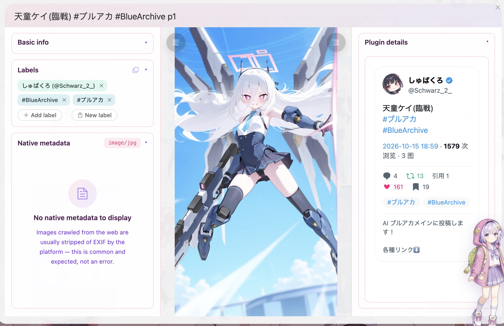
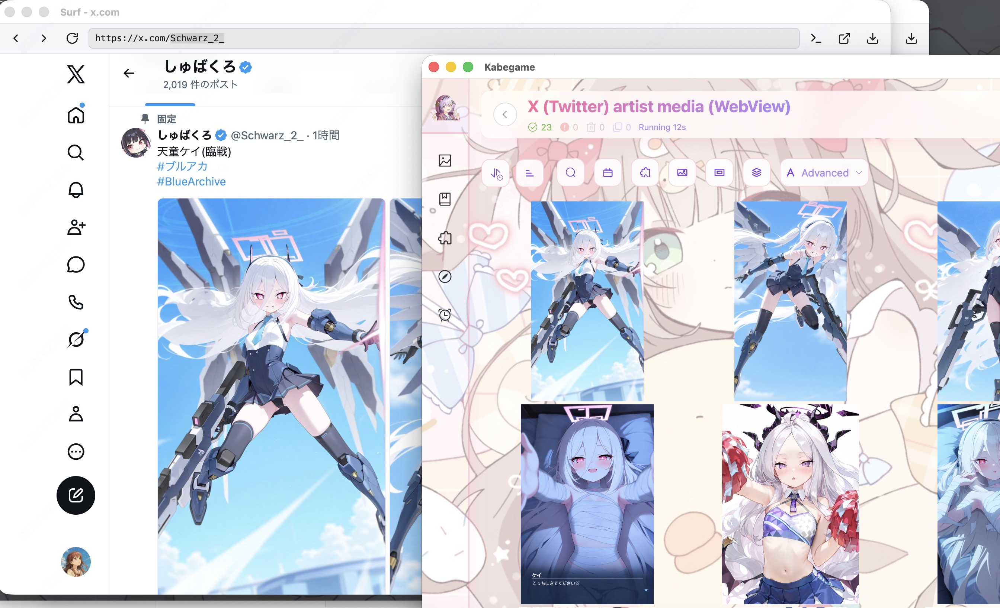
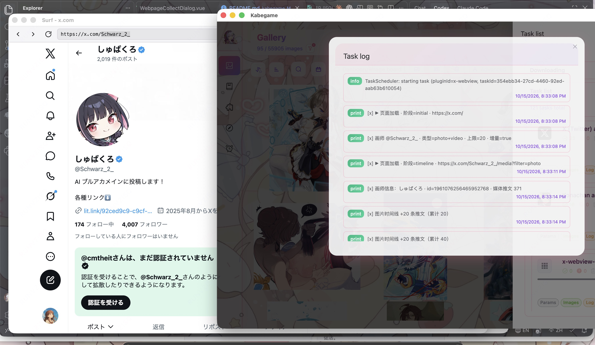
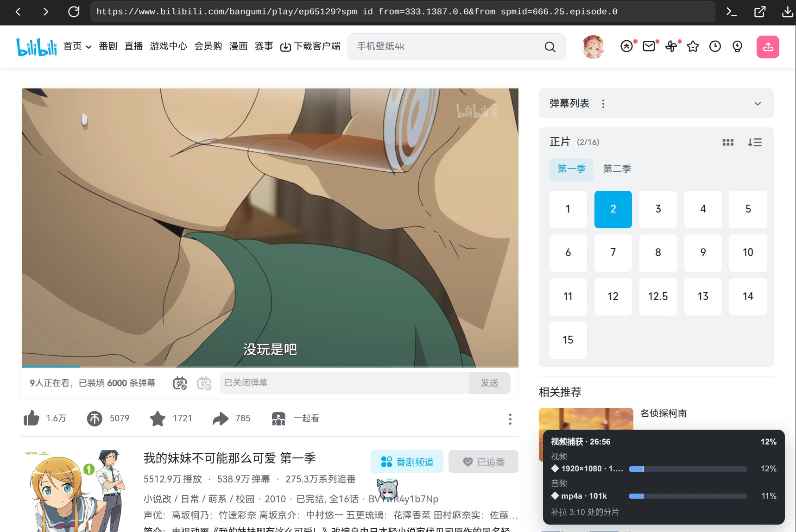

# Kabegame — A Plugin-Driven Anime Image & Video Collection and Archiving Tool

> *Translated by AI. [中文](README.md) | English | [日本語](README.ja.md) | [한국어](README.ko.md)*

Gather images and videos scattered across illustration sites, communities, creator platforms, and local folders into one local library—while keeping the source, tags, and artwork metadata.

Kabegame doesn't just download: plugins can automatically classify tags such as characters, works, and artists; local directories can be mapped to continuously synced albums; when a login is needed, sign in once in the built-in browser and plugins can reuse the saved cookies. Ordinary sites are handled by lightweight V8 plugins, while JS-heavy or anti-scraping sites can be collected through a real WebView.

<p align="center">
  <a href="https://github.com/kabegame/kabegame/releases/latest"><b>Download latest</b></a>
  · <a href="https://demo.kabegame.com">Live demo</a>
  · <a href="https://kabegame.com/guide/quickstart/">Quick start</a>
  · <a href="https://github.com/kabegame/crawler-plugins">Browse plugins</a>
  · <a href="https://kabegame.com/dev/overview/">Develop plugins</a>
</p>

<p align="center">
  <a href="https://github.com/kabegame/kabegame/releases/latest">
    
  </a>
  <a href="https://github.com/kabegame/kabegame/releases">
    
  </a>
  <a href="https://github.com/kabegame/kabegame/stargazers">
    
  </a>
  <a href="https://github.com/kabegame/kabegame/blob/main/LICENSE">
    
  </a>
  <a href="https://kabegame.com">
    
  </a>
</p>

## Highlights

- **Automatic tag classification**: Supported plugins write structured tags such as character, work, artist, model, and source at download time, automatically forming a browsable tag directory that supports combined filtering—no need to sort images one by one after collecting them.
- **Continuous local folder sync**: Map a disk directory to a synced album; additions and deletions in the directory are reflected in the library, and subdirectories can generate sub-albums that keep their original hierarchy. Ideal for continuously receiving output from drawing software, AI image generators, or other downloaders.
- **Sign in once, reuse automatically afterward**: Sign in to a site normally in the built-in "Surf" browser and Kabegame saves every site cookie; the host can securely inject the login state into plugins, so you don't have to copy cookies over and over, and plugins never see cookie plaintext.
- **Save videos straight from Surf**: Right-click a video in the built-in browser and choose "Download video"; even `blob:` / MSE streaming players are captured per quality level, audio and video are muxed and imported, and a corner panel shows live capture progress for each stream.
- **Real WebView-driven crawling**: Beyond lightweight V8 HTTP / HTML plugins, plugins can run inside a real browser page to handle SPAs, JS rendering, browser fingerprinting, Cloudflare checks, and login flows that need interaction.
- **Extend to new content sources with scripts**: Crawler plugins are written in JavaScript / TypeScript with no need to modify or recompile Kabegame; a single plugin can define collection logic, configuration forms, tag classification, source metadata, and detail views at once, and be packaged as a `.kgpg` file to share with other users.
- **Source information stays with the image**: Plugins can save the author, original post link, body text, comments, community tags, and AI generation parameters, and provide their own detail views and search fragments—so an image still knows "where it came from and why it was saved" after leaving the original site.

<table width="100%">
  <tr>
    <td align="center" width="50%">
      <br/>
      <small>Plugins write structured tags, automatically forming a filterable tag directory</small>
    </td>
    <td align="center" width="50%">
      <br/>
      <small>Map local directories to continuously synced albums that keep their hierarchy</small>
    </td>
  </tr>
  <tr>
    <td align="center" width="50%">
      <br/>
      <small>Sign in once in Surf; later collections reuse the login state automatically</small>
    </td>
    <td align="center" width="50%">
      <br/>
      <small>Author, original post, tags, and interaction info are kept alongside the image</small>
    </td>
  </tr>
</table>

<table width="100%">
  <tr>
    <td align="center" width="50%">
      <br/>
      <small>Plugins run in real browser pages and feed media into collection tasks</small>
    </td>
    <td align="center" width="50%">
      <br/>
      <small>Page interaction, scrolling, and extraction can be traced in the task log</small>
    </td>
  </tr>
  <tr>
    <td align="center" colspan="2">
      <br/>
      <small>Right-click a streaming video in Surf to download it, with live per-stream capture progress in the corner</small>
    </td>
  </tr>
</table>

## From Collecting to Archiving

- **Unified collection**: Batch-fetch content from sources like Pixiv, Bilibili, Danbooru, wallpaper sites, and communities through plugins—or browse and collect on the fly in the built-in browser.
- **Unified search**: Different sources land in the same gallery, filterable by combinations of time, plugin, tag, media type, dimensions, file size, and metadata search.
- **Unified management**: Organize themes by hand with plain albums, auto-classify with tag directories, follow disk folders with synced albums, and handle a library accumulated over the long term with deduplication and hiding.
- **Locally owned**: Original files and library data are in your hands; customize the download directory, and access albums from other applications through a virtual disk.
- **Keep extending**: Crawler plugins are written in JavaScript / TypeScript; MCP lets AI agents search and organize the library under explicit permissions.

What Kabegame tries to solve isn't "how to download an image" but how to preserve context and organize images over the long term as they cross sources and keep accumulating. It frees your hands from organizing images, and suits AI trainers, anime fans, and people slacking off at work. PNGs and other images can even have their metadata parsed—you might just discover the prompts behind AI-generated images! (I've salvaged several of my own workflows with Kabegame.)

## Quick Start

1. Download and install Kabegame from [GitHub Releases](https://github.com/kabegame/kabegame/releases/latest).
2. Open "Sources" and install a plugin you're interested in from the official plugin directory; skip this step if you only manage local images.
3. Go back to "Gallery", click "Start collecting", and choose local import or a web plugin.
4. Filter the gallery by source and tag, view the original post metadata, and organize what you want to keep long-term into albums.

See [Quick Start](https://kabegame.com/guide/quickstart/) for the full five-minute walkthrough. You can also open the [live demo](https://demo.kabegame.com) to try the library UI without installing the desktop app.

## Core Capabilities

| Capability | Description |
| --- | --- |
| Plugin-driven collection | Built-in plugin store to install, upgrade, and manage `.kgpg` plugins; the V8 and WebView backends cover lightweight requests and real browser scenarios respectively. |
| Login state reuse | Surf saves site cookies, which V8 plugins can securely request to be injected; WebView plugins use the browser session directly. |
| Tags and metadata | Plugins can auto-classify tags, save original posts, authors, comments, and generation parameters, and contribute detail views and search fields. |
| Gallery and search | Browse images and videos, filtering by combinations of time, source, tag, media, dimensions, file size, and metadata. |
| Albums and folders | Manual albums support multi-level organization; synced albums continuously follow local directories and their subdirectories. |
| Local library integration | Custom download directory, drag-and-drop import, batch operations, deduplication, virtual disk, and native metadata parsing. |
| Automation and open interfaces | Scheduled collection, CLI, and MCP; wallpaper setting and album rotation are provided as additional desktop capabilities. |

## Plugin Ecosystem

The official plugin repository already covers more than twenty illustration sites, communities, creator platforms, and wallpaper sites. Different plugins can offer their own configuration forms, login methods, tag dimensions, detail displays, and recommended tasks.

- **Using plugins**: [Browse the official plugin directory](https://github.com/kabegame/crawler-plugins) · [Install and manage plugins](https://kabegame.com/guide/plugins-usage/)
- **Developing plugins**: [Development overview](https://kabegame.com/dev/overview/) · [Choosing a V8 / WebView backend](https://kabegame.com/dev/crawler-backends/) · [API reference](https://kabegame.com/reference/kabegame-api/)
- **Contributing plugins**: Submit new sources, fix broken sites, or improve the docs and metadata of existing plugins.

V8 plugins are self-contained ES modules, well suited to collecting via HTTP requests, APIs, and HTML parsing, and they can also run on Android. When you must rely on real browser rendering, a browser session, or page interaction, use the desktop WebView backend; it actually runs the page, then extracts content from the DOM, network responses, or page downloads.

> Plugins should only be used to organize content you have the right to access. Please follow the source sites' terms of service, respect authors' copyright and privacy, and keep access rates reasonable.

## Download & Platforms

The desktop version is the primary release; `kabegame-cli` is a separate, optional tool that is not installed with the main app.

| Platform | Download | Notes |
| --- | --- | --- |
| Windows x64 | `Kabegame-standard_<version>_x64-setup.exe` | Double-click to install. The album virtual disk needs Dokan 2.x; the app prompts you to install it the first time you enable it. |
| macOS Apple silicon | `Kabegame-standard_<version>_aarch64.dmg` | Supports macOS 11 and later; the installer is not yet signed. |
| Linux amd64 | `Kabegame-standard_<version>_amd64.deb` | Install with `apt`; the album virtual disk depends on `fuse3`. |
| Android | `Kabegame_<version>_android-preview.apk` | Android 8.0 and later; use v4.3.0 for now, later versions are still being adapted. |

If macOS reports an unverified developer or a damaged app on first launch:

```bash
xattr -d com.apple.quarantine /Applications/Kabegame.app
```

To use the album virtual disk on macOS, install macFUSE as well:

```bash
brew install --cask macfuse
```

Linux installation:

```bash
sudo apt install ./Kabegame-standard_*_amd64.deb
```

Images are saved by default in `Pictures/Kabegame` under your user Pictures directory, and uninstalling the app will not delete them. See the [installation docs](https://kabegame.com/guide/installation/) for fuller platform requirements, data directories, and troubleshooting.

## Contributing

You don't need to know the whole Tauri / Rust monorepo first to contribute to Kabegame:

- If you hit a problem, file a [Bug report](https://github.com/kabegame/kabegame/issues/new?template=bug_report.md).
- To support a new source, submit a plugin or open a request in the [plugin repository](https://github.com/kabegame/crawler-plugins).
- To improve the app itself, start with [Building from source](https://kabegame.com/dev-contrib/building/) and [Architecture](https://kabegame.com/dev-contrib/architecture/).
- Documentation, translations, screenshots, and plugin descriptions are valuable contributions too.

If Kabegame helps you, a Star is welcome. It helps more users and potential plugin authors discover the project, and it's encouragement for me too.

## Technical Highlights

Kabegame is built with Vue 3, Tauri 2, and Rust, with several extensions for library queries, the plugin runtime, and desktop browser capabilities:

- [WebviewHandler](./src-tauri/kabegame-core/src/crawler/webview.rs): run plugins that need a login state or page interaction in a real page environment.
- [tauri-runtime-cef](./src-tauri/tauri-runtime-cef/): a CEF Tauri runtime customized for the desktop.
- [PathQL](./src-tauri/pathql-rs/): a database query engine combining path-based filtering, sorting, pagination, and the Provider DSL.

See [Architecture and project structure](https://kabegame.com/dev-contrib/architecture/) for the project layout, process model, and key modules.

## License

Kabegame is open source under [GPL-3.0](./LICENSE).

## Origin of the Name 🐢

**Kabegame** is the romanization of the Japanese「壁亀」(かべがめ), which sounds close to「壁紙」(かべがみ, "wallpaper"). Like a quiet little turtle lying on your desktop, guarding your image collection.
