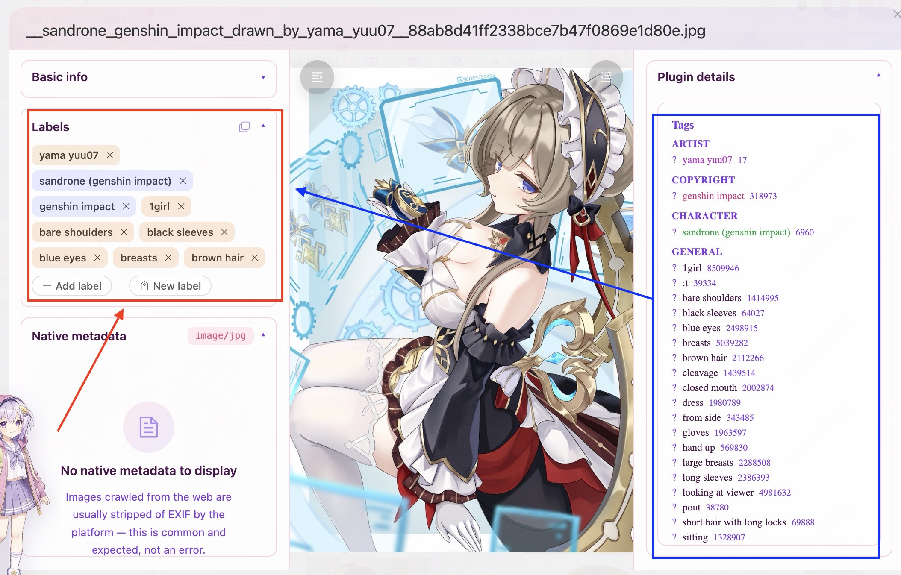
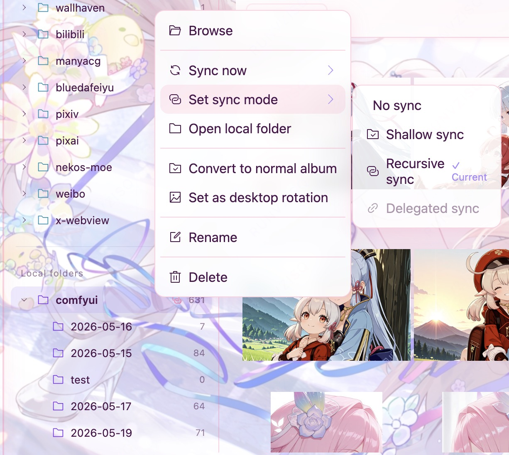
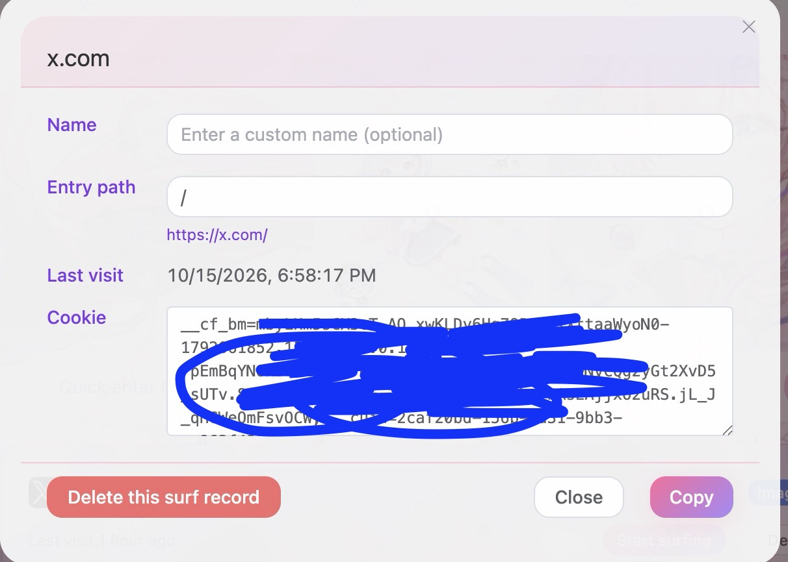
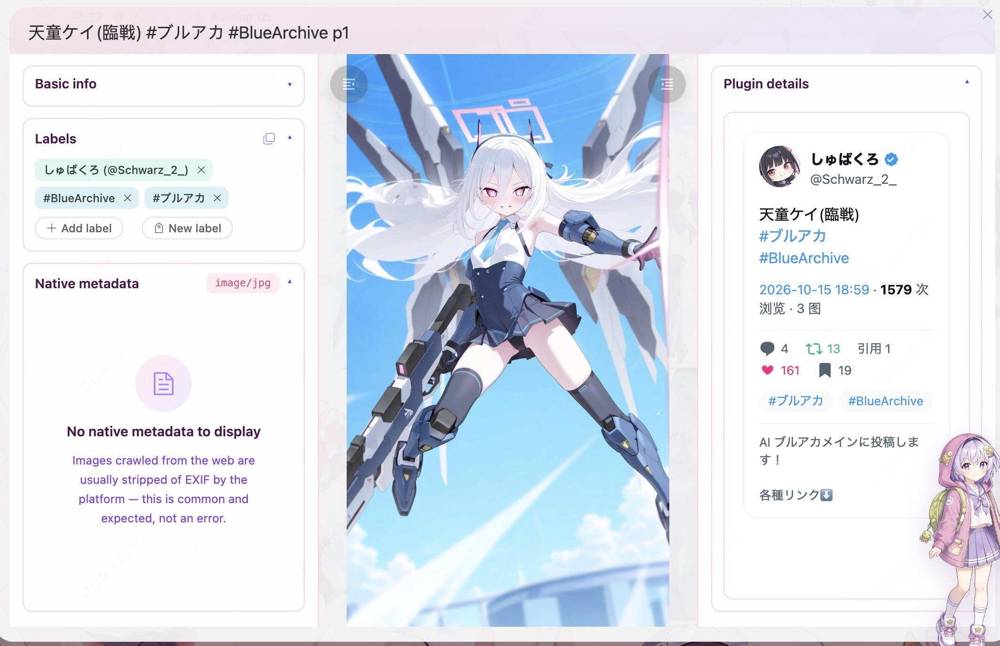
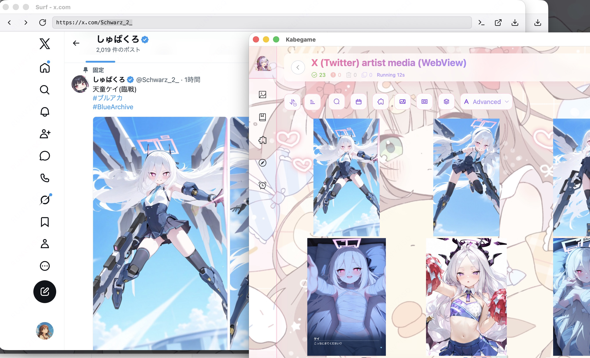
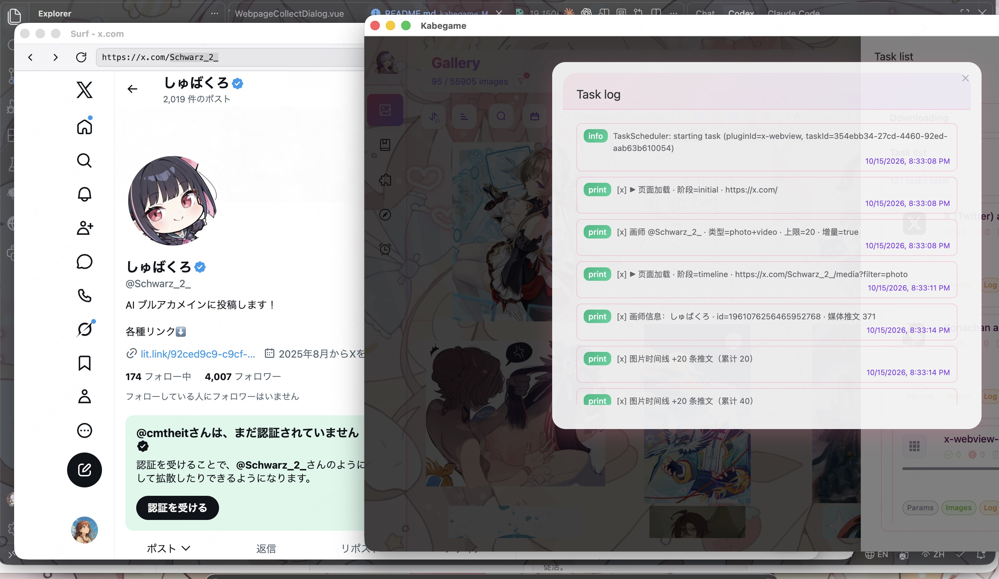
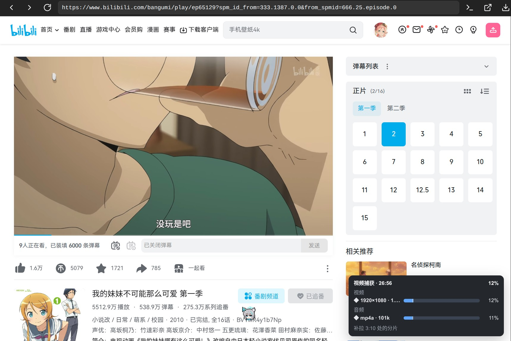

# Kabegame — A Plugin-Driven Multimedia Collection and Organizing Tool

> *Translated by AI. [中文](README.md) | English | [日本語](README.ja.md) | [한국어](README.ko.md)*

Spotted some great images online and want to save them locally in one click? Want updates delivered by automatic subscription instead of opening web pages by hand every day? — `Kabegame` runs JS plugins that can crawl any site and implement almost any logic, however complex. You can also schedule them to run automatically, so new images pop up in your library every day.

Want a crawler framework that collects tags and metadata automatically? — `Kabegame` plugins can attach the source site's tags and an EJS preview of the original post to each image, so you can later filter by tag in the gallery, or let MCP do the filtering for you.

Want to organize your local library and find exactly the images you want by keyword, size, color, date, metadata, tags, or any free combination of them? — `Kabegame` can import a local folder of your choice into the library, and can optionally keep it recursively in sync automatically.

Want the simplest way to sign in, without copying cookies by hand? — `Kabegame` plugins never take your username or password: just open a site in the app's built-in browser and sign in. From then on, that site's login credentials are reused when downloading, which is more convenient than most crawler tools. WebView JS plugins can even drive the built-in browser directly, simulating human actions in the WebView to crawl content and add it to the library. Streaming videos on sites like x.com can also be crawled automatically through the WebView, or downloaded manually with a right-click.

`v4.7.0` Want the community's best open-source Wallpaper Engine implementation to automatically download and preview Wallpaper Engine wallpapers on desktop, and set them as your wallpaper? — `Kabegame` 4.7.0 uses the powerful `Opus5.5` + `REA MCP` + `RenderDOC MCP` + a pixel-comparison `harness` framework to bring Wallpaper Engine's scene wallpaper format, web wallpapers, and videos to `WebGPU`, with over 99.9% pixel-level fidelity. Preview them and set them as your wallpaper on desktop platforms! (Downloads use the credentials of the Steam account that purchased WE.)

### kabegame (/ka.be.ɡa.me/) can fulfill almost every wish you have for collecting a local image library, thanks to its powerful `js` crawler plugin scripts and strong cross-platform capabilities built on `Tauri 2`, a customized `Chromium`, and the in-house `kbcef` runtime. On top of that comes `PathQL`, an in-house, extremely flexible, path-based folding query engine.

Basic workflow: open the app -> choose Local / Network in the top-right corner -> fill in the form to start importing -> wait for the items to land in the library.

https://github.com/user-attachments/assets/7654b2b5-4273-4acd-81b2-24d3e05c26f1

<p align="center">
  <a href="https://github.com/kabegame/kabegame/releases/latest"><b>Download latest</b></a>
  · <a href="https://demo.kabegame.com">Live demo</a>
  · <a href="https://kabegame.com/guide/quickstart/">Quick start</a>
  · <a href="https://github.com/kabegame/crawler-plugins">Browse plugins</a>
  · <a href="https://kabegame.com/dev/overview/">Develop plugins</a>
</p>

<p align="center">
  <a href="https://github.com/kabegame/kabegame/releases/latest">
    
  </a>
  <a href="https://github.com/kabegame/kabegame/releases">
    
  </a>
  <a href="https://github.com/kabegame/kabegame/stargazers">
    
  </a>
  <a href="https://github.com/kabegame/kabegame/blob/main/LICENSE">
    
  </a>
  <a href="https://kabegame.com">
    
  </a>
</p>

## Highlights
- **JS plugin extensions**: Similar tools such as `yt-dlp`, `hydrus`, and `gallery-dl` only work with built-in sites or offer limited dynamic extension. `Kabegame` supports almost entirely free, scriptable crawling, and plugins can even extend how you search—for example, the `anime-pictures` plugin adds filtering by image score. See the [plugin repository](https://github.com/kabegame/crawler-plugins) for details.

- **Automatic tag classification**: Supported plugins write any kind of tag—character, work, artist, model, source, and more—at download time, and Kabegame automatically builds a browsable tag directory that supports combined filtering, so you don't have to sort images one by one after collecting them.

- **Continuous local folder sync**: Map a disk directory to an album; additions and deletions in the directory are reflected in the library, and subdirectories can generate sub-albums that keep their original hierarchy. Ideal for continuously receiving output from drawing software, AI image generators, or other downloaders.

- **Sign in once, reuse automatically afterward**: Sign in to a site normally in the built-in "Surf" browser and Kabegame saves the cookies for every site. Plugins never read cookies; the host injects the login state for the matching site, so you don't have to copy cookies over and over or hunt down Chrome's data directory.

- **Download straight from the built-in browser**: While watching videos or viewing images in the built-in "Surf" browser, right-click and choose "Download video" or "Download image". Even videos in `blob:` / MSE streaming players are captured per quality level, with audio and video segments muxed and imported, and live capture progress for each stream shown in the bottom-right corner.

- **Real WebView-driven crawling**: Beyond lightweight V8 JS plugins, plugins can also run inside a real browser page to handle SPAs, JS rendering, browser fingerprinting, Cloudflare checks, and login flows that require interaction.

- **Automatic metadata and tag parsing**: Plugins can save the author, original post link, body text, comments, and community tags, and provide their own EJS detail views and extended search (via a `PathQL provider`), giving you the most flexible mix of image and text data and letting you browse locally just as you would on the site.

- **Kabegame CLI**: `Kabegame` is more than a GUI! Advanced users can use the CLI to run kgpg plugins that output images into a directory, query the library with `PathQL`, and more.

<table width="100%">
  <tr>
    <td align="center" width="50%">
      <br/>
      <small>Plugins write structured tags, automatically forming a filterable tag directory</small>
    </td>
    <td align="center" width="50%">
      <br/>
      <small>Map local directories to continuously synced albums that keep their hierarchy</small>
    </td>
  </tr>
  <tr>
    <td align="center" width="50%">
      <br/>
      <small>Sign in once in Surf; later collections reuse the login state automatically</small>
    </td>
    <td align="center" width="50%">
      <br/>
      <small>Author, original post, tags, and interaction info are kept alongside the image</small>
    </td>
  </tr>
</table>

<table width="100%">
  <tr>
    <td align="center" width="50%">
      <br/>
      <small>Plugins run in real browser pages and feed media into collection tasks</small>
    </td>
    <td align="center" width="50%">
      <br/>
      <small>Page interaction, scrolling, and extraction can be traced in the task log</small>
    </td>
  </tr>
  <tr>
    <td align="center" colspan="2">
      <br/>
      <small>Right-click a streaming video in Surf to download it, with live per-stream capture progress in the bottom-right corner</small>
    </td>
  </tr>
</table>

What Kabegame tries to solve isn't "how to download an image," but how to preserve context and keep things organized over the long term as images come in from different sources and keep piling up. It frees your hands from sorting images, and suits AI trainers, desktop customization fans, media collectors, and anyone managing a local image library. PNGs and other images can even have their metadata parsed, revealing secrets you can't see in the picture itself.

## Quick Start

1. Download and install Kabegame from [GitHub Releases](https://github.com/kabegame/kabegame/releases/latest).
2. Click "Start collecting" in the top-right corner and choose local or network.
3. Go back to "Gallery", click "Start collecting", and choose local import or a network plugin.
4. Filter the gallery by source and tag, view the original post metadata, and organize what you want to keep long-term into albums.

See [Quick Start](https://kabegame.com/guide/quickstart/) for the full five-minute walkthrough. You can also open the [live demo](https://demo.kabegame.com) to try the library UI without installing the desktop app.

## Core Capabilities

- **Unified collection**: Existing plugins batch-fetch content from sources such as Pixiv, yande, konachan, anime-pictures, Danbooru, and the Steam Wallpaper Engine workshop, and you can also download as you browse in the built-in "Surf" browser.
- **Unified search**: Different sources land in the same gallery, filterable by combinations of time, plugin, tag, media type, dimensions, file size, and metadata search. Plugins can even define their own search dimensions—something few other apps offer.
- **Unified management**: Organize themes by hand with plain albums, auto-classify with tag directories, follow disk folders with synced albums, and keep a library built up over the long term in shape with deduplication and hiding.
- **Locally owned**: Original files and library data stay in your hands; you can customize the download directory, access the library through MCP, or transfer images between devices on your home network with the kabegame server plugin.
- **Keep extending**: Crawler plugins are written in JavaScript / TypeScript; MCP lets AI agents search and organize the library under explicit permissions.

## Plugin Ecosystem

The official plugin repository already covers more than thirty illustration sites, communities, creator platforms, and wallpaper sites. Different plugins can offer their own configuration forms, login methods, tag dimensions, detail displays, and recommended tasks.

- **Using plugins**: [Browse the official plugin directory](https://github.com/kabegame/crawler-plugins) · [Install and manage plugins](https://kabegame.com/guide/plugins-usage/)
- **Developing plugins**: [Development overview](https://kabegame.com/dev/overview/) · [Choosing a V8 / WebView backend](https://kabegame.com/dev/crawler-backends/) · [API reference](https://kabegame.com/reference/kabegame-api/)
- **Contributing plugins**: Submit new sources, fix broken sites, or improve the docs and metadata of existing plugins.

V8 plugins are self-contained ES modules, well suited to collecting via HTTP requests, APIs, and HTML parsing. When a plugin must rely on real browser rendering, a browser session, or page interaction, it can declare the WebView backend, which actually runs the page and executes the plugin's JS logic directly inside it.

## Download & Platforms

The desktop version is the primary release; `kabegame-cli` is a separate, optional tool that is not installed with the main app.

| Platform | Download | Notes |
| --- | --- | --- |
| Windows x64 | `Kabegame-standard_<version>_x64-setup.exe` | Double-click to install. |
| macOS Apple silicon | `Kabegame-standard_<version>_aarch64.dmg` | Supports macOS 11 and later; the installer is not yet signed. |
| Linux amd64 | `Kabegame-standard_<version>_amd64.deb` | Install with `apt`. |
| Android | `Kabegame_<version>_android-preview.apk` | Android 8.0 and later |

If macOS reports an unverified developer or a damaged app on first launch:

```bash
xattr -d com.apple.quarantine /Applications/Kabegame.app
```

Linux installation:

```bash
sudo apt install ./Kabegame-standard_*_amd64.deb
```

Images are saved by default in `Pictures/Kabegame` under your user Pictures directory, and uninstalling the app will not delete them. See the [installation docs](https://kabegame.com/guide/installation/) for fuller platform requirements, data directories, and troubleshooting.

## Wallpaper Notes

### Wallpaper Modes

Switch the wallpaper mode via Kamechan -> Settings -> Wallpaper -> Wallpaper mode.

- **Native mode**: Uses the system's native wallpaper API, so the wallpaper stays on screen even after Kabegame exits; the downside is that only images are supported.
- **Window / plugin mode**: Kabegame renders the wallpaper in a full-screen window, using techniques such as off-screen rendering or placing the window at the very bottom of the stack. Every type of wallpaper is supported, and it looks almost exactly like the in-app preview.

### Compatibility Table
🖼️ = images can be set, 🎬 = videos / Web / scenes can be set ("Web / scene" means Wallpaper Engine's web and scene wallpapers); anything unmarked is unsupported. In window mode (Windows, macOS) and plugin mode (Linux), Kabegame renders the wallpaper itself, so every type can be set as the desktop wallpaper.

To find the GNOME version listed below, run `gnome-shell --version`; to find your desktop environment, run `echo $XDG_SESSION_DESKTOP`; to find the display protocol (Wayland / X11), run `echo $XDG_SESSION_TYPE`.
<table>
  <thead>
    <tr>
      <th>Operating system</th>
      <th>Desktop / display protocol</th>
      <th>Native mode</th>
      <th>Window / plugin mode</th>
    </tr>
  </thead>
  <tbody>
    <tr>
      <td>Windows</td>
      <td>System desktop</td>
      <td>🖼️</td>
      <td>🖼️ 🎬</td>
    </tr>
    <tr>
      <td>macOS</td>
      <td>System desktop</td>
      <td>🖼️</td>
      <td>🖼️ 🎬</td>
    </tr>
    <tr>
      <td rowspan="8">Linux</td>
      <td>KDE Plasma 6 · Wayland</td>
      <td>🖼️</td>
      <td>🖼️ 🎬<br>Frames are handed over directly on the GPU when one is available</td>
    </tr>
    <tr>
      <td>KDE Plasma 6 · X11</td>
      <td>🖼️</td>
      <td>🖼️ 🎬<br>Frames go through shared memory, so resource usage is higher</td>
    </tr>
    <tr>
      <td>KDE Plasma 5</td>
      <td>🖼️</td>
      <td>No plugin mode</td>
    </tr>
    <tr>
      <td>GNOME 49–51 (Wayland, X11)</td>
      <td>🖼️</td>
      <td>🖼️ 🎬<br>Requires Kabegame's GNOME Shell extension, which can be installed in one click when switching</td>
    </tr>
    <tr>
      <td>GNOME 42–48 · X11</td>
      <td>🖼️</td>
      <td>🖼️ 🎬<br>Same as above</td>
    </tr>
    <tr>
      <td>GNOME 42–48 · Wayland</td>
      <td>🖼️</td>
      <td>🖼️ 🎬<br>⚠️ Untested; may cover desktop icons</td>
    </tr>
    <tr>
      <td>GNOME 41 and earlier, 52 and later</td>
      <td>🖼️</td>
      <td>Switching shows a message that this GNOME version is unsupported</td>
    </tr>
    <tr>
      <td>Other desktops</td>
      <td>🖼️<br>Tries the GNOME and Plasma methods in turn; if the desktop recognizes neither, the wallpaper can't be set</td>
      <td>No plugin mode</td>
    </tr>
    <tr>
      <td>Android</td>
      <td>System desktop</td>
      <td>🖼️</td>
      <td>—</td>
    </tr>
  </tbody>
</table>

### Other Notes

- Setting a video, Web, or scene wallpaper in native mode guides you to switch to window / plugin mode; native mode on macOS and Linux doesn't support GIFs, so GIFs also require switching the wallpaper mode. Android supports native wallpapers only.
- Native mode first converts formats the system may not recognize, such as WebP, AVIF, and HEIC, into a JPEG / PNG copy and then sets that copy.
- On KDE Plasma 6, Linux plugin mode pushes frames over `PipeWire` to Kabegame's Plasma wallpaper plugin (installed automatically when you switch to plugin mode). On GNOME, Kabegame's GNOME Shell extension places the wallpaper window on the desktop; if the extension isn't installed, switching modes prompts you to install it. After installing, log out and back in, then open Kabegame again and set it to plugin mode. GNOME plugin mode is still experimental: the extension has been tested on GNOME 50, while 42–48 have only been checked against the system APIs. If the extension is disabled or GNOME Shell restarts while in plugin mode, Kabegame switches back to native mode and lets you know.
- When the current wallpaper can't be shown in the current wallpaper mode (for example, a video or Wallpaper Engine wallpaper after switching to native mode), the desktop stays unchanged and a warning is shown. If switching to window or plugin mode fails, the switch doesn't go through and Kabegame automatically falls back to native mode.
- Scene wallpapers are rendered on the GPU (WebGPU); without a usable GPU, only the preview image is shown.
- The Web version has no desktop wallpaper; "Set as wallpaper" only sets it as the Web background.

## Contributing

You don't need to know the whole Tauri / Rust monorepo first to contribute to Kabegame:

- If you hit a problem, file a [Bug report](https://github.com/kabegame/kabegame/issues/new?template=bug_report.md).
- To support a new source, submit a plugin or open a request in the [plugin repository](https://github.com/kabegame/crawler-plugins).
- To improve the app itself, see the [build documentation](./BUILD.md), which is still being written. The app needs a Chromium patched by Kabegame, and no binaries of it have been published yet—which is also a big reason the app isn't built on a GitHub Actions pipeline.
- Docs-site documentation, in-app text translations, screenshots, and plugin descriptions are valuable contributions too.

If Kabegame helps you, a Star is welcome. It helps more users and potential plugin authors discover the project, and it's encouragement for Kabegame as well.

## Technical Highlights

Kabegame is built with Vue 3, Tauri 2, and Rust, with several extensions for library queries, the plugin runtime, and desktop browser capabilities:

- [WebviewHandler](./src-tauri/kabegame-core/src/crawler/webview.rs): run plugins that need a login state or page interaction in a real page environment.
- [tauri-runtime-kbcef](./src-tauri/tauri-runtime-kbcef/): a CEF Tauri runtime customized for the Kabegame desktop app. To avoid a name clash with `tauri-runtime-cef` from `Tauri3`, it has been renamed `tauri-runtime-kbcef` as of `v4.7.0`.
- [PathQL](./src-tauri/pathql-rs/): a database query engine combining path-based filtering, sorting, pagination, and the Provider DSL.
- [wpe-scene](./apps/wpe-scene/): the core code that renders Wallpaper Engine (80k+ lines), drawing with WebGPU driven by pure TS. As a wallpaper, it is shown through a Tauri window or a CEF off-screen window (Plasma).

See [Architecture and project structure](https://kabegame.com/dev-contrib/architecture/) for the project layout, process model, and key modules.

## License

Kabegame is open source under [GPL-3.0](./LICENSE).

## Origin of the Name 🐢

**Kabegame** is the romanization of the Japanese「壁亀」(かべがめ), which sounds close to「壁紙」(かべがみ, "wallpaper"). Like a quiet little turtle lying on your desktop, guarding your image collection.
