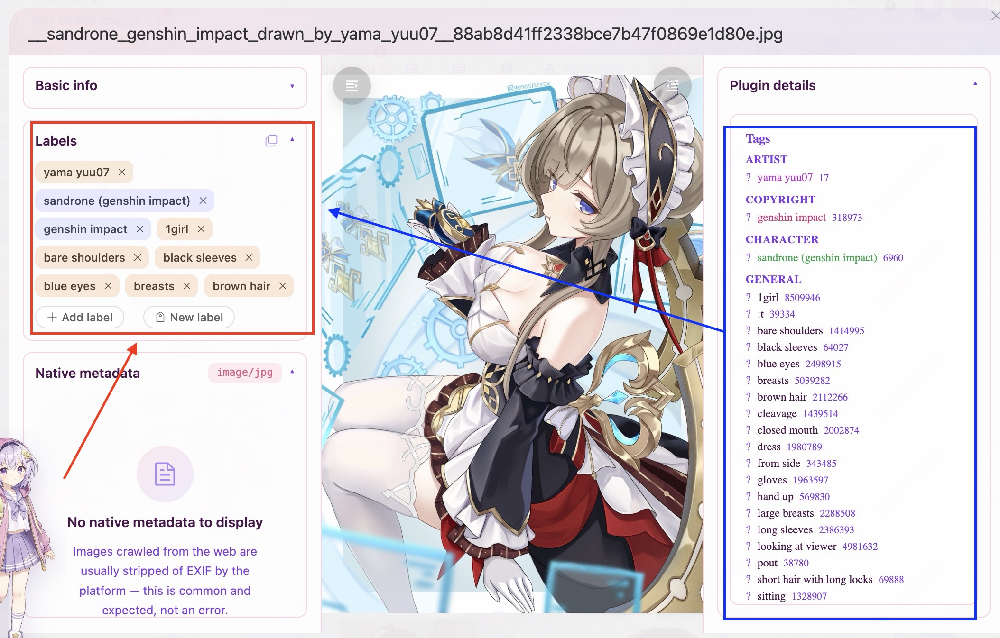
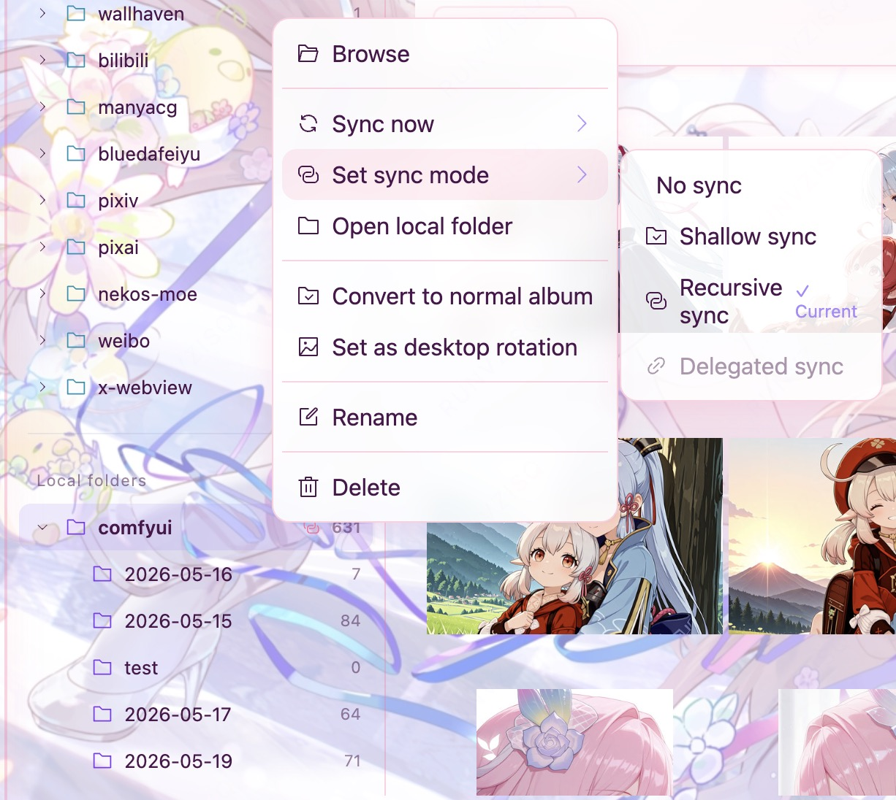
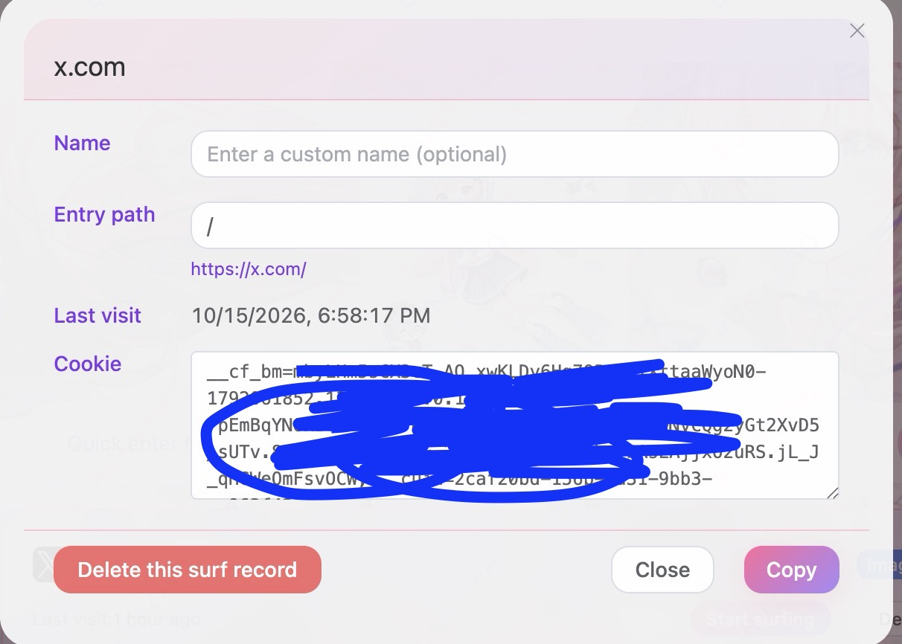
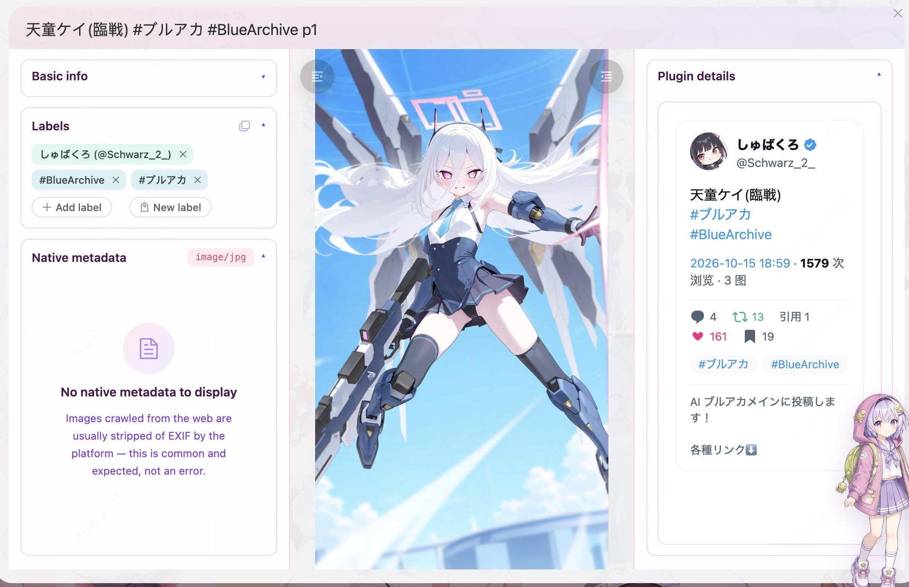
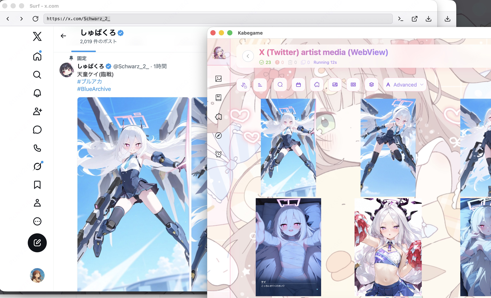
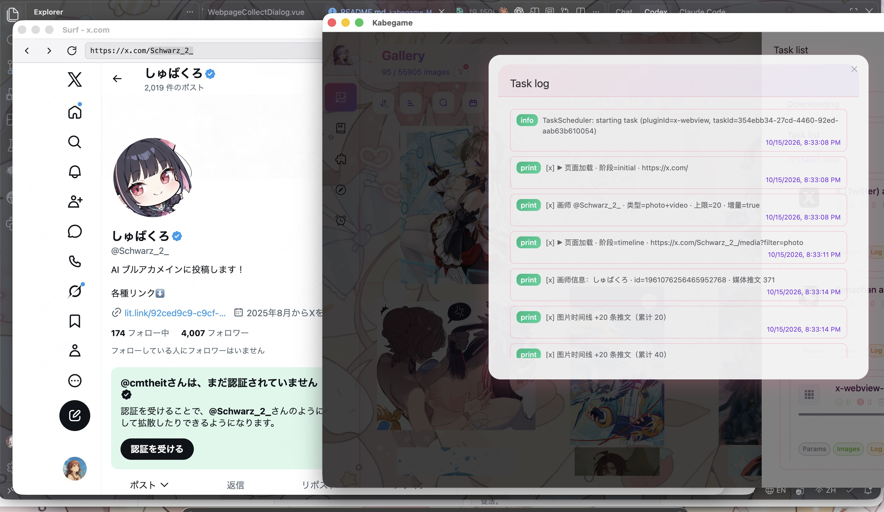
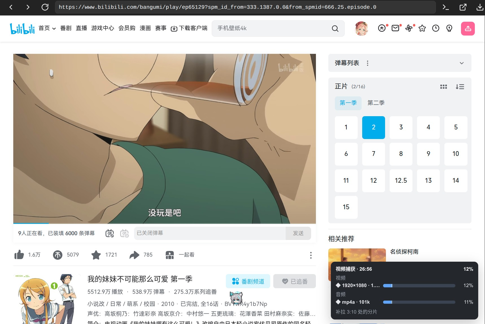

# Kabegame — プラグイン駆動のマルチメディア収集・整理ツール

> *Translated by AI. [中文](README.md) | [English](README.en-US.md) | 日本語 | [한국어](README.ko.md)*

ネットで見かけた素敵な画像を、ワンクリックでローカルに保存したい？ 更新を自動で購読して、毎日手作業でサイトを開いて回るのはもうやめたい？ —— `Kabegame` は JS プラグインを実行し、どんなサイトからのクロールでも、ほぼどんなに複雑なロジックでも実現できます。決まった時間に自動実行するよう設定することもでき、毎日ライブラリに新しい画像が自然と湧いてきます。

タグやメタデータを自動で集めてくれるクローラーフレームワークが欲しい？ —— `Kabegame` のプラグインは、画像に元サイトのタグや元投稿の EJS プレビューを付けられます。あとからギャラリーでタグで絞り込んだり、MCP に絞り込みを任せたりできます。

ローカルの画像ライブラリを整理して、キーワード、サイズ、色、日付、メタデータ、タグ、さらにはそれらの自由な組み合わせで欲しい画像を見つけたい？ —— `Kabegame` は指定したローカルフォルダをライブラリにインポートでき、そのフォルダと再帰的に自動同期し続けることも選べます。

Cookie を手でコピーしなくて済む、いちばん簡単なログイン方法が欲しい？ —— `Kabegame` のプラグインはアカウントやパスワードを受け取りません。アプリの内蔵ブラウザでサイトを開いてログインするだけです。以後は同じサイトのログイン情報がダウンロード時に再利用されるので、たいていのクローラーツールより手軽です。WebView JS プラグインなら内蔵ブラウザを直接操作し、WebView で人の操作をシミュレートしてクロールからライブラリへの取り込みまで行えます。x.com などのストリーミング動画も、WebView で自動クロールしたり、右クリックで手動ダウンロードしたりできます。

`v4.7.0` コミュニティ最高のオープンソース実装で、Wallpaper Engine の壁紙をデスクトップで自動ダウンロード・プレビューし、そのまま壁紙に設定したい？ —— `Kabegame` 4.7.0 は強力な `Opus5.5` + `REA MCP` + `RenderDOC MCP` + ピクセル比較の `harness` フレームワークを使い、Wallpaper Engine のシーン壁紙形式、Web 壁紙、動画を `WebGPU` へ移植し、ピクセル単位で 99.9% 以上の再現度を保証しています。デスクトッププラットフォームでプレビューし、壁紙に設定できます！（ダウンロードには WE を購入した Steam アカウントの認証情報を使います）

### kabegame (/ka.be.ɡa.me/) は、強力な `js` クローラープラグインスクリプトと、`Tauri 2`・カスタム `Chromium`・独自開発の `kbcef` ランタイムに支えられた強力なクロスプラットフォーム性能によって、ローカル画像ライブラリの収集に関するほぼすべての願いをかなえます。さらに、独自開発の極めて柔軟なパスベースの折りたたみ式クエリエンジン `PathQL` も備えています。

基本的な使い方：アプリを開く -> 右上でローカル／ネットワークを選ぶ -> フォームに入力してインポートを開始 -> ライブラリへの取り込みを待つ。

<!-- 10秒以内gif短视频 -->

<p align="center">
  <a href="https://github.com/kabegame/kabegame/releases/latest"><b>最新版をダウンロード</b></a>
  · <a href="https://demo.kabegame.com">オンライン体験</a>
  · <a href="https://kabegame.com/guide/quickstart/">クイックスタート</a>
  · <a href="https://github.com/kabegame/crawler-plugins">プラグインを見る</a>
  · <a href="https://kabegame.com/dev/overview/">プラグインを開発</a>
</p>

<p align="center">
  <a href="https://github.com/kabegame/kabegame/releases/latest">
    
  </a>
  <a href="https://github.com/kabegame/kabegame/releases">
    
  </a>
  <a href="https://github.com/kabegame/kabegame/stargazers">
    
  </a>
  <a href="https://github.com/kabegame/kabegame/blob/main/LICENSE">
    
  </a>
  <a href="https://kabegame.com">
    
  </a>
</p>

## 主なハイライト
- **JS プラグインによる拡張**：`yt-dlp`、`hydrus`、`gallery-dl` などの類似ツールは、組み込みのサイトか限られた動的拡張にしか対応していません。`Kabegame` はほぼ完全に自由なスクリプトによるクロールに対応し、プラグインが検索方法まで拡張できます。たとえば `anime-pictures` プラグインは、画像のスコアで絞り込む機能を提供しています。詳しくは[プラグインリポジトリ](https://github.com/kabegame/crawler-plugins)を参照してください。

- **タグの自動分類**：対応プラグインはダウンロード時にキャラクター、作品、絵師、モデル、出典など任意のタグを同時に書き込み、Kabegame が閲覧と組み合わせフィルタのできるタグディレクトリを自動で形成します。収集後に一枚ずつ整理する必要はありません。

- **ローカルフォルダの継続同期**：ディスク上のディレクトリをアルバムにマッピングすると、ディレクトリ内の追加・削除がライブラリに反映され、サブディレクトリは元の階層のまま子アルバムを生成できます。お絵かきソフト、AI 画像生成ツール、その他のダウンローダーの出力を受け取り続けるのに向いています。

- **一度ログインすれば以後は自動再利用**：内蔵ブラウザ「サーフ」で普通にサイトへログインすると、Kabegame がすべてのサイトの Cookie を保存します。プラグインは Cookie を読まず、ホストが該当サイトにログイン状態を注入するので、Cookie を何度もコピーしたり、Chrome のデータディレクトリを調べたりする必要はありません。

- **内蔵ブラウザから直接ダウンロード**：内蔵ブラウザ「サーフ」で動画や画像を見ているときに、右クリックで「動画をダウンロード」または「画像をダウンロード」を選べます。`blob:` / MSE のストリーミングプレーヤーの動画でも、画質ごとに音声・映像の断片を取り込み、結合してライブラリに追加します。右下には各ストリームの取り込み進捗がリアルタイムで表示されます。

- **実 WebView 駆動のクロール**：軽量な V8 JS プラグインに加え、プラグインを実際のブラウザページ内で実行し、SPA、JS レンダリング、ブラウザフィンガープリント、Cloudflare チェック、操作が必要なログインフローに対応できます。

- **メタデータとタグの自動解析**：プラグインは作者、元投稿リンク、本文、コメント、コミュニティタグを保存し、独自の EJS 詳細ビューと拡張検索（`PathQL provider` 経由）を提供できます。画像とテキストのデータを最も柔軟に扱え、ローカルでもサイトと同じ感覚で閲覧できます。

- **Kabegame CLI**：`Kabegame` は GUI だけではありません！ 上級ユーザーは CLI から kgpg プラグインを呼び出して特定のディレクトリに画像を出力したり、`PathQL` でライブラリを検索したりできます。

<table width="100%">
  <tr>
    <td align="center" width="50%">
      <br/>
      <small>プラグインが構造化タグを書き込み、絞り込めるタグディレクトリを自動で形成</small>
    </td>
    <td align="center" width="50%">
      <br/>
      <small>ローカルディレクトリを、階層を保ったまま継続同期するアルバムにマッピング</small>
    </td>
  </tr>
  <tr>
    <td align="center" width="50%">
      <br/>
      <small>サーフで一度ログインすれば、以後の収集はログイン状態を自動再利用</small>
    </td>
    <td align="center" width="50%">
      <br/>
      <small>作者、元投稿、タグ、インタラクション情報を画像と一緒に保持</small>
    </td>
  </tr>
</table>

<table width="100%">
  <tr>
    <td align="center" width="50%">
      <br/>
      <small>プラグインは実際のブラウザページで動作し、メディアを収集タスクへ渡します</small>
    </td>
    <td align="center" width="50%">
      <br/>
      <small>ページ操作、スクロール、抽出の過程をタスクログで追跡できます</small>
    </td>
  </tr>
  <tr>
    <td align="center" colspan="2">
      <br/>
      <small>サーフでストリーミング動画を右クリックで保存し、右下に各ストリームの取り込み進捗を表示</small>
    </td>
  </tr>
</table>

Kabegame が解決しようとしているのは「画像を一枚どうダウンロードするか」ではなく、画像が異なるソースをまたいで積み上がっていく中で、どう文脈を保ち、長期的に整理していくかです。画像整理からあなたの手を解放し、AI 学習者、デスクトップのカスタマイズ好き、メディア素材のコレクター、ローカル画像ライブラリの管理に最適です。png などの画像はメタデータも解析できるので、画像からは見えない秘密が見つかるかもしれません。

## クイックスタート

1. [GitHub Releases](https://github.com/kabegame/kabegame/releases/latest) から Kabegame をダウンロードしてインストールします。
2. 右上の「収集を開始」をクリックし、ローカルかネットワークかを選びます。
3. 「ギャラリー」に戻り、「収集を開始」をクリックして、ローカルインポートまたはネットワークプラグインを選びます。
4. ギャラリーで出典とタグにより絞り込み、元投稿のメタデータを確認し、長期保存したいものをアルバムに整理します。

5 分でわかる一連の流れは[クイックスタート](https://kabegame.com/guide/quickstart/)を参照してください。デスクトップアプリをインストールしなくても、[オンライン Demo](https://demo.kabegame.com) でライブラリ画面を試せます。

## 主な機能

- **統合収集**：開発済みのプラグインで Pixiv、yande、konachan、anime-pictures、Danbooru、Steam Wallpaper Engine ワークショップなどからまとめて取得でき、内蔵ブラウザ「サーフ」で見て回りながらダウンロードすることもできます。
- **統合検索**：異なるソースが同じギャラリーに入り、時間、プラグイン、タグ、メディア種別、サイズ、ファイルサイズ、メタデータ検索の組み合わせで絞り込めます。プラグインが検索の軸を独自に定義することもでき、これは他のソフトにはあまりない機能です。
- **統合管理**：通常のアルバムでテーマを手動整理し、タグディレクトリで自動分類し、同期アルバムでディスク上のフォルダを追従し、重複排除と非表示で長期間蓄積したライブラリを扱えます。
- **ローカル所有**：元ファイルとライブラリデータはあなたの手元にあります。ダウンロード先をカスタマイズでき、MCP 経由でアクセスしたり、kabegame server プラグインで自宅ネットワーク内のデバイス間で画像を転送したりできます。
- **拡張し続ける**：クローラープラグインは JavaScript / TypeScript で書けます。MCP を使えば、AI エージェントが明確な権限のもとでライブラリを検索・整理できます。

## プラグインエコシステム

公式プラグインリポジトリは、すでに三十以上のイラストサイト、コミュニティ、クリエイタープラットフォーム、壁紙サイトをカバーしています。プラグインごとに独自の設定フォーム、ログイン方法、タグ軸、詳細表示、おすすめタスクを提供できます。

- **プラグインを使う**：[公式プラグインディレクトリを見る](https://github.com/kabegame/crawler-plugins) · [プラグインのインストールと管理](https://kabegame.com/guide/plugins-usage/)
- **プラグインを開発する**：[開発概要](https://kabegame.com/dev/overview/) · [V8 / WebView バックエンドの選択](https://kabegame.com/dev/crawler-backends/) · [API リファレンス](https://kabegame.com/reference/kabegame-api/)
- **プラグインを貢献する**：新しいソースの追加、壊れたサイトの修正、既存プラグインのドキュメントやメタデータの改善ができます。

V8 プラグインは自己完結した ES Module で、HTTP リクエスト、API、HTML 解析による収集に適しています。実ブラウザのレンダリング、ブラウザセッション、ページ操作にどうしても依存する場合は WebView バックエンドを宣言できます。WebView バックエンドはページを実際に動かし、プラグインの JS ロジックをそのページ内で直接実行します。

## ダウンロードとプラットフォーム

現在の主要リリースはデスクトップ版です。`kabegame-cli` は独立した任意のツールで、本体と一緒にはインストールされません。

| プラットフォーム | ダウンロードファイル | 説明 |
| --- | --- | --- |
| Windows x64 | `Kabegame-standard_<バージョン>_x64-setup.exe` | ダブルクリックでインストールします。 |
| macOS Apple シリコン | `Kabegame-standard_<バージョン>_aarch64.dmg` | macOS 11 以降に対応。インストーラーはまだ署名されていません。 |
| Linux amd64 | `Kabegame-standard_<バージョン>_amd64.deb` | `apt` でインストールします。 |
| Android | `Kabegame_<バージョン>_android-preview.apk` | Android 8.0 以降 |

macOS の初回起動で開発元を検証できない、またはアプリが壊れていると表示された場合：

```bash
xattr -d com.apple.quarantine /Applications/Kabegame.app
```

Linux へのインストール：

```bash
sudo apt install ./Kabegame-standard_*_amd64.deb
```

画像はデフォルトでユーザーのピクチャディレクトリの `Pictures/Kabegame` に保存され、アプリをアンインストールしてもここにある画像は削除されません。より詳しいプラットフォーム要件、データディレクトリ、トラブルシューティングは[インストールドキュメント](https://kabegame.com/guide/installation/)を参照してください。

## 壁紙について

### 壁紙モード

壁紙モードは、Kamechan をクリック -> 設定 -> 壁紙 -> 壁紙モード で切り替えます。

- **ネイティブモード**：システム標準の壁紙 API を呼び出すため、Kabegame を終了しても壁紙が表示されたままです。ただし画像にしか対応していません。
- **ウィンドウ／プラグインモード**：Kabegame がフルスクリーンのウィンドウを使い、オフスクリーンレンダリングや最背面への配置などの方法で壁紙を描画します。すべての壁紙に対応し、見た目はアプリ内のプレビューとほぼ同じです。

### 互換性表
🖼️ は画像を設定可能、🎬 は動画 / Web / シーンを設定可能（「Web / シーン」は Wallpaper Engine の Web 壁紙とシーン壁紙のこと）、記号のないものは非対応です。ウィンドウモード（Windows、macOS）とプラグインモード（Linux）では Kabegame 自身が壁紙を描画するため、すべての種類をデスクトップに設定できます。

下表の GNOME のバージョンは `gnome-shell --version` で確認できます。デスクトップ環境は `echo $XDG_SESSION_DESKTOP`、表示プロトコル（Wayland / X11）は `echo $XDG_SESSION_TYPE` で確認できます。
<table>
  <thead>
    <tr>
      <th>OS</th>
      <th>デスクトップ / 表示プロトコル</th>
      <th>ネイティブモード</th>
      <th>ウィンドウ／プラグインモード</th>
    </tr>
  </thead>
  <tbody>
    <tr>
      <td>Windows</td>
      <td>システムのデスクトップ</td>
      <td>🖼️</td>
      <td>🖼️ 🎬</td>
    </tr>
    <tr>
      <td>macOS</td>
      <td>システムのデスクトップ</td>
      <td>🖼️</td>
      <td>🖼️ 🎬</td>
    </tr>
    <tr>
      <td rowspan="8">Linux</td>
      <td>KDE Plasma 6 · Wayland</td>
      <td>🖼️</td>
      <td>🖼️ 🎬<br>GPU が使えるときは画面を GPU 上で直接受け渡し</td>
    </tr>
    <tr>
      <td>KDE Plasma 6 · X11</td>
      <td>🖼️</td>
      <td>🖼️ 🎬<br>画面を共有メモリ経由で受け渡すため、負荷が高め</td>
    </tr>
    <tr>
      <td>KDE Plasma 5</td>
      <td>🖼️</td>
      <td>プラグインモードなし</td>
    </tr>
    <tr>
      <td>GNOME 49–51（Wayland、X11）</td>
      <td>🖼️</td>
      <td>🖼️ 🎬<br>Kabegame の GNOME Shell 拡張機能が必要。切り替え時にワンクリックでインストール可能</td>
    </tr>
    <tr>
      <td>GNOME 42–48 · X11</td>
      <td>🖼️</td>
      <td>🖼️ 🎬<br>同上</td>
    </tr>
    <tr>
      <td>GNOME 42–48 · Wayland</td>
      <td>🖼️</td>
      <td>🖼️ 🎬<br>⚠️ 未検証。デスクトップアイコンを覆ってしまう可能性あり</td>
    </tr>
    <tr>
      <td>GNOME 41 以前、52 以降</td>
      <td>🖼️</td>
      <td>切り替え時に、非対応の GNOME バージョンである旨を表示</td>
    </tr>
    <tr>
      <td>その他のデスクトップ</td>
      <td>🖼️<br>GNOME、Plasma の方式を順に試し、デスクトップがどちらにも対応していなければ設定できない</td>
      <td>プラグインモードなし</td>
    </tr>
    <tr>
      <td>Android</td>
      <td>システムのデスクトップ</td>
      <td>🖼️</td>
      <td>—</td>
    </tr>
  </tbody>
</table>

### その他の注意事項

- ネイティブモードで動画、Web、シーン壁紙を設定しようとすると、ウィンドウ／プラグインモードへの切り替えを案内します。macOS と Linux のネイティブモードは GIF に対応していないため、GIF の場合も壁紙モードの切り替えが必要です。Android ではネイティブ壁紙のみに対応しています。
- ネイティブモードでは、WebP、AVIF、HEIC などシステムが対応しているとは限らない形式を、まず JPEG / PNG のコピーに変換してから設定します。
- Linux のプラグインモードは、KDE Plasma 6 では `PipeWire` 経由で Kabegame の Plasma 壁紙プラグイン（プラグインモードへの切り替え時に自動インストール）に画面を送ります。GNOME では Kabegame の GNOME Shell 拡張機能が壁紙ウィンドウをデスクトップに配置します。拡張機能が入っていない場合はモード切り替え時にインストールを案内します。インストール後はいったんログアウトして再ログインし、改めて Kabegame を開いてプラグインモードに設定してください。GNOME のプラグインモードはまだ実験段階です。拡張機能は GNOME 50 で実機検証済みで、42–48 はシステムのインターフェースと照合しただけです。プラグインモード中に拡張機能が無効化されたり GNOME Shell が再起動したりすると、Kabegame はネイティブモードに戻して通知します。
- 現在の壁紙が現在の壁紙モードで表示できない場合（たとえば動画や Wallpaper Engine の壁紙のままネイティブモードに切り替えた場合）、デスクトップはそのままで、警告が表示されます。ウィンドウモードやプラグインモードへの切り替えに失敗した場合は切り替わらず、自動的にネイティブモードに戻ります。
- シーン壁紙の描画には GPU（WebGPU）を使います。使える GPU がない場合はプレビュー画像だけを表示します。
- Web 版にはデスクトップ壁紙がなく、「壁紙に設定」は Web の背景として設定するだけです。

## プロジェクトに参加する

Tauri / Rust のモノレポ全体を先に理解していなくても、Kabegame に参加できます：

- 問題が発生したら [Bug report](https://github.com/kabegame/kabegame/issues/new?template=bug_report.md) を提出してください。
- 新しいソースに対応してほしい場合は、[プラグインリポジトリ](https://github.com/kabegame/crawler-plugins)でプラグインを提出するか要望を出してください。
- アプリ本体を改善したい場合は、執筆中の[ビルドドキュメント](./BUILD.md)を参照してください。アプリには Kabegame がパッチを当てた Chromium が必要ですが、そのバイナリはまだ公開されていません。これが GitHub Actions のパイプラインでビルドしていない大きな理由の一つでもあります。
- ドキュメントサイトの文書、アプリ内テキストの翻訳、スクリーンショット、プラグイン説明も、同じく価値のある貢献です。

Kabegame が役に立ったら、Star を付けていただけると嬉しいです。より多くのユーザーと潜在的なプラグイン作者にプロジェクトを知ってもらう助けになり、Kabegame にとっても励みになります。

## 技術的なハイライト

Kabegame は Vue 3、Tauri 2、Rust で構築され、ライブラリクエリ、プラグインランタイム、デスクトップブラウザ機能についていくつかの拡張を行っています：

- [WebviewHandler](./src-tauri/kabegame-core/src/crawler/webview.rs)：ログイン状態やページ操作を必要とするプラグインを実ページ環境で実行します。
- [tauri-runtime-kbcef](./src-tauri/tauri-runtime-kbcef/)：Kabegame のデスクトップ版向けにカスタマイズした CEF Tauri runtime。`Tauri3` の `tauri-runtime-cef` との名前の衝突を避けるため、`v4.7.0` から `tauri-runtime-kbcef` に改名しました。
- [PathQL](./src-tauri/pathql-rs/)：パスによる組み合わせフィルタ、並べ替え、ページングと Provider DSL を備えたデータベースクエリエンジン。
- [wpe-scene](./apps/wpe-scene/)：Wallpaper Engine を描画するコアコード（8 万行以上）。純粋な TS で WebGPU を駆動して描画します。壁紙としての表示は、Tauri ウィンドウまたは CEF のオフスクリーンウィンドウ（Plasma）で実現しています。

プロジェクト構成、プロセスモデル、主要モジュールは[アーキテクチャとプロジェクト構成](https://kabegame.com/dev-contrib/architecture/)を参照してください。

## ライセンス

Kabegame は [GPL-3.0](./LICENSE) でオープンソース化されています。

## 名前の由来 🐢

**Kabegame** は日本語の「壁亀」（かべがめ）のローマ字表記で、「壁紙」（かべがみ）と発音が近いんです。まるで静かな亀さんがデスクトップに乗って、あなたの画像コレクションを見守っているかのよう。
