# Kabegame 二次元クローラークライアント

> *Translated by AI. [中文](README.md) | [English](README.en-US.md) | 日本語 | [한국어](README.ko.md)*

Tauri ベースの二次元クローラークライアント！壁紙をクロール・管理・設定/ローテーションして、推しの嫁（や旦那）たちに毎日そばにいてもらおう～ プラグインで拡張でき、様々な二次元サイトのリソースを簡単にクロールできます。

📖 **完全なドキュメント**：[https://kabegame.com](https://kabegame.com/)

🌐 **オンラインで体験（Demo）**：[https://demo.kabegame.com](https://demo.kabegame.com/)

論文が書けるレベルの[技術的な工夫](#興味があるかもしれません)。

> 理解しました、二次元には語りが必要だと。そこでプラグインメタデータを追加し、クロールした画像の投稿コメントを見られるようにしました。

> 気づきました、二次元には新鮮さが必要だと。そこでランダムソートを追加し、クロールを自動で設定・実行して、毎日入れ替わりのある美しい画像を楽しめるようにしました。
> - なぜ壁紙なのか？実はほとんどの人が、ほとんどの時間、壁紙を見ています。心理学的に、壁紙は人の気分に直接影響します。部屋の散らかり具合が気分に影響するのと同じです。素敵な壁紙は気分を晴れやかにし、寿命まで延ばしてくれます。
> - なぜローテーションなのか？それは審美疲労です。良いものでも長く見れば環境の一部になり、人は環境のノイズを自動的に濾過してしまい、主観的には美しいと感じなくなります。ローテーションなら新しい壁紙への期待とデスクトップの新鮮さを保ち続けられ、いつでも良い気分でいられます。

> 悟りました、二次元は際どさから、エロから切り離せないと。そこで
>  - R18 プラグインを積極的に導入し、さらに MCP（AI がキャラクターのエロ画像を一つの画集にまとめるのを手伝えます）も取り入れました。
>  - 画像メタデータの読み込みと高度な複合検索機能も作りました。好きなキャラクターを素早く見つけたり、AI prompt 付きの画像を素早く絞り込んだりするためだけに。
>  - フォルダ画集も作りました。生成した画像を自動で kabegame に取り込むためです。

> AI 生成画像は三次元から二次元への扉を開く鍵です。これがあれば、絵が描けなくても、他人の創作物に縛られずに自分だけの二次元を創造できます。考えたこともないかもしれませんが、あなたが好きなキャラクターは実際には誰かが作ったものです。大企業の会社員かもしれないし、ヒゲのプログラマーかもしれません。AI 生成画像は初めて、誰もが自分で二次元世界を創造する能力を授け、私たち自身の二次元を可能にし、傍観者ではなく全員が参加できるようにしました。

<div align="center" style="line-height: 3em">
  <b>努力は、二次元専用のソフトを作るためだけに。</b>
</div>

<div align="center">
  
</div>

<p align="center">
  <a href="https://github.com/kabegame/kabegame/releases/latest">
    
  </a>
  <a href="https://github.com/kabegame/kabegame/releases">
    
  </a>
  <a href="https://github.com/kabegame/kabegame/stargazers">
    
  </a>
  <a href="https://github.com/kabegame/kabegame/blob/main/LICENSE">
    
  </a>
  <a href="https://kabegame.com">
    
  </a>
  <br/>
  <a href="https://kabegame.com/guide/installation/">
    
  </a>
  <a href="https://v2.tauri.app/">
    
  </a>
  <a href="https://vuejs.org/">
    
  </a>
</p>

<table width="100%">
  <tr>
    <td align="center" width="50%">
      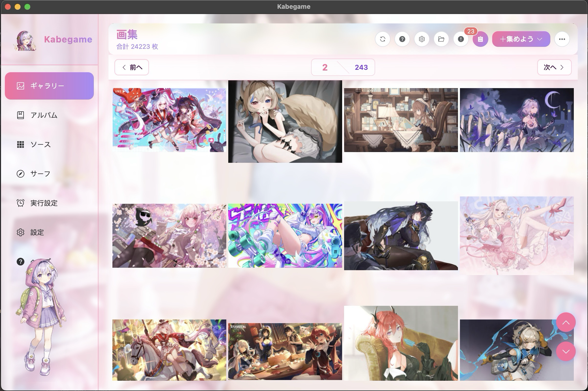<br/>
      <small>ギャラリー</small>
    </td>
    <td align="center" width="50%">
      <br/>
      <small>プレビュー</small>
    </td>
  </tr>
  <tr>
    <td align="center" width="50%">
      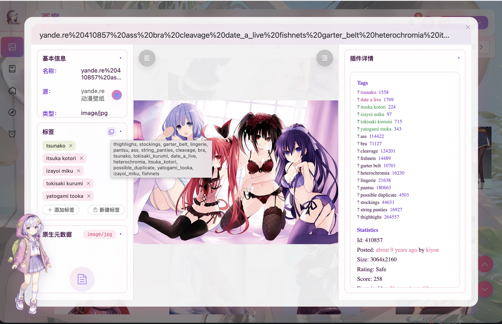<br/>
      <small>詳細メタデータ</small>
    </td>
    <td align="center" width="50%">
      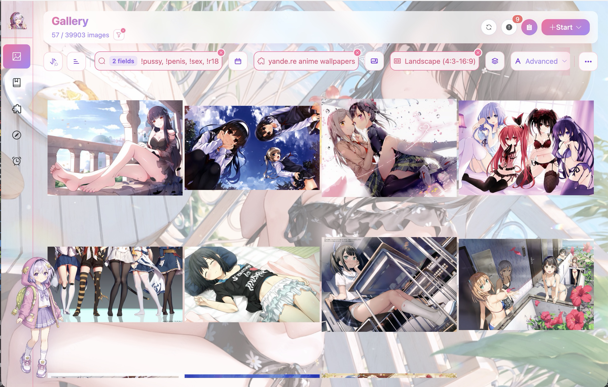<br/>
      <small>自由なフィルタリング</small>
    </td>
  </tr>
  <tr>
    <td align="center" width="50%">
      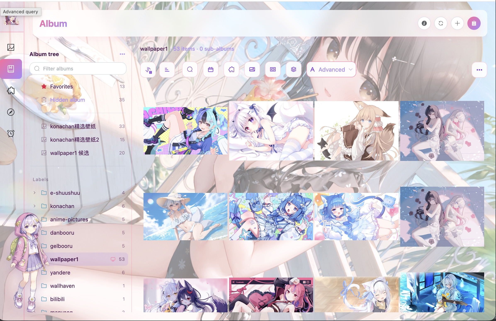<br/>
      <small>画集の整理</small>
    </td>
    <td align="center" width="50%">
      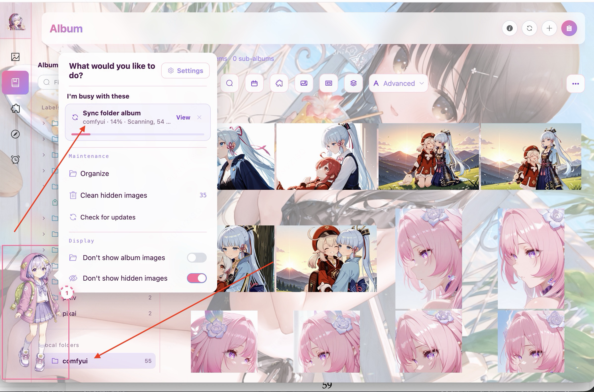<br/>
      <small>フォルダ同期</small>
    </td>
  </tr>
  <tr>
    <td align="center" width="50%">
      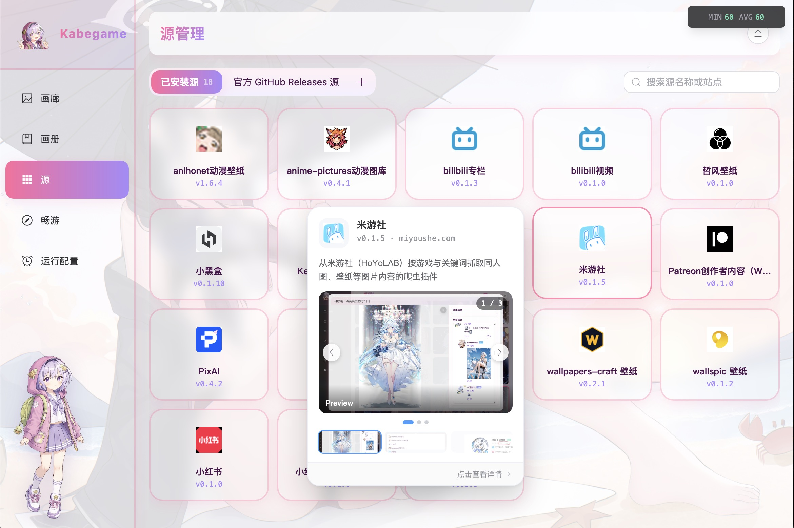<br/>
      <small>ソースプラグイン一覧</small>
    </td>
    <td align="center" width="50%">
      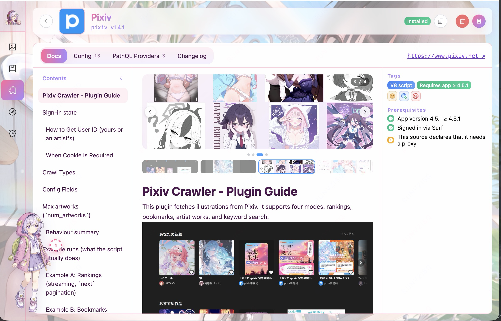<br/>
      <small>ソースプラグインドキュメント</small>
    </td>
  </tr>
  <tr>
    <td align="center" width="50%">
      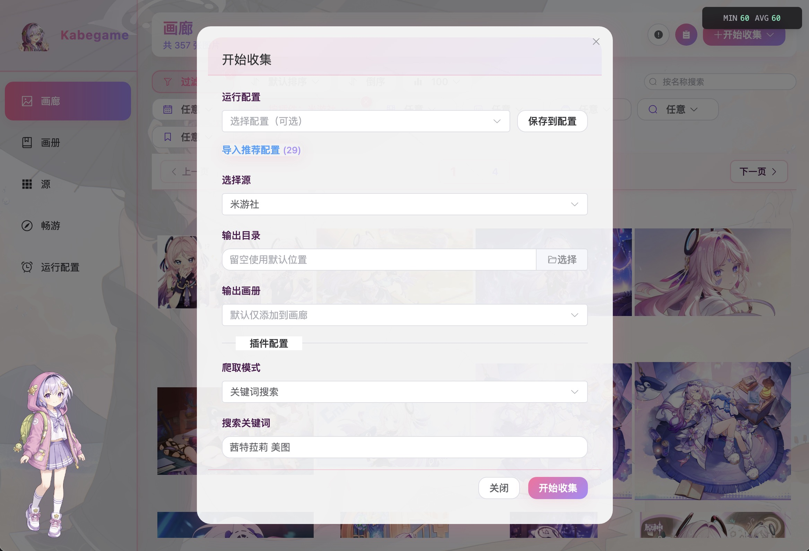<br/>
      <small>タスクパラメータ設定</small>
    </td>
    <td align="center" width="50%">
      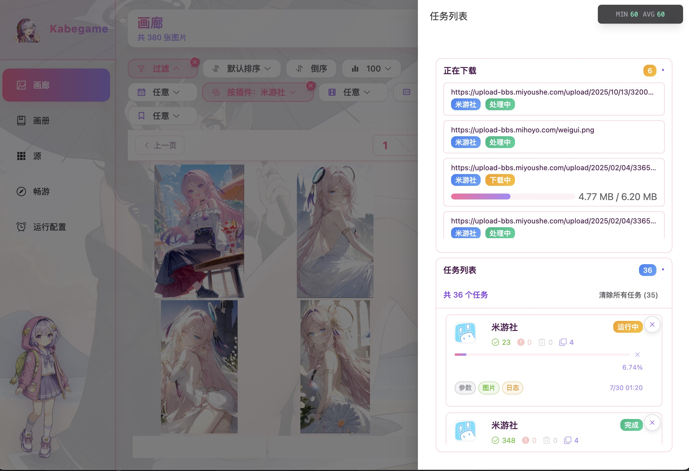<br/>
      <small>タスクを実行</small>
    </td>
  </tr>
  <tr>
    <td align="center" width="50%">
      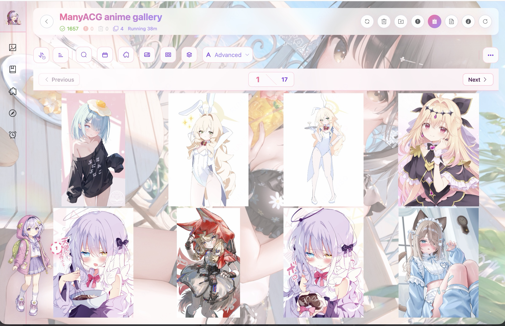<br/>
      <small>タスク画像</small>
    </td>
    <td align="center" width="50%">
      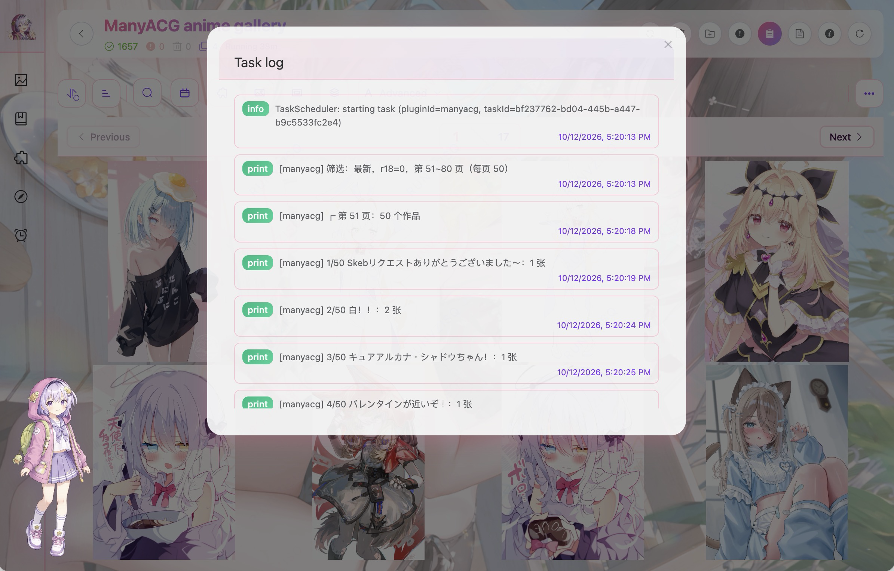<br/>
      <small>タスクログ（問題を素早く特定）</small>
    </td>
  </tr>
</table>

## 主な機能

- 🔌 **クローラークライアント**：`.kgpg` プラグインで各サイトから壁紙をクロール。内蔵のプラグインストアで閲覧/インストール/管理が可能。4.3.0 以降、リリース時点の最新プラグインをすべて同梱しています。プラグインは JS/TS で書かれ、V8（deno_core）または WebView バックエンドで動作します。
- 🎨 **壁紙セッター（画像/動画）**：二次元壁紙を収集・管理・ローテーションし、指定した画集からデスクトップ壁紙を自動で切り替えます。
- 🖼️ **画像マネージャー**：ギャラリー閲覧、自動タグ分類、画集の整理、仮想ディスク、ドラッグ＆ドロップでのインポート、フォルダと画集の同期。
- 🧩 **MCP 整理**：MCP サーバーを開き、外部の AI エージェントにきめ細かな権限のもとで壁紙の整理を任せられます。

Windows、macOS、Linux、Android に対応（v4.3.0 以前のみ。新しいバージョンは現在対応を進めています）。

## 興味があるかもしれません
二次元壁紙やクローラーには興味がないかもしれませんが、本アプリのいくつかの技術的な工夫にはもしかしたら興味を持ってもらえるかもしれません
- Tauri ベースの Webview クローラー [WebviewHandler](./src-tauri/kabegame-core/src/crawler/webview.rs)
- 自作の Tauri runtime [tauri-runtime-cef](./src-tauri/tauri-runtime-cef/)
  Kabegame 向けに深くカスタマイズしているため crate としては公開していませんが、AI に頼んで自分のプロジェクトへ移植できます。
- 自作のパス折りたたみ式クエリエンジン [PathQL](./src-tauri/pathql-rs/)
  簡単に紹介すると、Provider DSL と呼ばれるパーサーと、URL パスベースのクエリ構文を開発しました。アプリ内のほとんどの画像クエリはすでに [Provider DSL JSON5\YAML 形式](./src-tauri/kabegame-core/src/providers/dsl/) に置き換えられており、これらの DSL ファイルが PathQL エンジンのクエリ折りたたみ方法を決定します。たとえば、ギャラリーでメタデータに成人向けキーワードを含む画像を除外し、yande.re 由来の 4:3 から 16:9 の横長画像だけをランダム順で表示する場合、クエリはこう書きます：
    ```url
    images://gallery/hide/~not/~any/search/metadata/pussy/~or/search/native-metadata/pussy/~end/~end/~not/~any/search/metadata/penis/~or/search/native-metadata/penis/~end/~end/~not/~any/search/metadata/sex/~or/search/native-metadata/sex/~end/~end/~not/~any/search/metadata/r18/~or/search/native-metadata/r18/~end/~end/plugin/yandere/_kb_fc/aspect/4x3-16x9/_kb_fc/sort/random-7041412897802809
    ```
  このパスの意味は：非表示でない yande.re の画像だけを対象にし、業務メタデータと画像ネイティブメタデータのどちらにも `pussy`、`penis`、`sex`、`r18` のいずれのキーワードも含まれず、さらに画像のアスペクト比が 4:3 より大きく 16:9 以下で、最後に固定シードでランダムソートする、という意味です。
  このクエリエンジンに興味があれば issue を立ててください。ドキュメントを充実させます。
  理論上は crate として公開できますが、まだ探り切れていないエッジケースのバグがおそらく残っているので、AI に頼んで自分のプロジェクトへコピーしてもらうのもありです（GPL-3.0 にはご注意を）。

## ダウンロードとインストール

**[GitHub Releases](https://github.com/kabegame/kabegame/releases/latest)** からお使いのプラットフォーム向けの本体をダウンロードしてください（`kabegame-cli` は独立した任意のツールで、本体と一緒にはインストールされません）：

| プラットフォーム | ダウンロードファイル | インストール手順 |
| --- | --- | --- |
| Windows x64 | `Kabegame-standard_<バージョン>_x64-setup.exe` | インストーラーをダブルクリックし、ウィザードに従ってインストールします。画集仮想ディスクを使う場合は、アプリ設定で初めて「画集ドライブ」を有効にするときに、同梱の Dokan 2.x ドライバーのインストールを促す指示に従って許可してください。ドライバーのインストール後にもう一度有効にします。 |
| macOS（Apple シリコン） | `Kabegame-standard_<バージョン>_aarch64.dmg` | DMG を開き、`Kabegame.app` を「アプリケーション」にドラッグします。インストーラーは署名されていません。初回起動時に「壊れている」または開発元を検証できないと表示された場合は、下記の `xattr` コマンドをターミナルで実行してから再度開いてください。macOS 11 以降で利用できます。 |
| Linux amd64 | `Kabegame-standard_<バージョン>_amd64.deb` | ダウンロードディレクトリで下記の `apt install` コマンドを実行します。画集仮想ディスクに必要な `fuse3` も同時にインストールされます。 |
| Android（v4.3.0 以前のみ） | `Kabegame_<バージョン>_android-preview.apk` | システム設定でブラウザーまたはファイルマネージャーに「提供元不明のアプリのインストール」を許可し、APK をタップして指示に従ってインストールします。Android 8.0 以降で利用できます。新しい Android クライアントは現在対応を進めています。 |

macOS での初回起動時に隔離を解除：

```bash
xattr -d com.apple.quarantine /Applications/Kabegame.app
```

macOS で画集仮想ディスクを使う場合は、macFUSE もインストールしてください。インストール後にシステムの指示に従って拡張機能を承認し、必要に応じて再起動します：

```bash
brew install --cask macfuse
```

Linux へのインストール（まずターミナルでインストールパッケージのあるディレクトリに移動）：

```bash
sudo apt install ./Kabegame-standard_*_amd64.deb
```

インストール後は Kabegame を起動するだけです。画像はデフォルトでユーザーのピクチャディレクトリの `Pictures/Kabegame` に保存され、アプリをアンインストールしてもこれらの画像は削除されません。

## ドキュメント

完全なドキュメントはすべて **[kabegame.com](https://kabegame.com/)** にあります（4.4.0 以降は一部同期していない可能性があります）：

- [ユーザーガイド](https://kabegame.com/guide/installation/) —— インストール、ギャラリー、画集、壁紙、仮想ディスク、MCP など。
- [プラグイン開発](https://kabegame.com/dev/overview/) —— V8 / WebView クローラープラグインの作成、`.kgpg` 形式、パッケージングと公開。
- [開発に参加](https://kabegame.com/dev-contrib/building/) —— ソースからのビルド、Android 開発、アーキテクチャと技術スタック、謝辞と組み込み依存関係。（QQ を追加してください：2905432378）
- [コマンドラインツール](https://kabegame.com/reference/cli/) と [API リファレンス](https://kabegame.com/reference/kabegame-api/)。

クローラープラグインリポジトリ：**[kabegame/crawler-plugins](https://github.com/kabegame/crawler-plugins)**（プラグイン募集中！）

## ライセンス

ソースコードは [GPL v3](./LICENSE) ライセンスの下で提供されています。（オープンソースこそが究極の答え）

## 名前の由来 🐢

**Kabegame** は日本語の「壁亀」（かべがめ）のローマ字表記で、「壁紙」（かべがみ）と発音が近いんです～ まるで静かな亀さんがあなたのデスクトップに乗って、二次元壁紙コレクションをそっと見守っているかのよう。オープンソースを大切に、二次元好きのための、二次元好き自身のソフトウェアを作ろう。
