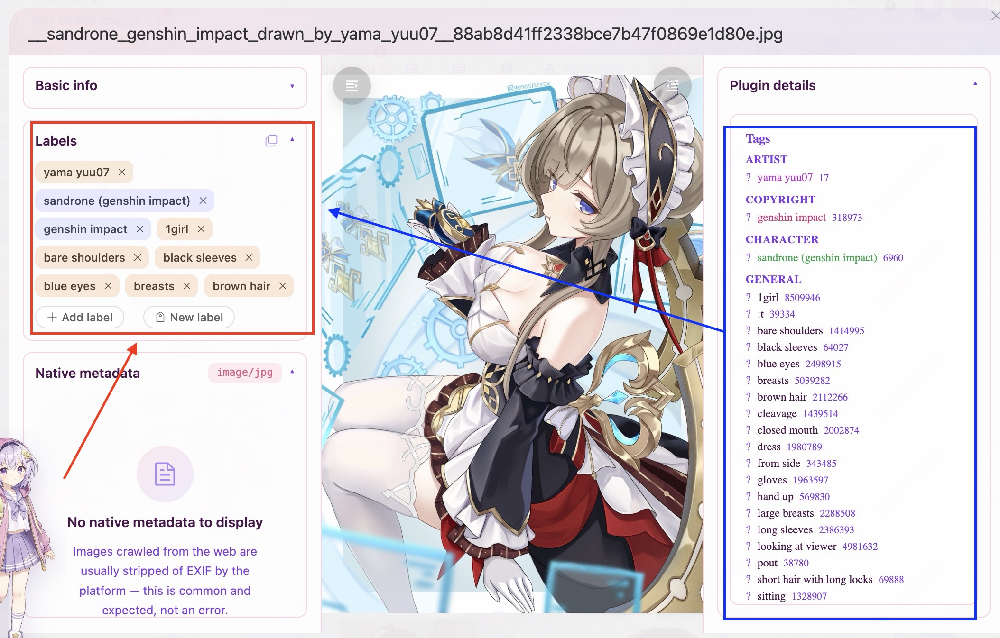
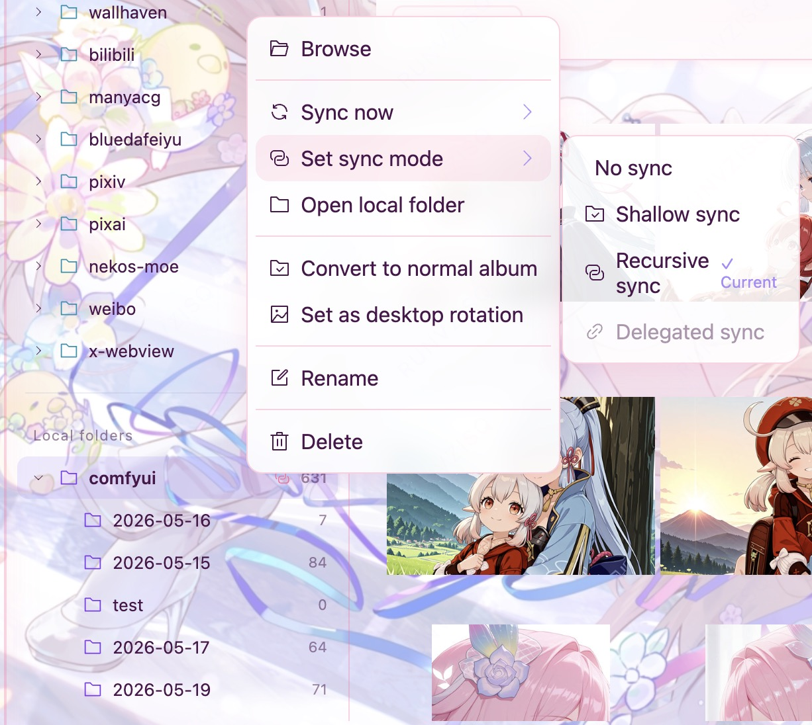
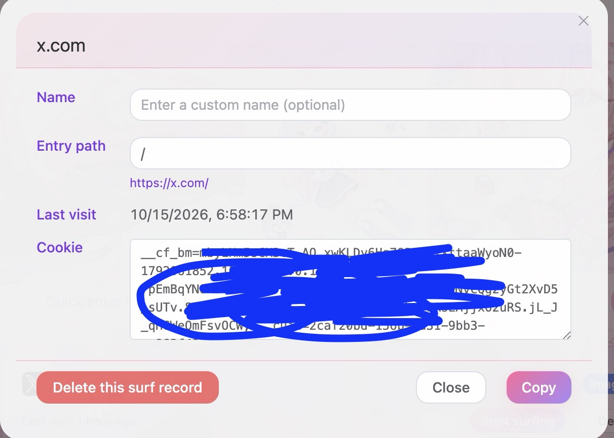
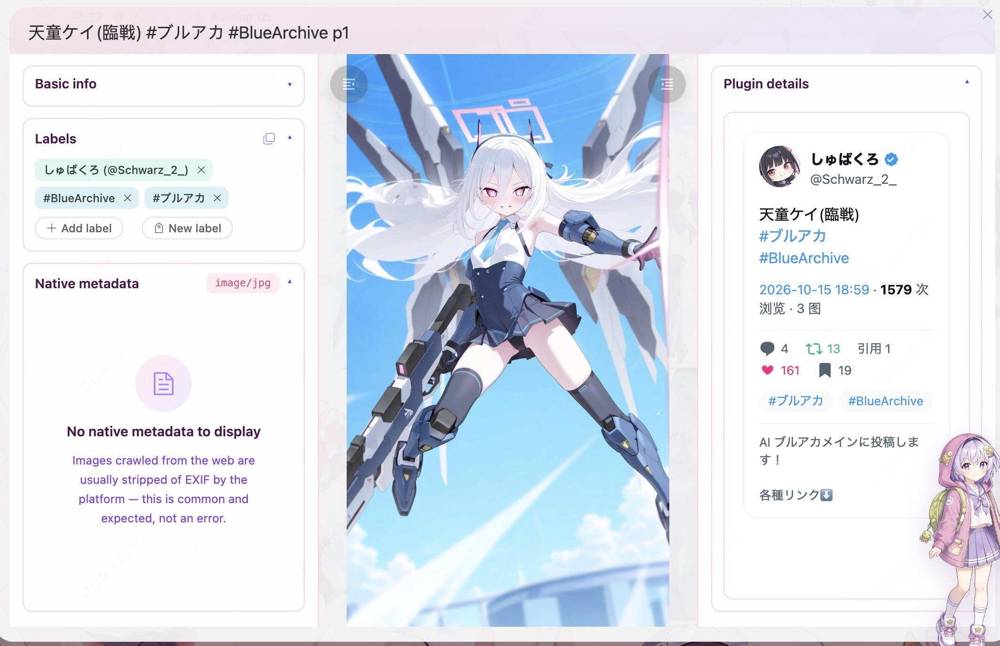
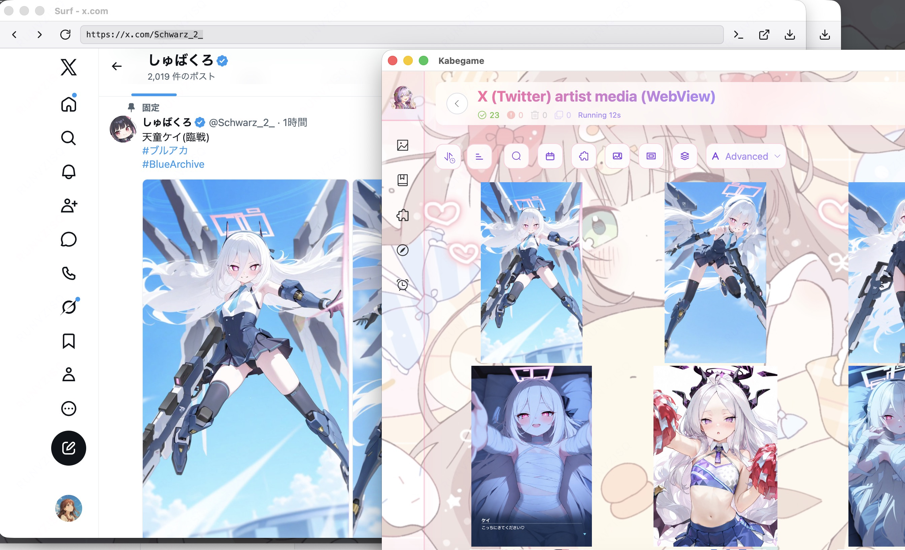
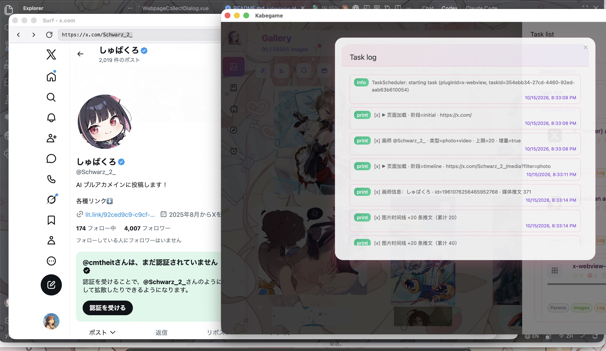
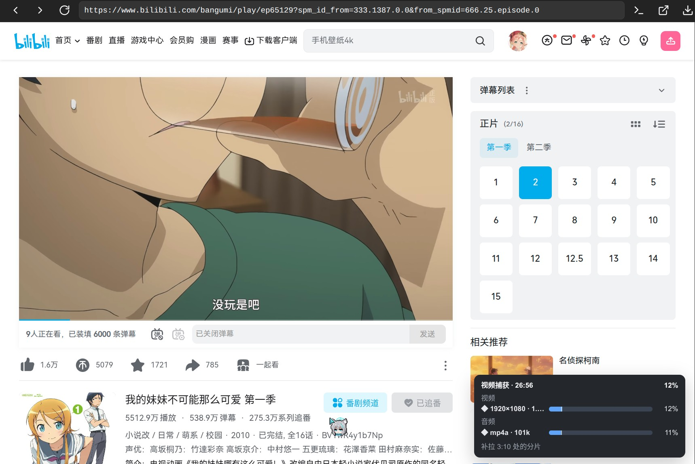

# Kabegame — 플러그인 기반 멀티미디어 수집·정리 도구

> *Translated by AI. [中文](README.md) | [English](README.en-US.md) | [日本語](README.ja.md) | 한국어*

인터넷에서 마음에 드는 이미지를 보고 클릭 한 번으로 로컬에 저장하고 싶으신가요? 매일 직접 웹페이지를 열어 둘러보는 대신 업데이트를 자동으로 구독하고 싶으신가요? — `Kabegame`은 JS 플러그인을 실행해 어떤 사이트에서든 크롤링하고, 거의 어떤 복잡한 로직이든 구현할 수 있습니다. 정해진 시간에 자동으로 실행되도록 설정할 수도 있어, 매일 새 이미지가 라이브러리에 저절로 쌓입니다.

태그와 메타데이터를 자동으로 수집하는 크롤러 프레임워크가 필요하신가요? — `Kabegame` 플러그인은 이미지에 원본 사이트의 태그와 원본 게시물의 EJS 미리보기를 붙여 줍니다. 이후 갤러리에서 태그로 필터링하거나, MCP에 필터링을 맡길 수 있습니다.

로컬 이미지 라이브러리를 정리하면서 키워드, 크기, 색상, 날짜, 메타데이터, 태그, 나아가 이들의 자유로운 조합으로 원하는 이미지를 찾고 싶으신가요? — `Kabegame`은 지정한 로컬 폴더를 라이브러리로 가져올 수 있고, 그 폴더와 재귀적으로 자동 동기화하도록 선택할 수도 있습니다.

Cookie를 직접 복사할 필요 없는 가장 간단한 로그인 방법을 원하시나요? — `Kabegame` 플러그인은 계정이나 비밀번호를 받지 않습니다. 앱의 내장 브라우저에서 사이트를 열고 로그인하기만 하면 됩니다. 이후 같은 사이트의 로그인 정보가 다운로드할 때 재사용되므로 대부분의 크롤러 도구보다 편리합니다. WebView JS 플러그인은 내장 브라우저를 직접 조작해, WebView에서 사람의 동작을 흉내 내며 크롤링하고 라이브러리에 넣을 수도 있습니다. x.com 등의 스트리밍 동영상도 WebView로 자동 크롤링하거나 우클릭으로 직접 다운로드할 수 있습니다.

`v4.7.0` 커뮤니티 최고의 오픈 소스 구현으로 Wallpaper Engine 배경화면을 데스크톱에서 자동으로 다운로드하고 미리 보고 배경화면으로 설정하고 싶으신가요? — `Kabegame` 4.7.0은 강력한 `Opus5.5` + `REA MCP` + `RenderDOC MCP` + 픽셀 비교 `harness` 프레임워크로 Wallpaper Engine의 장면 배경화면 형식, 웹 배경화면, 동영상을 `WebGPU`로 옮겨 왔으며, 99.9% 이상의 픽셀 단위 재현도를 보장합니다. 데스크톱 플랫폼에서 미리 보고 배경화면으로 설정할 수 있습니다! (다운로드에는 WE를 구매한 Steam 계정의 인증 정보를 사용합니다)

### kabegame (/ka.be.ɡa.me/)은 강력한 `js` 크롤러 플러그인 스크립트, 그리고 `Tauri 2`·커스텀 `Chromium`·자체 개발 `kbcef` 런타임을 바탕으로 한 강력한 크로스 플랫폼 능력으로, 로컬 이미지 라이브러리 수집에 관한 거의 모든 바람을 이루어 줍니다. 여기에 자체 개발한 매우 유연한 경로 기반 폴딩식 쿼리 엔진 `PathQL`까지 갖추었습니다.

기본 사용 흐름: 앱 열기 -> 오른쪽 위에서 로컬/네트워크 선택 -> 양식을 채워 가져오기 시작 -> 라이브러리에 들어올 때까지 대기.

<!-- 10秒以内gif短视频 -->

<p align="center">
  <a href="https://github.com/kabegame/kabegame/releases/latest"><b>최신 버전 다운로드</b></a>
  · <a href="https://demo.kabegame.com">온라인 체험</a>
  · <a href="https://kabegame.com/guide/quickstart/">빠른 시작</a>
  · <a href="https://github.com/kabegame/crawler-plugins">플러그인 둘러보기</a>
  · <a href="https://kabegame.com/dev/overview/">플러그인 개발</a>
</p>

<p align="center">
  <a href="https://github.com/kabegame/kabegame/releases/latest">
    
  </a>
  <a href="https://github.com/kabegame/kabegame/releases">
    
  </a>
  <a href="https://github.com/kabegame/kabegame/stargazers">
    
  </a>
  <a href="https://github.com/kabegame/kabegame/blob/main/LICENSE">
    
  </a>
  <a href="https://kabegame.com">
    
  </a>
</p>

## 핵심 하이라이트
- **JS 플러그인 확장**: `yt-dlp`, `hydrus`, `gallery-dl` 같은 비슷한 도구는 내장된 사이트만 지원하거나 동적 확장이 제한적입니다. `Kabegame`은 거의 완전히 자유로운 스크립트 기반 크롤링을 지원하며, 플러그인이 검색 방식까지 확장할 수 있습니다. 예를 들어 `anime-pictures` 플러그인은 이미지 점수로 필터링하는 기능을 제공합니다. 자세한 내용은 [플러그인 저장소](https://github.com/kabegame/crawler-plugins)를 참고하세요.

- **태그 자동 분류**: 지원 플러그인은 다운로드할 때 캐릭터, 작품, 작가, 모델, 출처 등 어떤 태그든 함께 기록하고, Kabegame이 탐색과 조합 필터가 가능한 태그 디렉터리를 자동으로 만듭니다. 수집한 뒤 한 장씩 정리할 필요가 없습니다.

- **로컬 폴더 지속 동기화**: 디스크 디렉터리를 앨범으로 매핑하면 디렉터리의 추가·삭제가 라이브러리에 반영되고, 하위 디렉터리는 기존 계층 그대로 하위 앨범을 만들 수 있습니다. 그림 소프트웨어, AI 이미지 생성 도구, 기타 다운로더의 출력을 계속 받아들이기에 적합합니다.

- **한 번 로그인하면 이후 자동 재사용**: 내장 브라우저 '서핑'에서 사이트에 평소처럼 로그인하면 Kabegame이 모든 사이트의 Cookie를 저장합니다. 플러그인은 Cookie를 읽지 않고, 호스트가 해당 사이트에 로그인 상태를 주입하므로 Cookie를 반복해 복사하거나 Chrome 데이터 디렉터리를 찾아볼 필요가 없습니다.

- **내장 브라우저에서 바로 다운로드**: 내장 브라우저 '서핑'에서 동영상이나 이미지를 보다가 우클릭해 '동영상 다운로드' 또는 '이미지 다운로드'를 선택할 수 있습니다. `blob:` / MSE 스트리밍 플레이어의 동영상도 화질별로 오디오·비디오 조각을 캡처하고 합쳐 라이브러리에 넣으며, 오른쪽 아래에 스트림별 캡처 진행률이 실시간으로 표시됩니다.

- **실제 WebView 기반 크롤링**: 가벼운 V8 JS 플러그인 외에도 플러그인을 실제 브라우저 페이지에서 실행해 SPA, JS 렌더링, 브라우저 핑거프린트, Cloudflare 검사, 상호작용이 필요한 로그인 흐름을 처리할 수 있습니다.

- **메타데이터와 태그 자동 파싱**: 플러그인은 작성자, 원본 게시물 링크, 본문, 댓글, 커뮤니티 태그를 저장하고, 자체 EJS 상세 뷰와 확장 검색(`PathQL provider`를 통해)을 제공할 수 있습니다. 이미지와 텍스트 데이터를 가장 유연하게 다룰 수 있고, 로컬에서도 사이트에서처럼 둘러볼 수 있습니다.

- **Kabegame CLI**: `Kabegame`에는 그래픽 인터페이스만 있는 것이 아닙니다! 고급 사용자는 CLI로 kgpg 플러그인을 호출해 특정 디렉터리에 이미지를 출력하거나, `PathQL`로 라이브러리를 조회하는 등의 작업을 할 수 있습니다.

<table width="100%">
  <tr>
    <td align="center" width="50%">
      <br/>
      <small>플러그인이 구조화 태그를 기록해 필터링 가능한 태그 디렉터리를 자동 생성</small>
    </td>
    <td align="center" width="50%">
      <br/>
      <small>로컬 디렉터리를 계층을 유지한 채 지속 동기화되는 앨범으로 매핑</small>
    </td>
  </tr>
  <tr>
    <td align="center" width="50%">
      <br/>
      <small>서핑에서 한 번 로그인하면 이후 수집은 로그인 상태를 자동 재사용</small>
    </td>
    <td align="center" width="50%">
      <br/>
      <small>작성자, 원본 게시물, 태그, 상호작용 정보를 이미지와 함께 보존</small>
    </td>
  </tr>
</table>

<table width="100%">
  <tr>
    <td align="center" width="50%">
      <br/>
      <small>플러그인이 실제 브라우저 페이지에서 실행되어 미디어를 수집 작업으로 넘깁니다</small>
    </td>
    <td align="center" width="50%">
      <br/>
      <small>페이지 상호작용, 스크롤, 추출 과정을 작업 로그에서 추적할 수 있습니다</small>
    </td>
  </tr>
  <tr>
    <td align="center" colspan="2">
      <br/>
      <small>서핑에서 스트리밍 동영상을 우클릭으로 저장하고, 오른쪽 아래에 스트림별 캡처 진행률 표시</small>
    </td>
  </tr>
</table>

Kabegame이 풀려는 것은 '이미지 한 장을 어떻게 다운로드할까'가 아니라, 이미지가 서로 다른 소스를 넘나들며 계속 쌓인 뒤에도 어떻게 맥락을 보존하고 오래도록 정리할까입니다. 이미지 정리에서 당신의 손을 해방하며, AI 학습자, 바탕화면 꾸미기를 좋아하는 사용자, 미디어 자료 수집가, 로컬 이미지 라이브러리 관리에 알맞습니다. png 등의 이미지는 메타데이터도 파싱할 수 있어, 이미지에서 보이지 않던 비밀을 발견할 수도 있습니다.

## 빠른 시작

1. [GitHub Releases](https://github.com/kabegame/kabegame/releases/latest)에서 Kabegame을 내려받아 설치합니다.
2. 오른쪽 위의 '수집 시작'을 클릭하고 로컬과 네트워크 중 하나를 선택합니다.
3. '갤러리'로 돌아가 '수집 시작'을 클릭하고 로컬 가져오기 또는 네트워크 플러그인을 선택합니다.
4. 갤러리에서 출처와 태그로 필터링하고 원본 게시물 메타데이터를 확인한 뒤, 오래 보관할 내용을 앨범으로 정리합니다.

5분 전체 흐름은 [빠른 시작](https://kabegame.com/guide/quickstart/)을 참고하세요. 데스크톱 앱을 설치하지 않아도 [온라인 Demo](https://demo.kabegame.com)에서 라이브러리 화면을 체험할 수 있습니다.

## 핵심 기능

- **통합 수집**: 이미 개발된 플러그인으로 Pixiv, yande, konachan, anime-pictures, Danbooru, Steam Wallpaper Engine 창작마당 등에서 일괄 수집할 수 있고, 내장 브라우저 '서핑'에서 둘러보며 다운로드할 수도 있습니다.
- **통합 검색**: 서로 다른 소스가 같은 갤러리에 들어오고, 시간, 플러그인, 태그, 미디어 유형, 크기, 파일 크기, 메타데이터 검색의 조합으로 필터링할 수 있습니다. 플러그인이 검색 기준을 직접 정의할 수도 있는데, 이는 다른 소프트웨어에서는 보기 드문 기능입니다.
- **통합 관리**: 일반 앨범으로 테마를 수동 정리하고, 태그 디렉터리로 자동 분류하고, 동기화 앨범으로 디스크 폴더를 따라가며, 중복 제거와 숨기기로 오래 쌓인 라이브러리를 다룹니다.
- **로컬 소유**: 원본 파일과 라이브러리 데이터는 사용자가 직접 보유합니다. 다운로드 디렉터리를 지정할 수 있고, MCP로 접근하거나 kabegame server 플러그인으로 가정 내 네트워크의 기기 간에 이미지를 전송할 수 있습니다.
- **계속 확장**: 크롤러 플러그인은 JavaScript / TypeScript로 작성합니다. MCP를 사용하면 AI 에이전트가 명확한 권한 아래 라이브러리를 검색하고 정리할 수 있습니다.

## 플러그인 생태계

공식 플러그인 저장소는 이미 서른 개가 넘는 일러스트 사이트, 커뮤니티, 크리에이터 플랫폼, 배경화면 사이트를 지원합니다. 플러그인마다 자체 설정 폼, 로그인 방식, 태그 축, 상세 표시, 추천 작업을 제공할 수 있습니다.

- **플러그인 사용**: [공식 플러그인 디렉터리 보기](https://github.com/kabegame/crawler-plugins) · [플러그인 설치 및 관리](https://kabegame.com/guide/plugins-usage/)
- **플러그인 개발**: [개발 개요](https://kabegame.com/dev/overview/) · [V8 / WebView 백엔드 선택](https://kabegame.com/dev/crawler-backends/) · [API 레퍼런스](https://kabegame.com/reference/kabegame-api/)
- **플러그인 기여**: 새로운 소스를 제출하거나, 깨진 사이트를 고치거나, 기존 플러그인의 문서와 메타데이터를 개선할 수 있습니다.

V8 플러그인은 자체 완결형 ES Module로, HTTP 요청, API, HTML 파싱으로 수집하기에 적합합니다. 실제 브라우저 렌더링, 브라우저 세션, 페이지 상호작용에 반드시 의존해야 할 때는 WebView 백엔드를 선언할 수 있습니다. WebView 백엔드는 페이지를 실제로 실행하고, 플러그인의 JS 로직을 그 페이지 안에서 직접 실행합니다.

## 다운로드와 플랫폼

현재 주요 배포판은 데스크톱 버전입니다. `kabegame-cli`는 별도의 선택 도구이며 본체와 함께 설치되지 않습니다.

| 플랫폼 | 다운로드 파일 | 설명 |
| --- | --- | --- |
| Windows x64 | `Kabegame-standard_<버전>_x64-setup.exe` | 더블클릭으로 설치합니다. |
| macOS Apple 실리콘 | `Kabegame-standard_<버전>_aarch64.dmg` | macOS 11 이상을 지원하며, 설치 파일은 아직 서명되지 않았습니다. |
| Linux amd64 | `Kabegame-standard_<버전>_amd64.deb` | `apt`로 설치합니다. |
| Android | `Kabegame_<버전>_android-preview.apk` | Android 8.0 이상 |

macOS 첫 실행 시 개발자를 확인할 수 없거나 앱이 손상되었다고 표시되면:

```bash
xattr -d com.apple.quarantine /Applications/Kabegame.app
```

Linux 설치:

```bash
sudo apt install ./Kabegame-standard_*_amd64.deb
```

이미지는 기본적으로 사용자 사진 디렉터리의 `Pictures/Kabegame`에 저장되며, 앱을 삭제해도 이곳의 이미지는 삭제되지 않습니다. 더 자세한 플랫폼 요구사항, 데이터 디렉터리, 문제 해결 방법은 [설치 문서](https://kabegame.com/guide/installation/)를 참고하세요.

## 배경화면 안내

### 배경화면 모드

배경화면 모드는 Kamechan 클릭 -> 설정 -> 배경화면 -> 배경화면 모드에서 전환합니다.

- **네이티브 모드**: 시스템 기본 배경화면 API를 호출하므로 Kabegame을 종료해도 배경화면이 계속 표시됩니다. 단점은 이미지만 지원한다는 점입니다.
- **창/플러그인 모드**: Kabegame이 전체 화면 창으로 오프스크린 렌더링, 맨 아래 레이어에 배치하기 등의 방식을 써서 배경화면을 렌더링합니다. 모든 배경화면을 지원하며, 앱 안의 미리보기와 거의 똑같이 보입니다.

### 호환성 표
🖼️는 이미지 설정 가능, 🎬는 동영상 / 웹 / 장면 설정 가능('웹 / 장면'은 Wallpaper Engine의 웹 배경화면과 장면 배경화면을 뜻함)이며, 표시가 없으면 지원하지 않습니다. 창 모드(Windows, macOS)와 플러그인 모드(Linux)에서는 Kabegame이 직접 배경화면을 렌더링하므로 모든 유형을 바탕화면에 설정할 수 있습니다.

아래 표의 GNOME 버전은 `gnome-shell --version`으로, 데스크톱 환경은 `echo $XDG_SESSION_DESKTOP`으로, 디스플레이 프로토콜(Wayland / X11)은 `echo $XDG_SESSION_TYPE`으로 확인할 수 있습니다.
<table>
  <thead>
    <tr>
      <th>운영체제</th>
      <th>데스크톱 / 디스플레이 프로토콜</th>
      <th>네이티브 모드</th>
      <th>창 / 플러그인 모드</th>
    </tr>
  </thead>
  <tbody>
    <tr>
      <td>Windows</td>
      <td>시스템 데스크톱</td>
      <td>🖼️</td>
      <td>🖼️ 🎬</td>
    </tr>
    <tr>
      <td>macOS</td>
      <td>시스템 데스크톱</td>
      <td>🖼️</td>
      <td>🖼️ 🎬</td>
    </tr>
    <tr>
      <td rowspan="8">Linux</td>
      <td>KDE Plasma 6 · Wayland</td>
      <td>🖼️</td>
      <td>🖼️ 🎬<br>GPU를 쓸 수 있으면 화면을 GPU에서 바로 전달</td>
    </tr>
    <tr>
      <td>KDE Plasma 6 · X11</td>
      <td>🖼️</td>
      <td>🖼️ 🎬<br>화면을 공유 메모리로 전달하므로 자원 사용량이 더 많음</td>
    </tr>
    <tr>
      <td>KDE Plasma 5</td>
      <td>🖼️</td>
      <td>플러그인 모드 없음</td>
    </tr>
    <tr>
      <td>GNOME 49–51 (Wayland, X11)</td>
      <td>🖼️</td>
      <td>🖼️ 🎬<br>Kabegame의 GNOME Shell 확장이 필요하며, 전환할 때 원클릭으로 설치 가능</td>
    </tr>
    <tr>
      <td>GNOME 42–48 · X11</td>
      <td>🖼️</td>
      <td>🖼️ 🎬<br>위와 같음</td>
    </tr>
    <tr>
      <td>GNOME 42–48 · Wayland</td>
      <td>🖼️</td>
      <td>🖼️ 🎬<br>⚠️ 실제로 테스트하지 않았으며, 바탕화면 아이콘을 가릴 수 있음</td>
    </tr>
    <tr>
      <td>GNOME 41 이하, 52 이상</td>
      <td>🖼️</td>
      <td>전환할 때 지원하지 않는 GNOME 버전이라고 안내</td>
    </tr>
    <tr>
      <td>기타 데스크톱</td>
      <td>🖼️<br>GNOME, Plasma 방식을 차례로 시도하며, 데스크톱이 둘 다 인식하지 못하면 설정되지 않음</td>
      <td>플러그인 모드 없음</td>
    </tr>
    <tr>
      <td>Android</td>
      <td>시스템 데스크톱</td>
      <td>🖼️</td>
      <td>—</td>
    </tr>
  </tbody>
</table>

### 기타 안내

- 네이티브 모드에서 동영상, 웹, 장면 배경화면을 설정하면 창 / 플러그인 모드로 전환하도록 안내합니다. macOS와 Linux의 네이티브 모드는 GIF를 지원하지 않으므로 GIF도 배경화면 모드를 전환해야 합니다. Android에서는 네이티브 배경화면만 지원합니다.
- 네이티브 모드는 WebP, AVIF, HEIC처럼 시스템이 인식하지 못할 수도 있는 형식을 먼저 JPEG / PNG 사본으로 변환한 뒤 설정합니다.
- Linux 플러그인 모드는 KDE Plasma 6에서 `PipeWire`를 통해 Kabegame의 Plasma 배경화면 플러그인(플러그인 모드로 전환할 때 자동 설치)으로 화면을 보냅니다. GNOME에서는 Kabegame의 GNOME Shell 확장이 배경화면 창을 바탕화면에 배치하며, 확장이 설치되어 있지 않으면 모드를 전환할 때 설치를 안내합니다. 설치한 뒤에는 로그아웃했다가 다시 로그인하고, Kabegame을 다시 열어 플러그인 모드로 설정하세요. GNOME 플러그인 모드는 아직 실험 단계입니다. 확장은 GNOME 50에서 실제로 테스트했고, 42–48은 시스템 인터페이스와 대조만 했습니다. 플러그인 모드에서 확장이 꺼지거나 GNOME Shell이 재시작되면 Kabegame은 네이티브 모드로 되돌리고 알려 줍니다.
- 현재 배경화면을 현재 배경화면 모드에서 표시할 수 없으면(예: 동영상이나 Wallpaper Engine 배경화면인 상태에서 네이티브 모드로 전환한 경우) 바탕화면은 그대로 유지되고 경고가 표시됩니다. 창 모드나 플러그인 모드로의 전환에 실패하면 전환되지 않고 자동으로 네이티브 모드로 돌아갑니다.
- 장면 배경화면은 그래픽 카드(WebGPU)로 렌더링하며, 사용할 수 있는 그래픽 카드가 없으면 미리보기 이미지만 표시합니다.
- 웹 버전에는 바탕화면 배경화면이 없으며, '배경화면으로 설정'은 웹 배경으로만 설정됩니다.

## 프로젝트 참여

Tauri / Rust 모노레포 전체를 먼저 알지 못해도 Kabegame에 참여할 수 있습니다:

- 문제가 생기면 [Bug report](https://github.com/kabegame/kabegame/issues/new?template=bug_report.md)를 제출하세요.
- 새로운 소스를 지원하고 싶다면 [플러그인 저장소](https://github.com/kabegame/crawler-plugins)에 플러그인을 제출하거나 요청을 남기세요.
- 앱 본체를 개선하려면 작성 중인 [빌드 문서](./BUILD.md)를 참고하세요. 앱에는 Kabegame이 패치한 Chromium이 필요한데, 아직 그 바이너리를 공개하지 않았습니다. 이것이 GitHub Actions 파이프라인으로 빌드하지 않는 큰 이유 중 하나이기도 합니다.
- 문서 사이트의 문서, 앱 내 텍스트 번역, 스크린샷, 플러그인 설명도 똑같이 가치 있는 기여입니다.

Kabegame이 도움이 되었다면 Star를 눌러 주세요. 더 많은 사용자와 잠재적 플러그인 작성자가 프로젝트를 발견하게 돕고, Kabegame에게도 큰 힘이 됩니다.

## 기술적 하이라이트

Kabegame은 Vue 3, Tauri 2, Rust로 구축되었으며, 라이브러리 쿼리, 플러그인 런타임, 데스크톱 브라우저 기능에 여러 확장을 더했습니다:

- [WebviewHandler](./src-tauri/kabegame-core/src/crawler/webview.rs): 로그인 상태나 페이지 상호작용이 필요한 플러그인을 실제 페이지 환경에서 실행합니다.
- [tauri-runtime-kbcef](./src-tauri/tauri-runtime-kbcef/): Kabegame 데스크톱용으로 커스터마이즈한 CEF Tauri runtime. `Tauri3`의 `tauri-runtime-cef`와 이름이 겹치지 않도록 `v4.7.0`부터 `tauri-runtime-kbcef`로 이름을 바꾸었습니다.
- [PathQL](./src-tauri/pathql-rs/): 경로 조합 필터, 정렬, 페이지네이션과 Provider DSL을 갖춘 데이터베이스 쿼리 엔진.
- [wpe-scene](./apps/wpe-scene/): Wallpaper Engine을 렌더링하는 핵심 코드(8만 줄 이상). 순수 TS로 WebGPU를 구동해 그립니다. 배경화면 표시는 Tauri 창 또는 CEF 오프스크린 창(Plasma)으로 구현합니다.

프로젝트 구조, 프로세스 모델, 주요 모듈은 [아키텍처와 프로젝트 구조](https://kabegame.com/dev-contrib/architecture/)를 참고하세요.

## 라이선스

Kabegame은 [GPL-3.0](./LICENSE)으로 오픈 소스로 공개되어 있습니다.

## 이름의 유래 🐢

**Kabegame**은 일본어「壁亀」(かべがめ)의 로마자 표기로,「壁紙」(かべがみ, '벽지')와 발음이 비슷합니다. 마치 조용한 거북이 한 마리가 바탕화면에 엎드려 당신의 이미지 컬렉션을 지켜주는 것처럼요.
