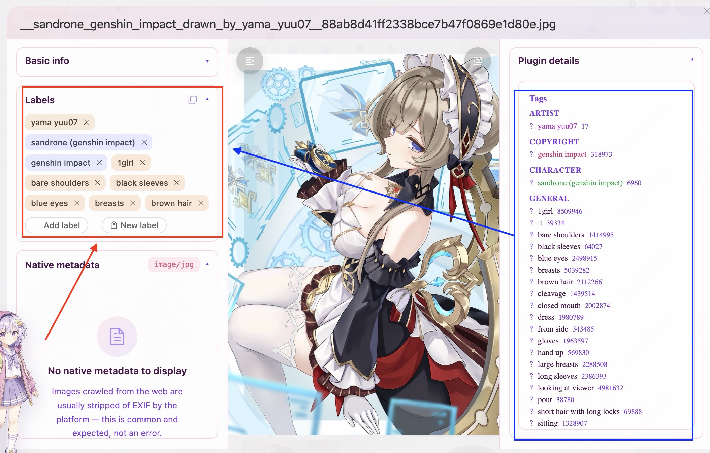
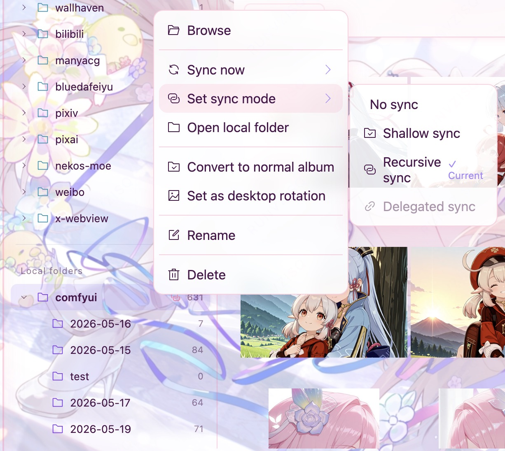
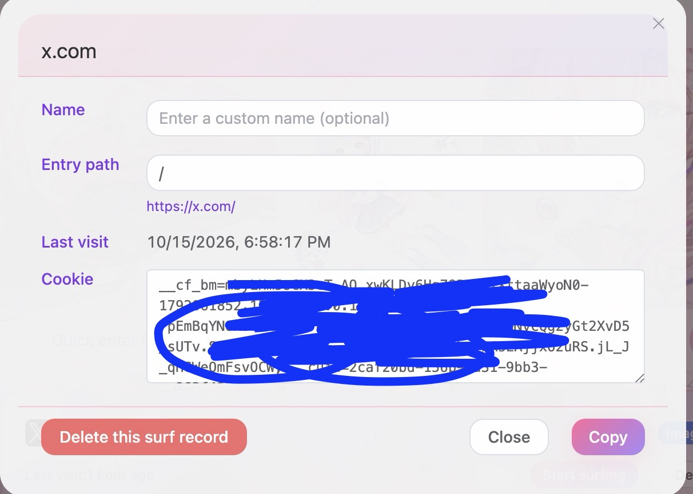
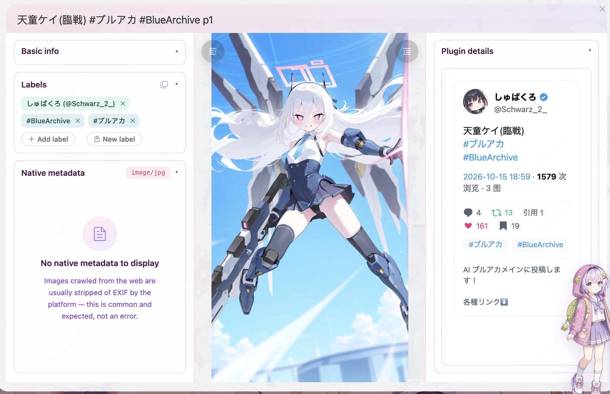
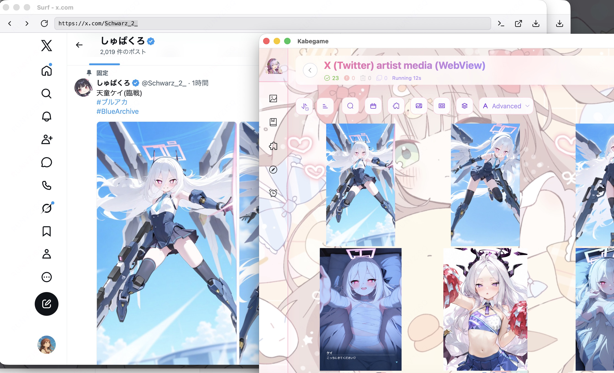
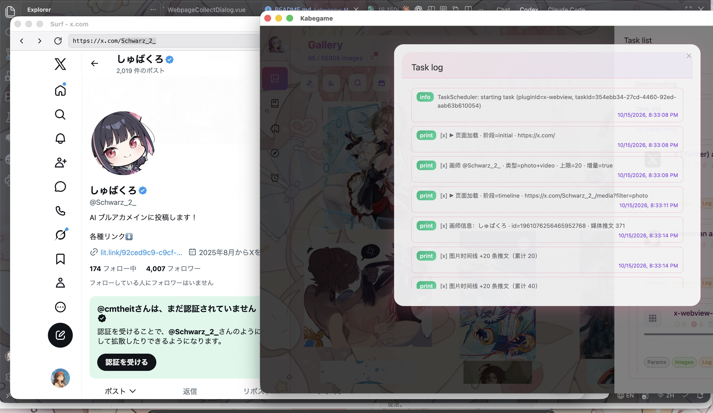
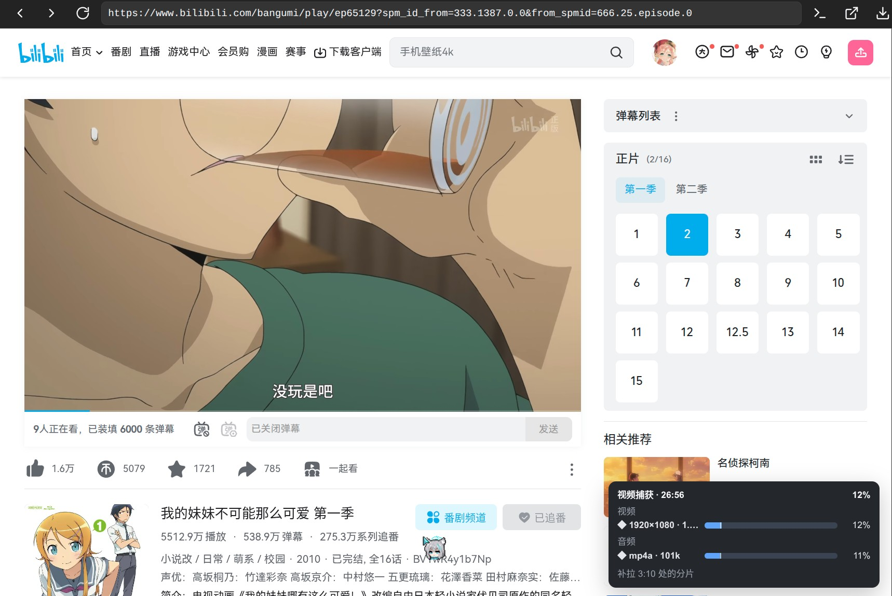

# Kabegame — 插件驱动的多媒体收集与整理工具

> 中文 | [日本語](README.ja.md) | [한국어](README.ko.md) | [English](README.en-US.md)

在网上看到好看的图片，想一键下载到本地？还希望自动化订阅更新，不想每天手动打开网页浏览？—— `Kabegame` 能运行 js 插件实现从任意站点爬取以及几乎任意复杂逻辑。并能配置一定的时间自动运行，每天都会有图片自动从图库里冒出来。

想要一个自动爬取标签、元数据的爬虫框架？——`Kabegame` 插件能为图片提供源站标签、原帖ejs预览，之后可以通过画廊标签过滤，或者通过mcp帮你过滤。

想整理本地图库，按关键字、大小、颜色、日期、元数据、标签甚至它们的任意自由组合来找到自己想要的图片？—— `Kabegame` 能导入指定本地文件夹到图库，并能选择自动保持与其递归同步。

想要最简单的登录授权方法，不用手动复制 cookie？—— `Kabegame` 插件不需要接收账号密码，你只需要从应用内置浏览器打开一个网站，登录。之后同一网站的登录凭证会在下载时复用，比大多数爬虫工具更便利。webview js插件甚至还能直接驱动内置浏览器，通过webview 模拟人的操作爬取入库。x.com 等流式视频也能通过 webview 自动爬取或手动右键下载。

`v4.7.0` 想要用全社区最好的 Wallpaper Engine 壁纸开源实现在桌面端自动下载、预览、设置它们为壁纸？—— `Kabegame` 4.7.0 用强大的 `Opus5.5` + `REA MCP` + `RenderDOC MCP` + 像素对比 `harness` 框架将 Wallpaper Engine 场景壁纸格式、web壁纸和视频搬到了`WebGPU`，保证99.9%以上的像素级还原度。可以在桌面平台上预览、设置它们为壁纸！（下载用的是购买WE的Steam账号凭证）

### kabegame (/ka.be.ɡa.me/) 能满足你关于本地图库收集的几乎所有愿望，基于它强大的 `js` 爬虫插件脚本以及基于 `Tauri 2` 和定制 `Chromium` + 自研 `kbcef` 运行时的强大跨平台能力。外加一个自研的极其灵活的基于路径的折叠式查询引擎 `PathQL`。

基本使用流程：打开应用 -> 右上角选择本地/网络 -> 填写表单开始导入 -> 等待入库。

https://github.com/user-attachments/assets/7654b2b5-4273-4acd-81b2-24d3e05c26f1

<p align="center">
  <a href="https://github.com/kabegame/kabegame/releases/latest"><b>下载最新版</b></a>
  · <a href="https://demo.kabegame.com">在线体验</a>
  · <a href="https://kabegame.com/guide/quickstart/">快速上手</a>
  · <a href="https://github.com/kabegame/crawler-plugins">浏览插件</a>
  · <a href="https://kabegame.com/dev/overview/">开发插件</a>
</p>

<p align="center">
  <a href="https://github.com/kabegame/kabegame/releases/latest">
    
  </a>
  <a href="https://github.com/kabegame/kabegame/releases">
    
  </a>
  <a href="https://github.com/kabegame/kabegame/stargazers">
    
  </a>
  <a href="https://github.com/kabegame/kabegame/blob/main/LICENSE">
    
  </a>
  <a href="https://kabegame.com">
    
  </a>
</p>

## 核心亮点
- **JS 插件扩展**：其他类似工具如 `yt-dlp`、`hydrus`、`gallery-dl` 都只能用内置的站点或者有限的动态扩展支持，`Kabegame` 支持几乎完全自由的脚本化的爬取功能，甚至插件能够扩展检索方式，如 `anime-pictures` 插件提供了按图片分数过滤的能力。详见 [插件仓库](https://github.com/kabegame/crawler-plugins)。

- **标签自动归类**：支持的插件在下载时同时写入角色、作品、画师、模型、来源等任意标签，kabegame会自动形成可浏览、可组合过滤的标签目录，不必收完以后再逐张整理。

- **本地文件夹持续同步**：把磁盘目录映射为画册，目录中的新增与删除会反映到图库，子目录还能按原有层级生成子画册；适合持续接收绘图软件、AI 生图工具或其他下载器的输出。

- **登录一次，后续自动复用**：在内置浏览器“畅游”中正常登录网站，Kabegame 会保存所有站点 Cookie；插件不读取 Cookie，宿主会在对应站点中注入登录态，不必反复复制 Cookie 或确认 Chrome 的数据目录。

- **内置浏览器直接下载**：在内置浏览器“畅游”里看视频或图片时右键“下载视频”或者“下载图片”，视频即使是 `blob:` / MSE 流式播放器也能按清晰度捕获音视频分片并合流入库，右下角实时显示每路流的捕获进度。

- **真实 WebView 驱动爬取**：除了轻量的 V8 JS 插件，还能让插件运行在真实浏览器页面中，处理 SPA、JS 渲染、浏览器指纹、Cloudflare 检查以及需要交互的登录流程。

- **自动解析元数据+标签**：插件可以保存作者、原帖链接、正文、评论、社区标签，并提供自己的详情EJS视图与扩展检索（通过`PathQL provider`），让你能够掌握最灵活的图片+文本数据，以及在本地像在网站一样浏览。

- **Kabegame CLI**: `Kabegame` 不止有图形界面！对于高级用户，可以用cli调用kgpg插件来往某个目录里输出图片，以及通过 `PathQL` 查询图库等功能。

<table width="100%">
  <tr>
    <td align="center" width="50%">
      <br/>
      <small>插件写入结构化标签，自动形成可筛选的标签目录</small>
    </td>
    <td align="center" width="50%">
      <br/>
      <small>把本地目录映射为持续同步、保留层级的画册</small>
    </td>
  </tr>
  <tr>
    <td align="center" width="50%">
      <br/>
      <small>在畅游中登录一次，后续收集自动复用登录态</small>
    </td>
    <td align="center" width="50%">
      <br/>
      <small>作者、原帖、标签与互动信息跟随图片一起保留</small>
    </td>
  </tr>
</table>

<table width="100%">
  <tr>
    <td align="center" width="50%">
      <br/>
      <small>插件在真实浏览器页面中运行，并把媒体送入收集任务</small>
    </td>
    <td align="center" width="50%">
      <br/>
      <small>页面交互、滚动与提取过程可在任务日志中追踪</small>
    </td>
  </tr>
  <tr>
    <td align="center" colspan="2">
      <br/>
      <small>在畅游中右键下载流式视频，右下角实时显示每路流的捕获进度</small>
    </td>
  </tr>
</table>

Kabegame 试图解决的不是“怎样下载一张图”，而是图片跨越不同来源、不断积累之后，怎样保留上下文并长期整理。解放你图片整理的双手，适合 AI 训练者、桌面美化用户、媒体资源收集用户、本地图库管理。png等图片还能被解析元数据，让你发现图片里看不到的秘密。

## 快速开始

1. 从 [GitHub Releases](https://github.com/kabegame/kabegame/releases/latest) 下载并安装 Kabegame。
2. 点击右上角“开始收集”，选择本地还是网络。
3. 回到「画廊」，点击「开始收集」，选择本地导入或网络插件。
4. 在画廊中按来源和标签筛选，查看原帖元数据，再把需要长期保留的内容整理进画册。

完整的五分钟流程见[快速上手](https://kabegame.com/guide/quickstart/)。不安装桌面程序也可以先打开[在线 Demo](https://demo.kabegame.com)体验图库界面。

## 核心能力

- **统一收集**：已经开发插件从 Pixiv、yande、konachan、anime-pictures、Danbooru、Steam Wallpaper Engine workshop等来源批量获取内容，也能在内置浏览器“畅游”里边逛边下载。
- **统一检索**：不同来源进入同一个画廊，可按时间、插件、标签、媒体类型、尺寸、文件大小和元数据搜索组合过滤。插件甚至能直接自定义检索维度，这是其他软件很少有的。
- **统一管理**：用普通画册手工整理主题，用标签目录自动分类，用同步画册跟随磁盘文件夹，再通过去重和隐藏处理长期积累的图库。
- **本地持有**：原始文件和图库数据由你掌握；可自定义下载目录，可通过MCP访问，或者通过 kabegame server 插件在你的家庭网络设备之间传输图片。
- **继续扩展**：爬虫插件使用 JavaScript / TypeScript 编写；MCP 可让 AI 代理在明确权限下检索和整理图库。

## 插件生态

官方插件仓库已经覆盖三十余个插画站、社区、创作者平台和壁纸站。不同插件可以提供自己的配置表单、登录方式、标签维度、详情展示和推荐任务。

- **使用插件**：[浏览官方插件目录](https://github.com/kabegame/crawler-plugins) · [安装与管理插件](https://kabegame.com/guide/plugins-usage/)
- **开发插件**：[开发总览](https://kabegame.com/dev/overview/) · [V8 / WebView 后端选择](https://kabegame.com/dev/crawler-backends/) · [API 参考](https://kabegame.com/reference/kabegame-api/)
- **贡献插件**：可以提交新的来源、修复失效站点，或者改善现有插件的文档与元数据。

V8 插件是自包含的 ES Module，适合使用 HTTP 请求、API 和 HTML 解析完成收集；必须依赖真实浏览器渲染、浏览器会话或页面交互时，可声明 WebView 后端，它会让页面真正运行起来，并直接在页面里运行插件的js逻辑。

## 下载与平台

桌面版是当前主要发布版本；`kabegame-cli` 是独立的可选工具，不随主程序安装。

| 平台 | 下载文件 | 说明 |
| --- | --- | --- |
| Windows x64 | `Kabegame-standard_<版本>_x64-setup.exe` | 双击安装。 |
| macOS Apple 芯片 | `Kabegame-standard_<版本>_aarch64.dmg` | 支持 macOS 11 及以上；安装包暂未签名。 |
| Linux amd64 | `Kabegame-standard_<版本>_amd64.deb` | 使用 `apt` 安装。 |
| Android | `Kabegame_<版本>_android-preview.apk` | Android 8.0 及以上 |

macOS 首次启动若提示无法验证开发者或应用已损坏：

```bash
xattr -d com.apple.quarantine /Applications/Kabegame.app
```

Linux 安装：

```bash
sudo apt install ./Kabegame-standard_*_amd64.deb
```

图片默认保存在用户图片目录的 `Pictures/Kabegame`，卸载应用不会删除这里的图片。更完整的平台要求、数据目录和排障方法见[安装文档](https://kabegame.com/guide/installation/)。

## 壁纸说明

### 壁纸模式

壁纸模式通过 点击kamechan -> 设置 -> 壁纸 -> 壁纸模式 来切换。

- **原生模式**: 调用系统原生的壁纸接口，能够在 Kabegame 退出的时候也显示，缺点是只支持图片。
- **窗口/插件模式**: Kabegame 通过一个全屏窗口通过离屏渲染、叠放底层等方式渲染壁纸，支持所有壁纸，效果和应用内预览几乎完全相同。

### 兼容性表格
🖼️ 能设图片，🎬 能设视频 / Web / 场景（「Web / 场景」指 Wallpaper Engine 的网页壁纸与场景壁纸），没有标的就是不支持。窗口模式（Windows、macOS）与插件模式（Linux）由 Kabegame 自己渲染壁纸，所有类型都能设为桌面。

以下 gnome 版本通过 `gnome-shell --version` 可获得。 桌面环境通过 `echo $XDG_SESSION_DESKTOP` 可得，显示协议（Wayland / X11）通过 `echo $XDG_SESSION_TYPE` 可得。
<table>
  <thead>
    <tr>
      <th>操作系统</th>
      <th>桌面 / 显示协议</th>
      <th>原生模式</th>
      <th>窗口 / 插件模式</th>
    </tr>
  </thead>
  <tbody>
    <tr>
      <td>Windows</td>
      <td>系统桌面</td>
      <td>🖼️</td>
      <td>🖼️ 🎬</td>
    </tr>
    <tr>
      <td>macOS</td>
      <td>系统桌面</td>
      <td>🖼️</td>
      <td>🖼️ 🎬</td>
    </tr>
    <tr>
      <td rowspan="8">Linux</td>
      <td>KDE Plasma 6 · Wayland</td>
      <td>🖼️</td>
      <td>🖼️ 🎬<br>能用显卡时直传画面</td>
    </tr>
    <tr>
      <td>KDE Plasma 6 · X11</td>
      <td>🖼️</td>
      <td>🖼️ 🎬<br>画面经共享内存传，占用更高</td>
    </tr>
    <tr>
      <td>KDE Plasma 5</td>
      <td>🖼️</td>
      <td>没有插件模式</td>
    </tr>
    <tr>
      <td>GNOME 49–51（Wayland、X11）</td>
      <td>🖼️</td>
      <td>🖼️ 🎬<br>需要 Kabegame 的 GNOME Shell 扩展，切换时可一键安装</td>
    </tr>
    <tr>
      <td>GNOME 42–48 · X11</td>
      <td>🖼️</td>
      <td>🖼️ 🎬<br>同上</td>
    </tr>
    <tr>
      <td>GNOME 42–48 · Wayland</td>
      <td>🖼️</td>
      <td>🖼️ 🎬<br>⚠️ 未实测，可能会盖住图标</td>
    </tr>
    <tr>
      <td>GNOME 41 及更早、52 及更新</td>
      <td>🖼️</td>
      <td>切换时提示 GNOME 版本不支持</td>
    </tr>
    <tr>
      <td>其它桌面</td>
      <td>🖼️<br>按 GNOME、Plasma 的方式依次尝试，桌面不认就设不上</td>
      <td>没有插件模式</td>
    </tr>
    <tr>
      <td>Android</td>
      <td>系统桌面</td>
      <td>🖼️</td>
      <td>—</td>
    </tr>
  </tbody>
</table>

### 其他说明

- 原生模式下设视频、Web、场景壁纸时，会引导切到窗口 / 插件模式；macOS、Linux 的原生模式不支持 GIF 所以也需要切换壁纸模式。Android 上只支持原生壁纸。
- 原生模式会把 WebP、AVIF、HEIC 等系统不一定认的格式先转成 JPEG / PNG 副本再设。
- Linux 插件模式在 KDE Plasma 6 上经 `PipeWire` 把画面推给 Kabegame 的 Plasma 壁纸插件（切换到插件模式时自动安装）；在 GNOME 上由 Kabegame 的 GNOME Shell 扩展把壁纸窗口放到桌面，没装扩展时切换模式会提示安装，装完需要注销重新登录，再打开 Kabegame 设置为插件模式。GNOME 的插件模式还在实验阶段：扩展在 GNOME 50 上实测过，42–48 只按系统接口核对过；插件模式下扩展被关掉或 GNOME Shell 重启时，Kabegame 会切回原生模式并提示。
- 当前壁纸在当前壁纸模式下显示不了（比如视频、Wallpaper Engine 壁纸切到原生模式）时，桌面保持不变并警告。如果切换到窗口或插件模式失败，则不会切换成功，而是自动退回原生模式。
- 场景壁纸要用显卡（WebGPU）渲染，没有可用显卡时只显示预览图。
- Web 版没有桌面壁纸，「设为壁纸」只设成Web背景。

## 参与项目

不必先熟悉整个 Tauri / Rust 单体仓库，也可以参与 Kabegame：

- 遇到问题，请提交 [Bug report](https://github.com/kabegame/kabegame/issues/new?template=bug_report.md)。
- 希望支持新的来源，可以在[插件仓库](https://github.com/kabegame/crawler-plugins)提交插件或提出需求。
- 想改进应用本体，见正在撰写的 [构建文档](./BUILD.md)。应用需要被 Kabegame 补丁后的 Chromium，而目前还没有发布二进制，这也是没有走 github action 流水线构建的一个很大的原因。
- 文档站文档、应用内文本翻译、截图和插件说明同样是很有价值的贡献。

如果 Kabegame 对你有帮助，欢迎点一个 Star。它会让更多用户和潜在插件作者发现这个项目，对 Kabegame 来说也是一份鼓励。

## 技术亮点

Kabegame 使用 Vue 3、Tauri 2 与 Rust 构建，并针对图库查询、插件运行时和桌面浏览器能力做了多项扩展：

- [WebviewHandler](./src-tauri/kabegame-core/src/crawler/webview.rs)：基于真实页面环境运行需要登录态或页面交互的插件。
- [tauri-runtime-kbcef](./src-tauri/tauri-runtime-kbcef/)：为 Kabegame 桌面端定制的 CEF Tauri runtime。为了避免与 `Tauri3` 的 `tauri-runtime-cef` 名称冲突，从 `v4.7.0` 开始改名 `tauri-runtime-kbcef`。 
- [PathQL](./src-tauri/pathql-rs/)：用路径组合过滤、排序、分页和 Provider DSL 的数据库查询引擎。
- [wpe-scene](./apps/wpe-scene/): 渲染 Wallpaper Engine 核心代码（8w+行）。用纯TS驱动WebGPU画。壁纸则是通过一个tauri窗口或cef的离屏窗口(plasma)实现。

项目结构、进程模型与关键模块见[架构与项目结构](https://kabegame.com/dev-contrib/architecture/)。

## License

Kabegame 基于 [GPL-3.0](./LICENSE) 开源。

## 名称由来 🐢

**Kabegame** 是日语「壁亀」（かべがめ）的罗马音，与「壁纸」（かべがみ）发音相近。就像一只安静的龟龟趴在桌面上，守护你的图片收藏。


<!-- others: 

为了优化docs文档，你要作为不懂项目的插件作者，想按照docs里的步骤写一个自定义插件，注意不用 kabegame-plugins skill。你安装了最新的 kabegame-cli 到path中，你决定在 ~/Code/ 下

-->
