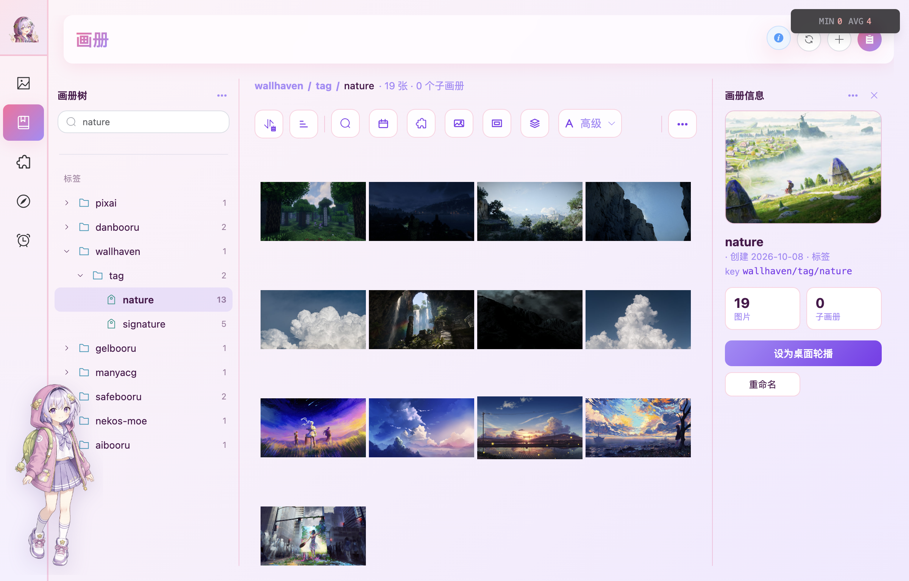
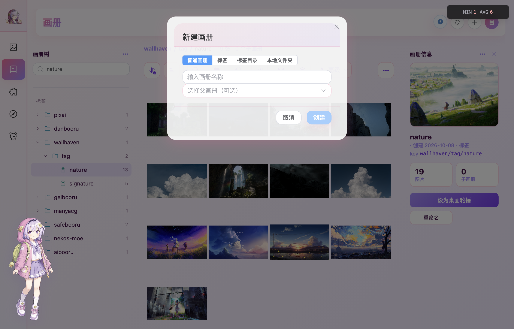
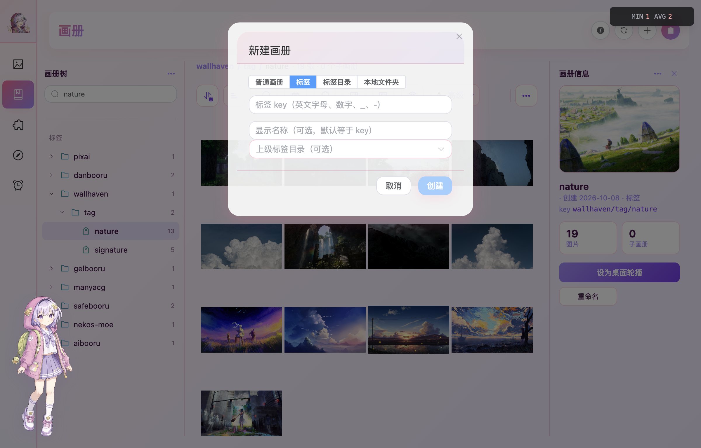
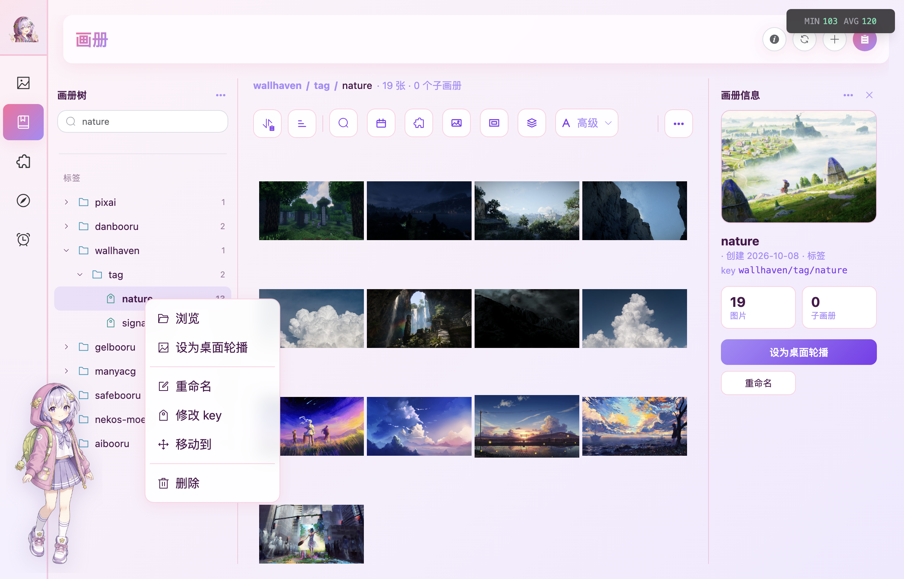
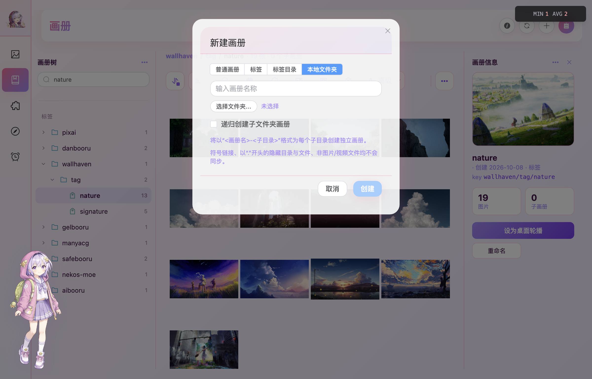
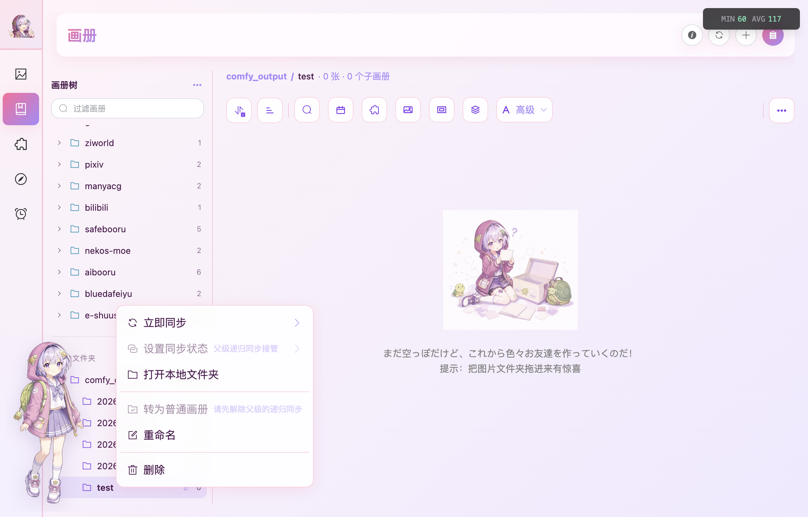
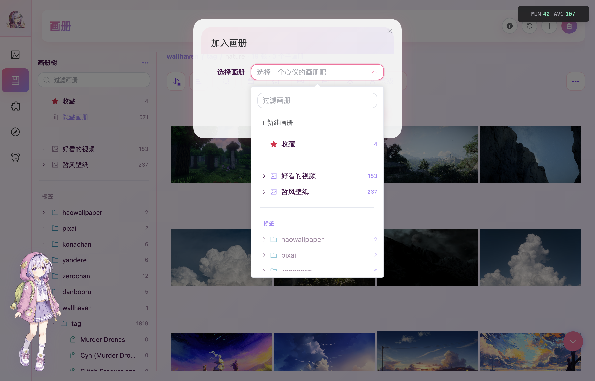
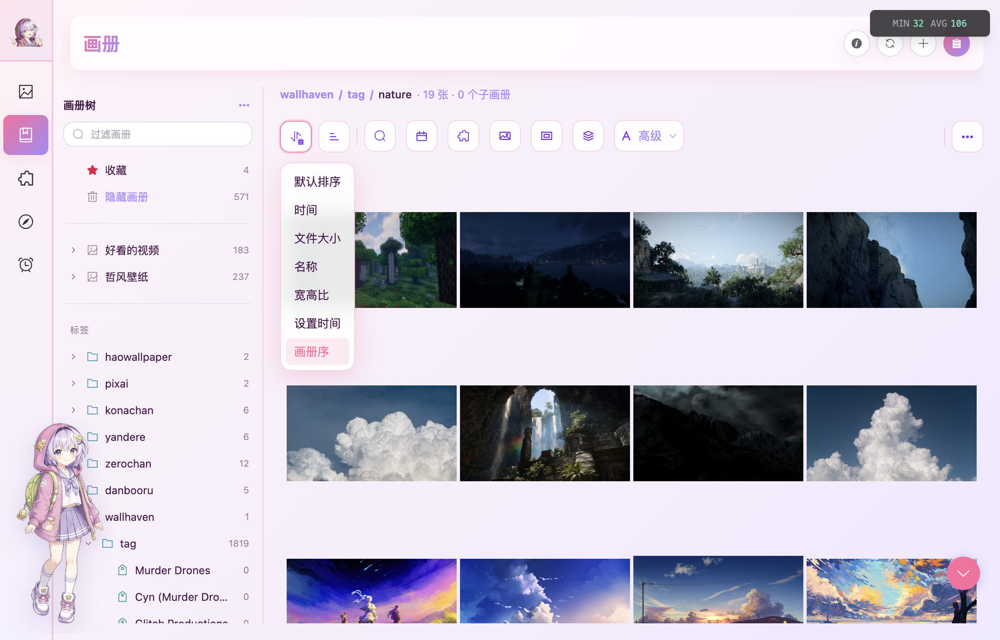
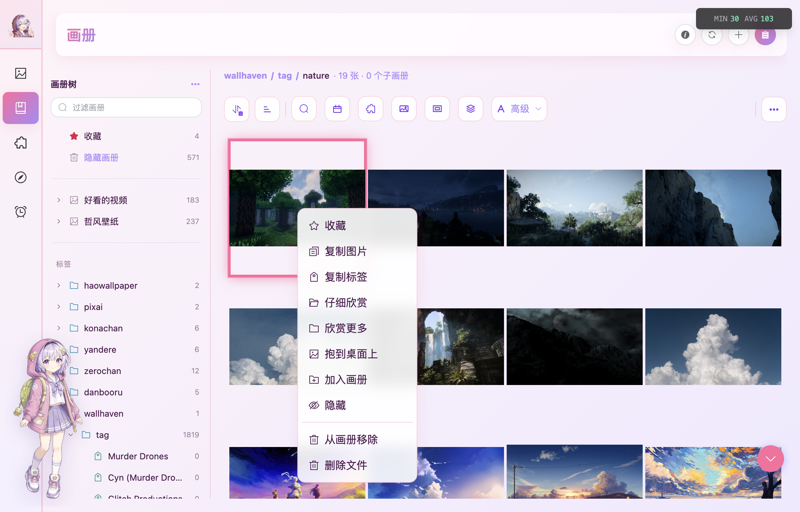

画册不是简单的“收藏夹”。Kabegame 把三种整理方式放进同一棵画册树：

- **普通画册**：按主题、项目或用途手工归档，可以建立任意层级的子画册。
- **标签与标签目录**：插件在图片入库时写入作品、角色、作者、模型等结构化标签，自动形成可浏览的分类树。
- **本地文件夹**：把磁盘目录映射成持续同步的画册，目录里的新增、删除和子目录变化会反映到图库。

此外，树顶还有固定的「收藏」与「隐藏画册」。同一张图片可以同时属于多个普通画册和标签；这些关系只引用图库中的图片，不会重复复制文件。



## 认识画册页

桌面版画册页分成三栏：

| 区域 | 用途 |
|---|---|
| 左侧画册树 | 浏览、搜索和调整画册层级；分为系统画册、普通画册、标签、本地文件夹 |
| 中间图片区 | 显示当前画册的图片，提供面包屑、查询、排序、分页和图片操作 |
| 右侧画册信息 | 显示封面、类型、标签 key 或同步路径、图片数、子画册数和常用操作 |

右上角按钮依次用于打开 / 收起画册信息、刷新、新建画册和打开任务列表。左右两栏都可以拖动边界调整宽度；双击画册树中的可浏览画册，会选中它并打开或收起右侧信息栏。

窄窗口和 Android 会把画册树、画册信息改成左右抽屉，内容与桌面版相同。

### 在画册树中查找

树顶的「过滤画册」会按画册名称和标签完整路径搜索。搜索结果仍保留原有层级，命中项的父目录会一起显示；清空搜索后，之前展开过的节点会恢复。

- 点画册行进入画册，点左侧箭头展开或收起子画册。
- 标签目录只负责组织下级标签，点击时展开或收起，不会打开图片列表。
- 右键画册打开操作菜单；Android 上使用长按。
- 普通画册和标签可以拖到合法的父节点上调整层级。普通画册与标签树互不混放，本地文件夹的层级由磁盘目录决定，不能手工移动。

---

## 新建画册

点击页面右上角的 **＋**，或点击「画册树」标题旁的 **…**。新建窗口会列出当前平台可用的画册类型。



| 类型 | 需要填写 | 适合什么情况 |
|---|---|---|
| 普通画册 | 名称；父画册可选 | 自己挑选图片，按主题或项目整理 |
| 标签 | 标签 key；显示名称与上级标签目录可选 | 让图片按结构化标签自动或手工归类 |
| 标签目录 | 标签 key；显示名称与上级标签目录可选 | 只组织下级标签和标签目录，不直接放图片 |
| 本地文件夹 | 名称、磁盘文件夹；可选递归 | 持续跟随一个真实目录，仅桌面版可用 |

从树标题旁的 **…** 新建时，Kabegame 会根据当前选中项预填父级：普通画册建在当前普通画册下，标签或标签目录建在当前标签目录下；仍可在窗口中改选父级。

### 普通画册

输入名称，按需选择父画册，然后点「创建」。普通画册可以继续嵌套子画册，适合维护“项目 → 阶段”“作品 → 角色”这类自己定义的结构。

新建后可以通过右键菜单的「新建子画册」继续扩展，也可以用「移动到」或直接拖动画册节点改变父级。

---

## 标签自动归类

支持标签的插件会在图片下载成功时同时写入结构化标签。Kabegame 会沿标签路径自动建立目录与叶子，例如：

```text
wallhaven / tag / nature
pixiv / artist / 123456
anime-pictures / character / hatsune
```

目录段是**标签目录**，最后一段是可以关联图片的**标签**。这样收集完成后，作品、角色、作者和来源等分类已经可以直接浏览，不需要再逐张整理。

标签有两个名字：

- **key**：稳定标识，也是完整标签路径的一部分；同一目录下不区分大小写且不能重复。
- **显示名称**：界面上看到的名字，可以省略；省略时使用 key。



标签 key 可以使用英文字母、数字、`_`、`-`、英文括号和单个空格，不支持 `/`、`,` 等路径或搜索分隔符，最长 64 个字符。

### 标签树的规则

- 标签目录只能包含下级标签或标签目录，不能直接关联图片。
- 标签是叶子节点，可以关联图片，但不能再建子节点。
- 标签树与普通画册树相互独立；移动时只能移到另一个标签目录或标签树根部。
- 右键标签可以浏览、设为轮播、重命名、修改 key、移动或删除。



删除标签或标签目录只会删除分类关系，不会删除图片文件。除了插件自动写入，也可以在图片预览的标签面板中添加 / 新建标签，或通过「加入画册」把图片加入已有标签。

---

## 本地文件夹持续同步（仅桌面）

新建时选择「本地文件夹」，填写画册名并选择一个真实目录。开启「递归创建子文件夹画册」后，Kabegame 会按磁盘目录树建立子画册；名称采用「父画册名-子目录名」。



递归最多展开 16 层。符号链接、以 `.` 开头的隐藏目录与文件，以及非图片 / 视频文件不会同步。

### 同步状态

本地文件夹画册会显示当前同步模式：

| 模式 | 行为 |
|---|---|
| 不同步 | 不监听目录变化，也不自动同步 |
| 浅同步 | 只同步当前文件夹这一层，不建立子画册 |
| 递归同步 | 同步整棵目录树，并按子文件夹建立画册 |
| 同步委托 | 当前子画册由父级递归同步接管，不能单独设置 |

文件系统发生变化后，Kabegame 会自动把本次新增、删除和更新同步进图库。右键菜单还提供三种立即同步范围：只同步当前文件夹、递归同步已有画册，以及完全递归同步并创建缺失的子画册。



画册行出现红点时，表示目录不存在、没有访问权限或读取失败；把鼠标放到红点上可以查看状态。页面顶部的「刷新」在当前选中本地文件夹画册时，也会额外发起一次当前层同步。

### 拖入与删除的含义

本地文件夹是磁盘内容的映射，普通“加入 / 从画册移除”不能绕过磁盘直接改成员关系：

- 把图片、视频或文件夹拖进本地文件夹画册，会先复制到同步目录，再导入并加入画册。
- 右键图片只提供「删除文件」，确认后会把真实源文件移入系统回收站，并从图库和所有画册移除。
- 删除本地文件夹画册本身只删除画册与关联关系，**不会删除磁盘目录和里面的文件**。
- 「转为普通画册」会停止跟随磁盘目录，并把整棵子树转换为普通画册；此操作不可逆。

:::caution[可移动磁盘与临时挂载]
如果同步根目录消失（例如磁盘被拔出），Kabegame 会把它视为目录已删除并移除对应画册树；图片记录仍保留在画廊，但画册结构不会在重新挂载后自动恢复。使用可移动磁盘时，建议先关闭同步或保持挂载稳定。
:::

---

## 把图片加入画册

在画廊、画册详情或任务详情中选中一张或多张图片，右键选择「加入画册」。任务详情页头还可以把该任务的全部成功图片一次加入画册。

选择器按同一棵画册树显示「收藏」、普通画册和标签：

- 标签目录只负责分组，不能作为目标。
- 当前正在浏览的画册会被排除，避免重复选择。
- 点「＋ 新建画册」可以现场创建一个普通画册并立即加入。
- 已经存在的成员会自动跳过，不会重复添加。



### 拖入当前画册（仅桌面）

把本地图片、视频或文件夹拖到画册页，整个页面会显示虚线拖入提示，松手后创建本地导入任务：

| 当前画册 | 拖入结果 |
|---|---|
| 普通画册或标签 | 递归导入媒体，并加入当前画册；文件夹内容按一次任务展开，不据此新建画册层级 |
| 本地文件夹 | 复制到该画册的同步目录，再导入并建立成员关系 |
| 收藏、隐藏画册或标签目录 | 不接受拖入 |

`.kgpg` 插件包不属于媒体文件，不能拖到画册页；请拖到[源页面](/guide/plugins-usage/#方法二拖到源页面仅桌面)。

---

## 在画册中浏览和查询

选中画册后，中间上方会显示完整面包屑、当前图片数与子画册数。下面的查询工具栏与画廊使用同一套操作：

- 搜索显示名称、本地路径、URL、元数据、原生元数据或标签。
- 按时间、来源插件、图片 / 视频、宽高比和文件大小过滤。
- 用「高级」组合多条“并且 / 或者 / 取反”条件。
- 点末尾的 **…** 自定义常驻工具。

搜索语法和高级查询示例见[画廊：查询与过滤](/guide/gallery/#查询与过滤)。切换画册时，当前查询会清空，并回到默认的「画册序」。

### 排序与分页



画册支持默认排序、时间、文件大小、名称、宽高比、壁纸设置时间和画册序；旁边的方向按钮切换正序 / 倒序。「画册序」用于查看手工或外部工具设置的成员顺序。

每页显示数量在「设置 → 应用设置 → 每页显示数量」中统一设置，与画廊共用。图片较多时，分页条会固定在页头下方。

### 画册信息栏

点页面右上角的 **ⓘ** 打开画册信息。信息栏会根据类型显示：

- 普通画册：自动封面、创建时间、图片与子画册数量。
- 标签：完整 key 路径。
- 本地文件夹：同步路径、目录状态与同步模式。
- 当前轮播来源：额外显示「桌面轮播中」。

这里提供「设为桌面轮播」、重命名，以及新建子画册或立即同步等常用操作；标题旁的 **…** 可以打开完整画册菜单。

---

## 管理画册里的图片

画册中的选择、预览和右键操作与画廊一致。单击选中，按住 Shift 可以范围选择；双击打开应用内预览。



普通画册和标签会把两种删除意图明确分开：

- **从画册移除**：只解除当前画册关系，图片文件、画廊记录和其他画册关系都保留。
- **删除文件**：把本地文件移入系统回收站，并从画廊和所有画册移除；符号链接、网络盘或虚拟盘上的文件只移出图库，不删除磁盘文件。

两项分别弹出确认窗口，不再通过同一个对话框中的复选框切换。若所选内容包含当前桌面壁纸，确认窗口会额外提示后续无法从图库恢复该壁纸。

本地文件夹画册不显示「从画册移除」，因为成员关系以磁盘目录为准；请使用「删除文件」，或先将整棵画册转成普通画册。

Android 上对普通画册图片上划，会直接执行“仅从当前画册移除”且不弹确认；本地文件夹同步在 Android 不可用。

---

## 管理画册本身

右键画册树中的节点，或打开右侧信息栏的 **…**：

- **浏览**：进入该画册。
- **新建子画册**：普通画册可建普通子画册；标签目录可建下级标签或标签目录。
- **重命名 / 修改 key**：名称只影响显示；修改标签 key 会同时更新其完整路径。
- **移动到**：选择新的合法父级，也可以移回根级。
- **删除**：删除画册、子画册及成员关系，但不删除图片文件。

「收藏」不能删除，也不能建立子画册；「隐藏画册」没有右键菜单。隐藏图片的完整工作方式与清理入口见[画廊：清理隐藏图片](/guide/gallery/#清理隐藏图片)。

画册树、计数、信息栏和图片列表会订阅图库变化，加入、移除、改名和移动后会自动更新。顶部「刷新」用于主动重读当前画册与画册树。

---

## 壁纸轮播与画册盘（桌面附加功能）

需要时，画册可以作为桌面壁纸轮播来源：在画册信息栏点「设为桌面轮播」，或在画册右键菜单中选择同名操作。空画册不会显示这项操作；删除当前轮播画册时，Kabegame 会清除对应轮播来源。

启用[画册盘](/guide/virtual-drive/)后，画册页顶栏可以打开挂载根目录，画册菜单也可以直接定位到对应目录。Android 与 Web 不提供本地文件夹同步或画册盘。

---

## 延伸阅读

- [画廊](/guide/gallery/) — 查询语法、图片选择、预览、隐藏和删除
- [下载任务](/guide/tasks/) — 在任务运行前指定输出画册，或把整个任务加入画册
- [插件使用](/guide/plugins-usage/) — 插件如何保存元数据、标签和来源信息
- [画册盘](/guide/virtual-drive/) — 在系统文件管理器中浏览画册
- [设置](/guide/settings/) — 每页数量、壁纸轮播与画册盘设置
- [Android 使用指南](/guide/android/) — 抽屉、长按与上划移除等移动端差异
