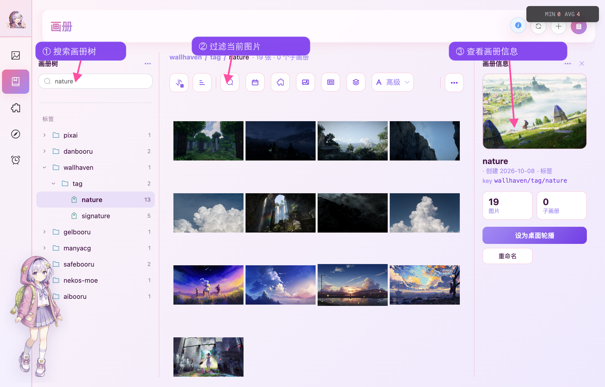
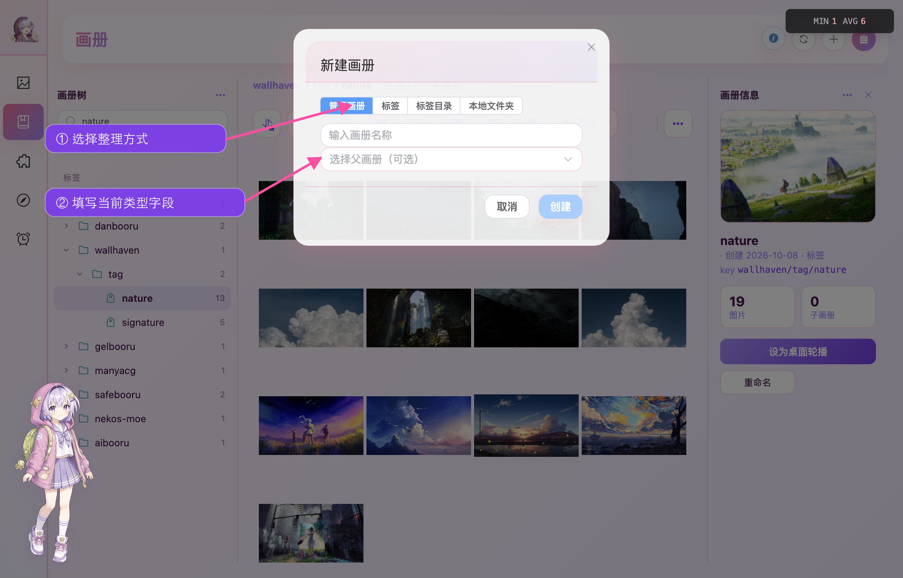
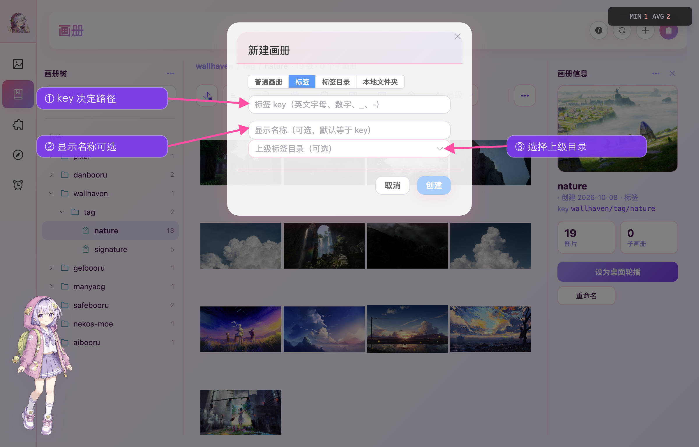
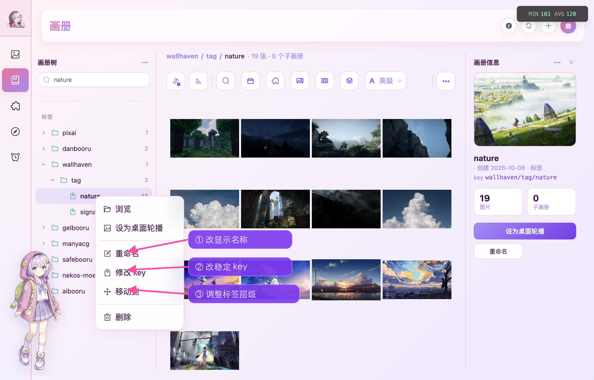
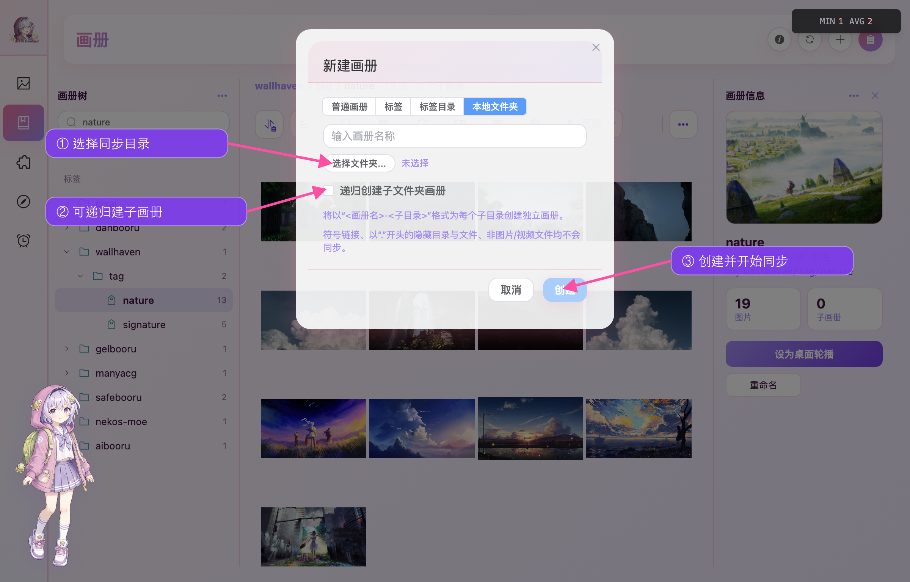
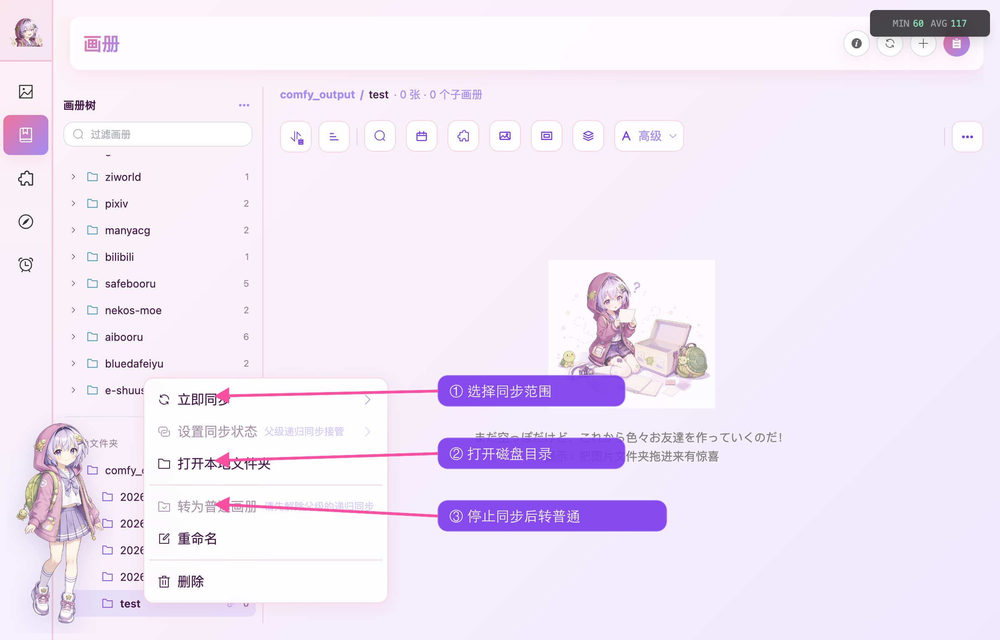
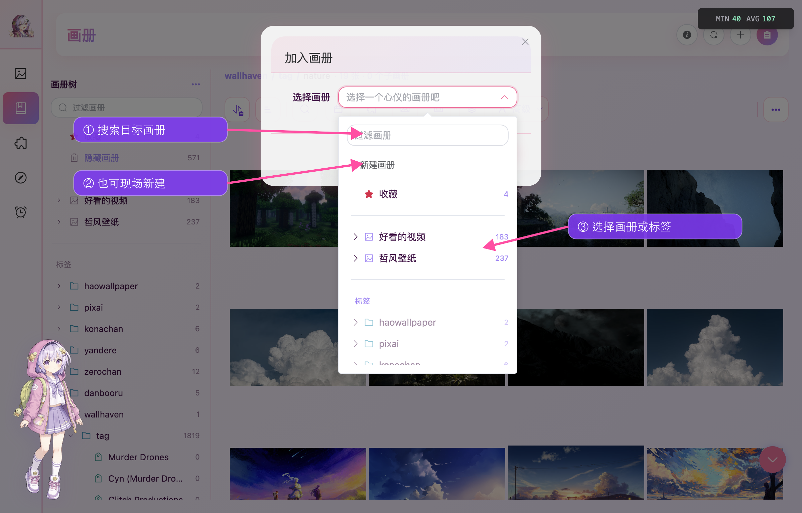
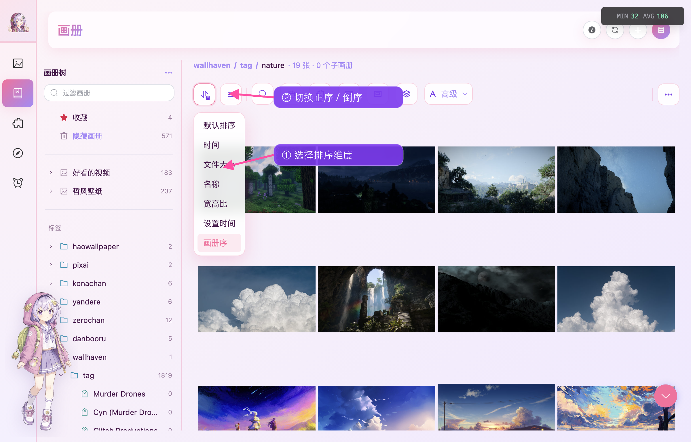
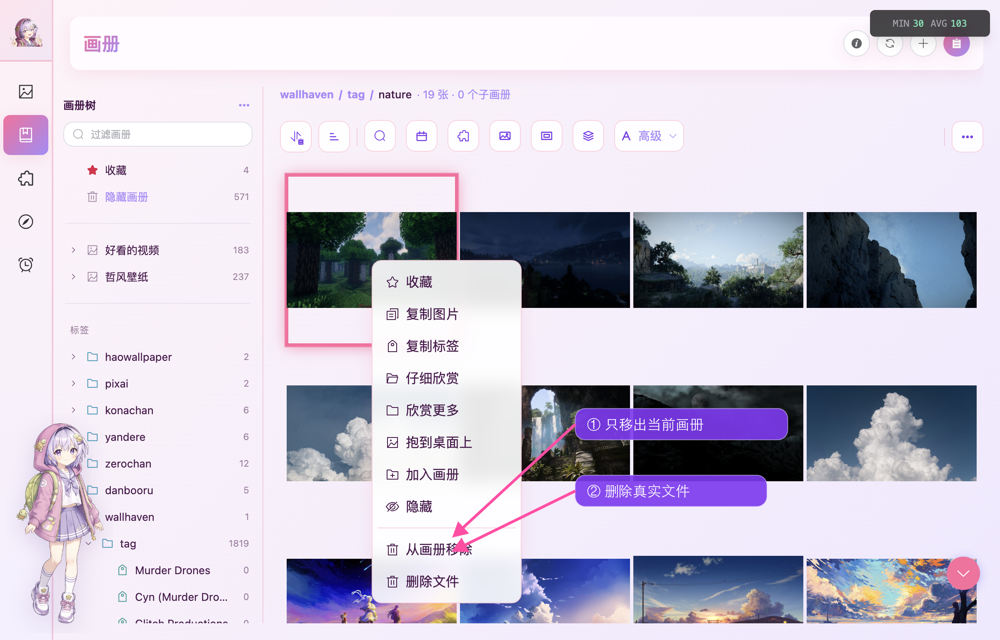

Kabegame 把三种整理方式放进同一棵画册树：

- **普通画册**：按主题或用途手工归档，可建立多级结构。
- **标签**：插件写入结构化标签后，自动形成作品、角色、作者等分类。
- **本地文件夹**：把磁盘目录映射成持续同步的画册。

树顶还有固定的「收藏」与「隐藏画册」。画册只引用图库记录，同一张图片加入多个画册不会重复复制文件。



## 认识画册页

桌面版左侧是画册树，中间浏览当前画册，右侧显示封面、类型、标签 key 或同步路径等信息。右上角可以打开信息栏、刷新、新建画册和查看任务；双击可浏览的画册会打开或收起信息栏。

窄窗口和 Android 会把左右两栏变成抽屉，功能不变。树顶搜索会匹配画册名称和标签完整路径，并保留命中项的父级结构。

- 点击画册进入，点击箭头展开子级；标签目录只展开，不显示图片。
- 右键打开操作菜单，Android 使用长按。
- 普通画册和标签可拖到合法父级；两棵树不能混放，本地文件夹层级由磁盘目录决定。

---

## 新建画册

点击页面右上角的 **＋**，或点击画册树标题旁的 **…**。



| 类型 | 用途 |
|---|---|
| 普通画册 | 手工挑选图片，可嵌套普通子画册 |
| 标签 | 自动或手工关联图片，是标签树的叶子 |
| 标签目录 | 只组织下级标签或目录，不直接关联图片 |
| 本地文件夹 | 持续跟随真实目录，仅桌面版可用 |

从树标题旁新建时，Kabegame 会按当前节点预填合法父级；创建后仍可用「移动到」或拖动节点调整层级。

---

## 标签自动归类

支持标签的插件会在图片入库时写入类似下面的路径：

```text
wallhaven / tag / nature
pixiv / artist / 123456
```

路径中间是**标签目录**，末段是可关联图片的**标签**。`key` 是稳定标识和路径的一部分；显示名称只影响界面，留空时使用 `key`。



`key` 最长 64 个字符，可使用英文字母、数字、`_`、`-`、英文括号和单个空格；不能使用 `/`、`,` 等路径或搜索分隔符。同一目录下的 `key` 不区分大小写且不能重复。

标签目录不能直接关联图片，标签也不能再建子节点。标签只能移动到其他标签目录或标签树根部。



删除标签或标签目录只删除分类关系，不删除图片文件。除了插件自动归类，也可以在图片预览的标签面板中添加标签，或通过「加入画册」手工关联。

---

## 本地文件夹持续同步（仅桌面）

选择真实目录后即可创建同步画册；开启递归会按磁盘目录树建立子画册，名称采用「父画册名-子目录名」。



递归最多 16 层。符号链接、以 `.` 开头的隐藏项和非图片 / 视频文件不会同步。

| 模式 | 行为 |
|---|---|
| 不同步 | 不监听，也不自动同步 |
| 浅同步 | 只同步当前目录 |
| 递归同步 | 同步整棵目录树并建立子画册 |
| 同步委托 | 由父级递归同步接管，当前节点不能单独设置 |

文件变化会自动进入图库；需要立即处理时，可在右键菜单中选择当前目录、已有画册树或完整目录树的同步范围。



画册行的红点表示目录不存在、没有权限或读取失败，悬停可查看原因。页面顶部刷新当前本地文件夹时，也会触发一次当前层同步。

### 拖入与删除

- 拖入图片、视频或文件夹：先复制到同步目录，再导入图库。
- 删除图片文件：把真实源文件移入系统回收站，并从图库和所有画册移除。
- 删除同步画册：只删除画册和关联关系，**不删除磁盘目录**。
- 转为普通画册：停止同步并转换整棵子树，此操作不可逆。

:::caution[可移动磁盘与临时挂载]
同步根目录消失时，Kabegame 会将其视为已删除并移除对应画册树；图片记录仍在画廊，但重新挂载不会自动恢复画册结构。使用可移动磁盘时，请先关闭同步或保持挂载稳定。
:::

---

## 把图片加入画册

在画廊、画册或任务详情中选中图片，右键选择「加入画册」。任务详情页头还可以一次加入该任务的全部成功图片。



选择器会排除当前画册并跳过已有成员。标签目录仅用于分组，不能作为目标；现场新建得到的是普通画册。

### 拖入当前画册（仅桌面）

| 当前画册 | 拖入结果 |
|---|---|
| 普通画册或标签 | 递归导入媒体并加入当前画册，不按文件夹另建层级 |
| 本地文件夹 | 复制到同步目录后导入 |
| 收藏、隐藏画册或标签目录 | 不接受拖入 |

`.kgpg` 插件包请拖到[源页面](/guide/plugins-usage/#方法二拖到源页面仅桌面)，不能作为媒体导入画册。

---

## 浏览、查询与排序

画册沿用[画廊的查询工具栏](/guide/gallery/#查询与过滤)：可搜索名称、路径、URL、元数据或标签，并按时间、来源、媒体类型、比例和大小过滤；「高级」用于组合条件。切换画册会清空查询并恢复「画册序」。



除默认排序外，还可按时间、文件大小、名称、宽高比、壁纸设置时间或画册序排列。「画册序」用于查看手工或外部工具设置的成员顺序。每页数量与画廊共用「设置 → 应用设置 → 每页显示数量」。

右侧信息栏按类型显示封面、创建时间、图片和子画册数量、标签完整路径或本地同步状态，也提供重命名、新建子画册、立即同步等常用操作。

---

## 管理画册里的图片

单击选中，按住 Shift 范围选择，双击打开应用内预览。普通画册和标签把两种删除意图明确分开：



- **从画册移除**：只解除当前关系，文件、画廊记录和其他画册关系都保留。
- **删除文件**：移入系统回收站，并从画廊和所有画册移除；符号链接、网络盘或虚拟盘文件只移出图库。

两项会分别确认；涉及当前桌面壁纸时还会额外警告。本地文件夹画册没有「从画册移除」，因为成员由磁盘决定。Android 上划普通画册图片会直接解除当前关系且不弹确认。

---

## 管理画册本身

右键节点或打开信息栏的 **…**，可以浏览、新建合法子画册、重命名、修改标签 `key`、移动或删除。删除画册会同时删除子画册及成员关系，但不删除图片文件。

「收藏」不能删除或建立子画册；「隐藏画册」没有右键菜单。隐藏图片的工作方式见[画廊：清理隐藏图片](/guide/gallery/#清理隐藏图片)。画册树、计数和图片列表会随数据变化自动更新，顶部「刷新」用于主动重读。

---

## 壁纸轮播与画册盘（桌面附加功能）

非空画册可以设为桌面轮播来源；删除当前来源时会清除对应设置。启用[画册盘](/guide/virtual-drive/)后，还可以从顶栏打开挂载根目录，或从画册菜单定位到对应目录。Android 与 Web 不提供本地文件夹同步或画册盘。

---

## 延伸阅读

- [画廊](/guide/gallery/) — 查询、选择、预览、隐藏和删除
- [下载任务](/guide/tasks/) — 指定输出画册或加入整个任务
- [插件使用](/guide/plugins-usage/) — 插件保存标签和来源信息
- [画册盘](/guide/virtual-drive/) — 在系统文件管理器中浏览画册
- [Android 使用指南](/guide/android/) — 抽屉、长按与上划等移动端差异
