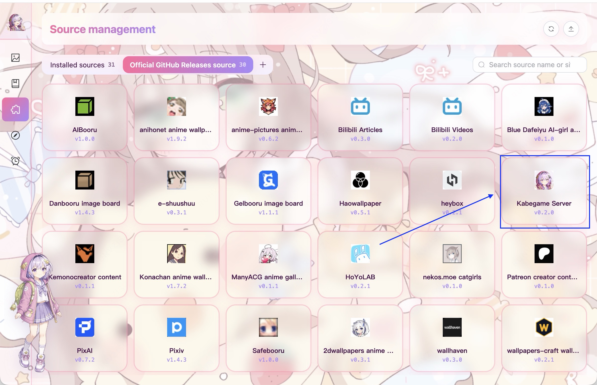
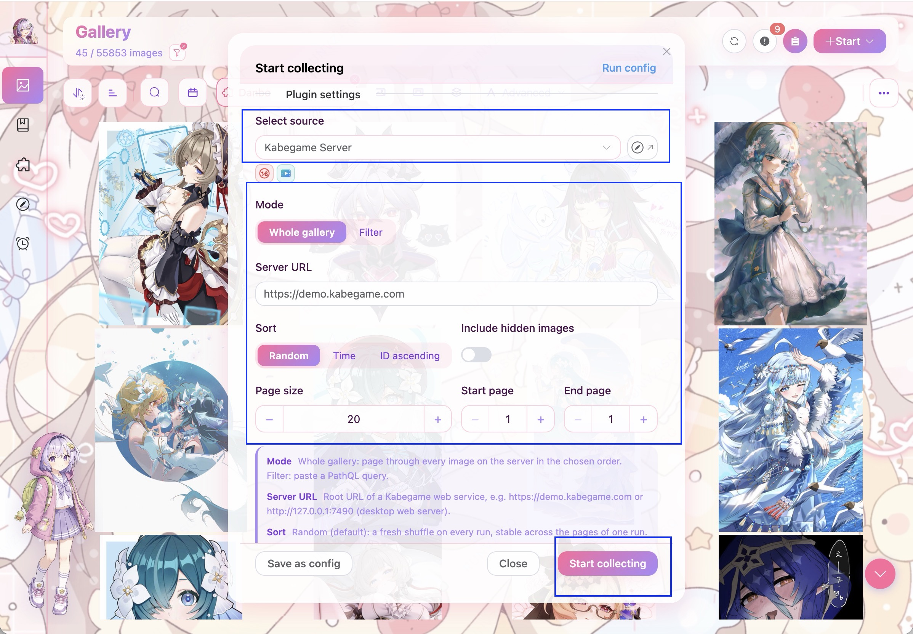
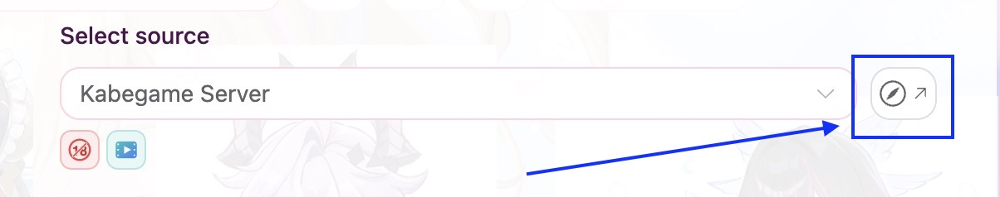
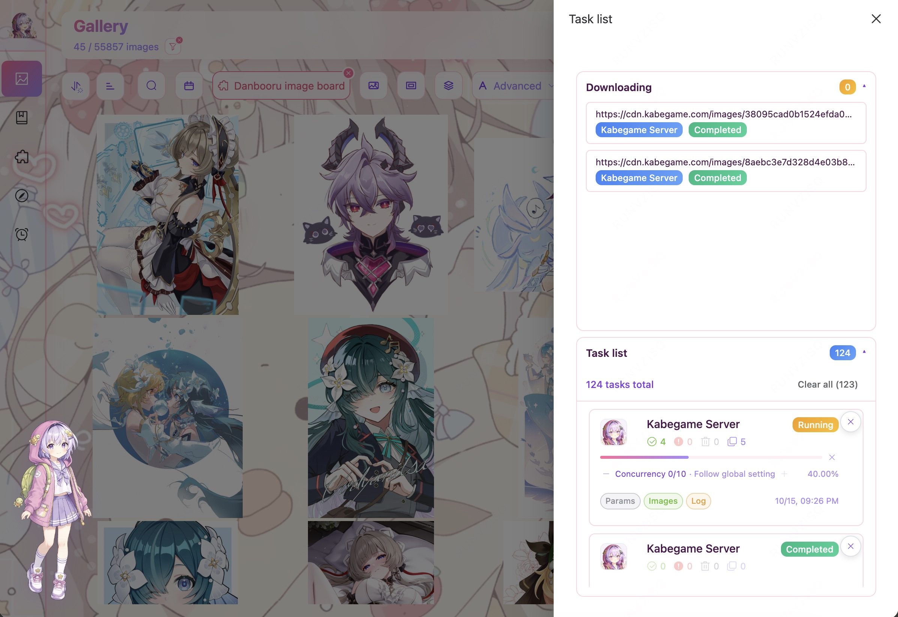
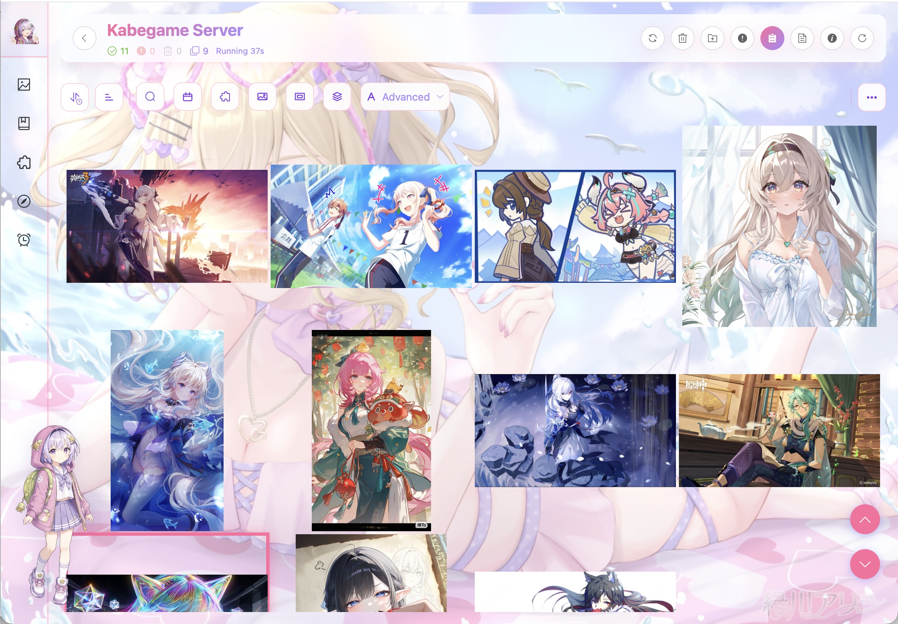

这篇文档带你实际运行一次「Kabegame 服务器」插件，使用默认参数从 Kabegame 在线 Demo 随机收集一批图片，并查看随图片一起保存的标签与来源信息。整个流程不需要登录，大约 5 分钟。

多数发行版本已经内置一组常用插件，因此先直接寻找「Kabegame 服务器」即可；只有没有看到它时，才需要前往插件商店安装。

## 第 1 步：确认插件已经安装

首次打开 Kabegame 会进入「画廊」。点击空状态中的「开始收集」，或右上角工具栏的同名按钮，然后选择「网络」。

在「选择源」中搜索并选择「Kabegame 服务器」。如果能找到，直接进入第 2 步。

如果没有看到这个插件：

1. 关闭收集窗口，点击左侧的「源」图标。
2. 打开「GitHub 官方插件目录」标签页。
3. 搜索并打开「Kabegame Server / Kabegame 服务器」。
4. 点击「安装」。安装完成后回到画廊，重新打开「开始收集 → 网络」。

:::note
本页截图使用英文界面，因此显示为 **Kabegame Server**；中文界面中的名称是 **Kabegame 服务器**，二者是同一个插件。安装后不需要重启应用。
:::

## 第 2 步：使用默认参数开始收集

选择「Kabegame 服务器」后，保持任务设置中的输出目录和输出画册为空：图片会保存到默认下载目录，并直接出现在画廊中。

插件参数也不需要修改。默认设置会从 `https://demo.kabegame.com` 的整个画廊中随机选择第一页，每页 20 项，并跳过已隐藏的内容。

如果表单像下面这样自动填好，直接点击底部的「开始收集」即可：

### 可选：用畅游检查连接或登录

桌面端选中来源后，「选择源」右侧会出现一个指南针形状的快捷按钮。点击它会使用该插件的网址打开应用内网页窗口「畅游」，不会立即开始收集任务。

对于本教程，你可以用它打开 Kabegame 在线 Demo，先确认当前网络能够访问站点。以后使用 Pixiv、X 等需要账号的来源时，也可以在开始收集前从这里进入网站并完成登录；畅游会保存站点 Cookie，支持自动登录态复用的插件之后可以直接使用，不必反复复制 Cookie。

检查或登录完成后关闭畅游窗口，回到收集表单，再点击「开始收集」。完整操作见[畅游](/guide/surf/)。

:::tip
「Kabegame 服务器」并不是只复制图片文件。它还会尽可能保留源服务器上的标签、作者与原帖信息、插件元数据和详情视图，所以很适合用来体验 Kabegame 的完整收集结果。
:::

:::note
默认模式按整个画廊随机取一页，因此每次看到的内容可能不同，也可能包含视频。这属于正常结果。
:::

## 第 3 步：查看任务进度

提交后，任务会进入下载队列。打开右侧的任务抽屉，可以看到「等待中 → 运行中 → 已完成」的状态变化，以及成功、失败、跳过和重复的数量。点击任务卡片上的「图片」或「日志」可以检查正在处理的内容。

默认会处理 20 项，通常很快就能完成。如果任务变成「失败」，打开任务日志查看具体原因；最常见的是当前网络无法访问 `demo.kabegame.com`。

延伸阅读：[任务与下载](/guide/tasks/)

## 第 4 步：在画廊检查结果

点击任务卡片可以进入任务详情页，边下载边查看本次任务已经收入的图片；任务完成后，这些图片也会自动出现在总画廊中，不需要刷新页面。

点击任意图片打开预览，重点看看这些区域：

- **基本信息**：图片尺寸、格式、文件大小和原帖地址。
- **标签**：源服务器已有的作者、角色、作品等标签会一起复制，可直接点击筛选。
- **插件详情**：如果原来源插件提供详情模板，可以继续看到作者、正文、互动数据或 AI 生成参数等信息。

恭喜！你的第一批图片已经住进 Kabegame 了，也完整走通了「选择插件 → 创建任务 → 图片入库 → 查看来源信息」的网络收集流程。接下来可以继续逛逛标签和插件详情，看看这批图片还带回了哪些有趣的信息。

## 接下来可以做什么

- 增加「结束页」，或者把「每页数量」从默认的 20 调大，一次收集更多内容。
- 在插件商店安装 Pixiv、Danbooru、Safebooru 等来源插件，直接从目标站点收集。
- 在收集窗口里选择输出画册，让新图片在入库时自动归档。
- 使用「保存为配置」记录常用参数，之后一键重复运行。
- 选择「开始收集 → 本地」，导入电脑中已有的图片和视频。

## 排障

**「选择源」里没有“Kabegame 服务器”** → 当前版本没有内置或尚未安装该插件 → 回到第 1 步，从 GitHub 官方插件目录安装。

**插件商店里也没有找到** → 先确认已经打开「GitHub 官方插件目录」，再点击右上角刷新按钮并搜索 `Kabegame Server`。

**提示无法访问 `https://demo.kabegame.com/rpc`** → 用浏览器确认在线 Demo 可以打开，并检查代理、防火墙或 DNS 设置；稍后也可以重新运行同一任务。

**任务完成，但画廊里没有看到新图片** → 清除当前画廊的搜索与过滤条件并回到第一页；如果已经运行过本教程，重复内容也可能被自动去重。

**想复制自己另一台设备上的图库** → 在那台桌面版 Kabegame 的「设置 → 高级」中开启 Web 服务器，再把插件的「服务器地址」改成界面显示的局域网地址。桌面 Web 服务器没有鉴权，只应在可信网络中开启。

## 延伸阅读

- [插件安装与管理](/guide/plugins-usage/) — 浏览商店、安装、更新和卸载插件。
- [任务与下载](/guide/tasks/) — 查看任务状态、日志、失败项和重试。
- [画廊](/guide/gallery/) — 浏览、筛选、预览、去重和整理图片。
- [画册](/guide/albums/) — 手工画册、标签目录与本地文件夹同步。
