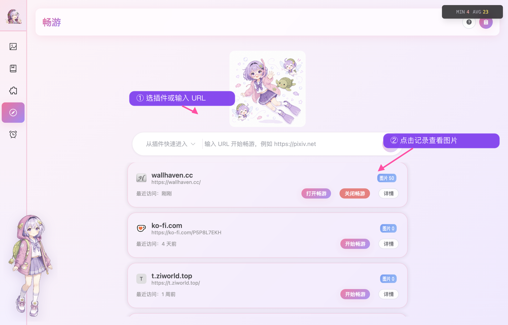
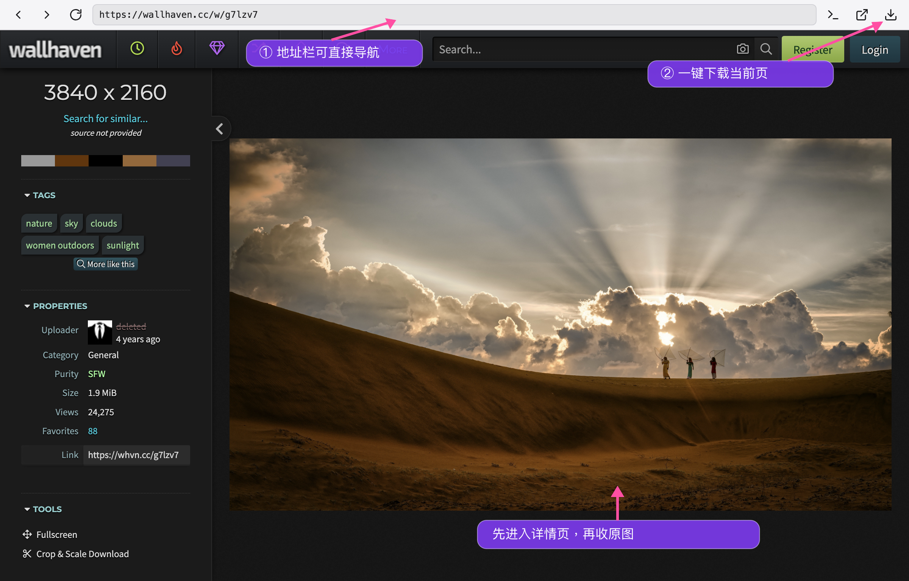
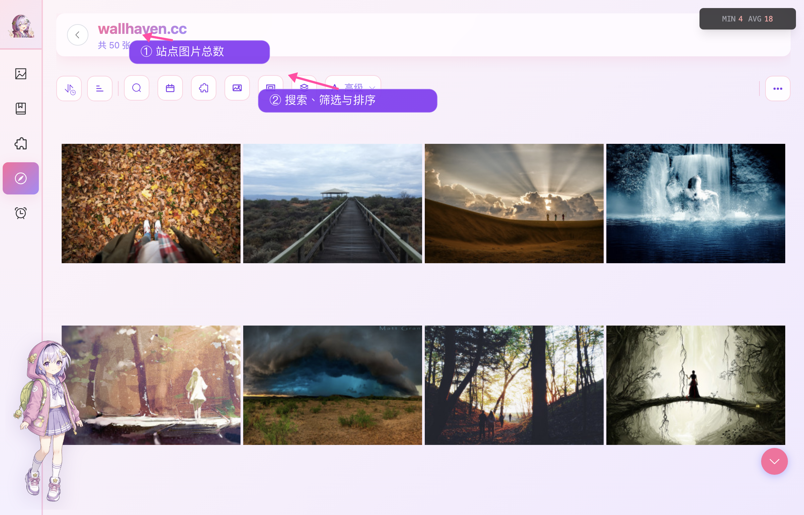

畅游是 Kabegame 的应用内网页窗口，适合临时浏览、人工挑选，以及需要先登录的网站。你可以把当前页面的图片或视频收进画廊，也可以让支持该能力的插件复用已保存的 Cookie；需要分页、计划运行或批量收集时，则优先使用插件。

## 开始一次畅游

进入侧栏的「畅游」，按图中任一种方式打开网站：

1. 在「从插件快速进入」中选择一个已安装插件，自动填入它配置的网站地址。
2. 直接输入 URL，再点右侧箭头。裸域名会自动补成 `https://`。

入口只接受 `https://` 地址。Kabegame 会按站点 host 建立或复用记录：同一站点已有窗口时直接聚焦并导航，不同站点则可以各自打开窗口。关闭窗口不会删除记录或已经下载的图片。

:::tip[从插件表单快捷进入]
桌面端在「开始收集 → 网络」中选中插件后，也可以点来源旁的指南针按钮，直接用插件网站打开畅游。它不会自动启动收集任务，适合先检查连通性或登录账号。
:::

## 认识畅游窗口

下面是真实打开 Wallhaven 图片详情页时的畅游窗口：

导航栏提供后退、前进、刷新、地址输入、开发者工具、在系统浏览器打开和一键下载。图中标出了最常用的地址栏与下载入口；进入窗口后，地址栏接受 `http` / `https`。

普通新标签链接会继续在当前窗口导航，OAuth 登录等需要独立窗口的弹窗则会正常放行；地址栏会随页面跳转同步更新。

## 一键下载当前页面

进入想收集的页面后，点击导航栏最右侧的**下载箭头**。Kabegame 会检测当前页面已经加载的媒体并加入下载队列；运行时图标会旋转，再次点击可取消尚未入队的项目。页面顶部会提示检测与入队结果，入库后记录中的图片数会自动更新。

:::tip[先进入详情页，再一键下载]
在搜索结果页或瀑布流页面点击一键下载，收集到的通常是当前页面里的缩略图；想保存原图时，应先点进单张图片的详情页，再点击下载箭头。上面的 Wallhaven 示例页只检测到一张 3840×2160 原图，更容易确认结果。
:::

### 一键下载很慢时检查「冻结网页」

「设置 → 下载设置 → 冻结网页」会先保存当前页面的 HTML 和样式，方便以后从图片详情回看来源。复杂页面生成快照可能较慢；若下载箭头长时间旋转且不需要回看网页，可临时关闭该设置再试。

一键下载只处理**当前页面**，不会自动翻页；相同文件会按全局去重设置跳过，因此检测数可能大于新增数。下载沿用当前窗口的 Cookie，成功内容同时出现在畅游记录和总画廊中。

## 右键下载单张媒体

只想保存某一项时，可以在图片、视频或带背景图的区域上右键，选择「下载图片」或「下载视频」。页面顶部会提示已入队、成功、失败或重复；普通文字和空白区域仍使用网页自己的菜单。对于 `blob:` / MSE 播放器，Kabegame 会尝试捕获已缓冲内容并在需要时合流音视频。

## 登录与 Cookie 复用

需要账号时，直接在畅游窗口登录。Kabegame 会保存该站点的 Cookie（包括 HttpOnly Cookie），下次继续使用；支持 `Kabegame.requireCookie()` 的 V8 插件还可以请求宿主注入登录态，但读不到 Cookie 明文。

记录的「详情」仍允许查看和复制 Cookie，供不支持自动注入的场景使用。

:::caution[Cookie 属于敏感信息]
Cookie 可能等同于账号登录凭证。不要把详情窗口截图或复制内容发送给他人；怀疑泄露时，应立即在网站退出所有会话或修改密码。
:::

## 查看下载图片

回到畅游记录列表后，点击 Wallhaven 这类记录卡片，就会进入该站点的下载图片页；也可以右键卡片选择「查看下载图片」。

这里复用画廊的图片网格：可以搜索、筛选和排序，单击选择、双击预览，并通过右键菜单查看详情、复制、收藏、加入画册、隐藏或用系统默认应用打开。

这里的「删除」会删除图库记录，并在支持的本地路径上把文件移入系统回收站；如果只想暂时不显示，请使用「隐藏」。下载图片仍然属于总画廊，因此从画廊也能找到和管理它们。

## 管理畅游记录

记录卡片显示站点、入口 URL、图片数和最近访问时间：

- **点击卡片**查看该站点下载的图片；右键也可选择「查看下载图片」。
- **开始畅游 / 打开畅游 / 关闭畅游**用于创建、聚焦或结束窗口。
- **详情**可以修改名称和入口路径、查看 Cookie 或删除记录。

入口路径只修改 host 后面的部分。例如保存的站点是 `https://example.com/`，把入口路径改成 `/users?id=1` 后，下次会从 `https://example.com/users?id=1` 打开。

删除畅游记录只删除访问记录和关联关系，**不会删除已经进入画廊的图片文件**。

用记录卡片的「关闭畅游」或窗口关闭按钮都能结束会话。已经保存的 Cookie 会继续保留，本次会话的临时文件会被清理。

## 平台差异

畅游是桌面功能，Android 和 Web 版本不提供。Linux 当前可以打开页面和管理记录，但受 WebKit 能力限制，畅游窗口中不能下载媒体。

| 能力 | Windows | macOS | Linux | Android / Web |
|---|---|---|---|---|
| 打开畅游窗口、浏览与登录 | 是 | 是 | 是 | 否 |
| 一键下载 / 右键下载 | 是 | 是 | 否 | 否 |
| 保存 Cookie、管理记录 | 是 | 是 | 是 | 否 |
| 查看畅游图片页 | 是 | 是 | 是 | 否 |

## 延伸阅读

- [画廊](/guide/gallery/) — 查询、预览、隐藏和删除畅游下载的内容
- [插件使用](/guide/plugins-usage/#登录态与-cookie) — 畅游 Cookie 如何供插件复用
- [快速开始](/guide/quickstart/#可选用畅游检查连接或登录) — 从收集表单快捷打开畅游
- [设置](/guide/settings/#下载设置) — 下载并发、间隔、去重和冻结网页
- [故障排查](/guide/troubleshooting/#畅游surf) — Linux 限制、Cookie 与会话错误
