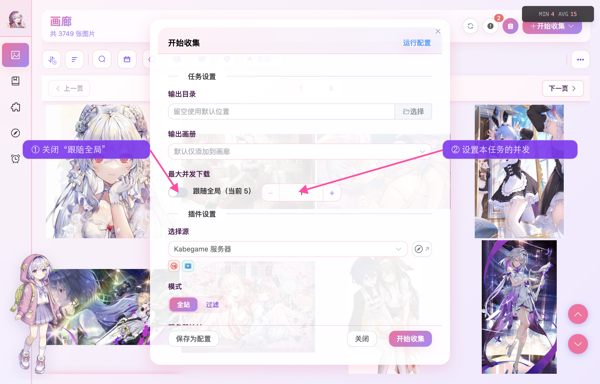
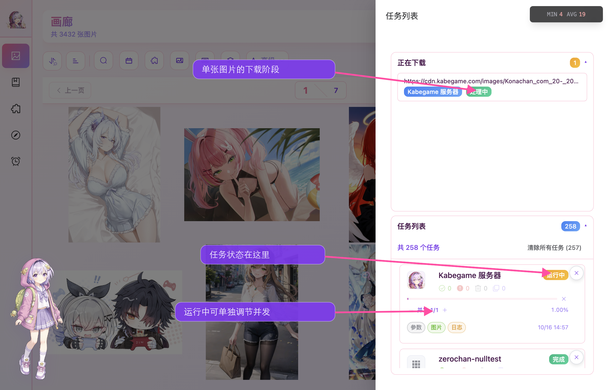
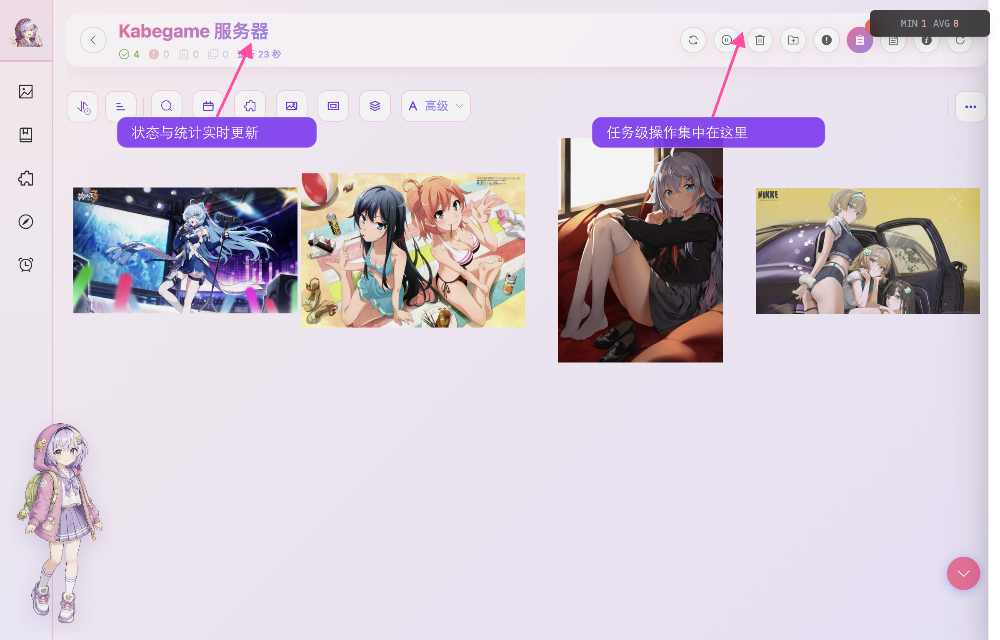
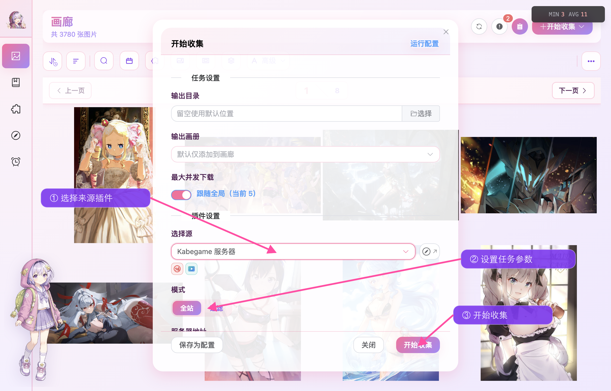

## 任务是什么？

任务是 Kabegame 中执行图片收集的工作单元。每个任务代表一次完整的图片收集过程，包括：

1. **执行插件脚本**：任务会执行某个源插件的脚本，从目标网站或本地文件系统收集图片
2. **按照配置的参数**：根据你提供的参数（如搜索关键词、页码、URL 等）执行收集逻辑
3. **下载图片到指定位置**：将收集到的图片下载并保存到你指定的输出目录
4. **添加到画廊和画册**：下载完成后，图片会自动出现在画廊；如果指定了画册，也会立刻出现在该画册里

任务创建后，会在后台自动执行，你可以在任务抽屉中查看进度和状态。

### 并发：全局上限与本任务上限

任务的执行节奏由三层限制共同决定：

| 设置 | 默认值 | 控制对象 |
|------|--------|----------|
| 同时运行任务数 | **2** | 同时执行插件脚本的任务数量；超出的任务显示「等待中」 |
| 全局最大并发下载量 | **3** | 所有任务合计同时下载的图片数量 |
| 本任务最大并发下载 | 跟随全局 | 当前任务最多占用多少个下载槽，范围 1–10，实际不会突破全局上限 |

创建任务时可以关闭「跟随全局」，给当前任务单独设一个较低的上限。任务进入「运行中」后，抽屉里的 `− / +` 仍可即时调整；达到全局值后会重新显示为「跟随全局」。这个值也会随运行配置一起保存。

例如全局上限为 3，任务 A 设为 1、任务 B 跟随全局时，两项任务合计仍最多同时下载 3 张，其中任务 A 最多占 1 个槽。

:::tip
全局上限、下载间隔、重试与自动去重等选项集中在[设置](/guide/settings/)页面；本任务上限在创建任务时设置。
:::

:::caution
并发数过高可能触发目标网站的限流或导致网络不稳定，建议循序渐进地调整。
:::

---

## 任务状态

任务共有六种状态，任务卡片右上角的徽章会显示当前状态：

| 状态 | 含义 |
|------|------|
| 等待中 | 任务已创建，受「同时运行任务数」限制暂未开跑 |
| 运行中 | 插件脚本正在抓取列表、生成下载项或下载图片 |
| 等待剩余下载 | 插件脚本已经结束，正在等待该任务排队或处理中的图片全部落盘 |
| 完成 | 任务正常结束，全部目标都已处理 |
| 失败 | 任务执行过程中出现错误，已中止 |
| 已取消 | 任务被用户手动停止 |

:::note
「等待剩余下载」是正常的收尾阶段，不需要刷新或重新运行；队列排空后会自动变为「完成」。你主动点「停止」会变成「已取消」，脚本抛错或网络中断导致结束则是「失败」。这两种情况下，**已经下载完成的图片都会保留**。
:::

---

## 任务抽屉

画廊、画册、任务详情页、畅游图片页的**右上角**都有一个圆形「列表」按钮（带红色未完成数徽章，最多显示 99），点击后任务抽屉从右侧滑入（Android 下为全宽抽屉）。

任务抽屉分为两个可折叠面板：

### 正在下载

展示当前**每一张正在下载的图片**，包括 URL、来源插件、准备 / 下载 / 解压 / 处理等阶段，以及可用时的字节进度。

### 任务列表

展示每个任务的卡片：插件图标、摘要、进度条，以及下列操作按钮。

| 按钮 | 作用 |
|------|------|
| 参数 | 打开运行参数对话框，查看这次任务用到的插件参数 |
| 图片 | 跳转到该任务的详情页 |
| 日志 | 打开任务日志对话框，查看脚本执行日志 |
| 停止 | 在「运行中」或「等待剩余下载」时中止任务 |
| × | 删除该任务记录（运行中会自动先停止） |

桌面端右键任务卡片还会出现菜单：**查看** / **删除** / **保存为运行配置**。保存后的运行配置可以在下次创建任务时快速复用同一套参数。

顶部显示「共 N 个任务」，右侧的「清除所有任务 (N)」只会清理已经结束的记录，不会清理「等待中」「运行中」或「等待剩余下载」的任务。

### 触底加载

任务很多时不用担心抽屉会卡住：任务列表按最新优先排序，一次只加载 20 条，向下滑动到接近底部时会自动继续加载更多历史任务。

:::note
拖入本地 zip/文件夹生成的任务在抽屉中会显示为「本地导入」，而不是具体的插件 ID。
:::

---

## 任务详情页

在任务抽屉里点击「图片」按钮，或右键任务选择「查看」即可进入任务详情页（`/tasks/:id`）。

### 顶部操作

标题下方的成功、失败、删除、去重与运行时长会实时更新。Header 右上角集中放置刷新、停止、删除、加入画册、任务抽屉、日志与运行参数等任务级操作；Android 上会折叠进菜单。

### 搜索、分页、每页数量

- **搜索框**（仅桌面，Android 隐藏）：按图片显示名进行子串搜索。
- **每页数量**：100 / 500 / 1000 三档切换，与画廊共用设置。
- **分页器**：图片总数超过一页时出现，可输入页码或翻页。

### 成功图片视图

`ImageGrid` 网格，支持：双击预览大图；单击选中、Shift 范围选择；右键菜单包括详情、收藏、加入画册、复制、打开所在文件夹、设置壁纸、隐藏、删除。

### 失败图片视图

每条失败记录是一张独立卡片，展示：

- 失败 URL（点击可在浏览器中打开）
- 错误信息（附「复制」按钮，可把 URL / 错误 / 插件 / 时间一起复制）
- 插件标签与失败时间
- 正在重试时会出现进度条 + 阶段标签
- 「重试」按钮：重新走一次下载流程；若本质问题是权限或 URL 失效，仍会再次失败
- 「删除」按钮：仅删除失败记录，不涉及本地文件（因为本就没下载成功）

### 统计副标题

任务标题下方是一串动态统计：**共 N 张** · **失败 N 张** · **已删除 N 张** · **去重 N 张** · **运行 XX 分钟**。

下载进行中时，这些计数会实时刷新，运行时间每秒跳动，无需手动刷新页面。

---

## 全部失败图片

除了单个任务详情页里的失败视图，Kabegame 还提供一个跨任务的「全部失败图片」页面，入口是画廊/任务详情页右上角的「失败图片」按钮。

你可以在这里：

- 按**插件**筛选失败记录，快速聚焦某个源的问题。
- **全部重试**：批量重跑所有符合当前筛选条件的失败下载。
- **全部删除**：批量清除失败记录。
- 在每条卡片上点「在浏览器打开」直接排查 URL，或点「查看任务」跳回对应任务详情。
- 对还在等待/重试队列中的条目，点「取消等待」或「取消重试」可以中止它们。

:::tip
想让同一网络错误少触发几次失败卡片，可以调高[设置](/guide/settings/)里的「网络失效重试次数」—— 它控制的是 **单次下载内部** 的自动重试，与失败卡片上的手动「重试」按钮是两件事。
:::

---

## 创建任务

**方式一：通过收集对话框创建**

在画廊页面点击右上角的「开始收集」按钮，打开收集对话框：

1. 选择来源插件，并填写它要求的参数。
2. 按需指定输出目录、输出画册和本任务最大并发；留空目录会使用默认下载位置，也可以加载保存过的运行配置。
3. 点击「开始收集」，任务会进入后台执行。

**方式二：拖入文件自动创建导入任务**（仅桌面）

将本地图片文件或文件夹直接拖入应用窗口，会自动创建本地导入任务。Android 上使用系统媒体选择器完成导入。

:::tip
插件参数的含义与编写方式，请参考[插件使用](/guide/plugins-usage/)。
:::

---

## 停止任务

如果任务处于「运行中」或「等待剩余下载」，你可以随时停止它：

可以在任务抽屉点击卡片上的「停止」，也可以在任务详情页点击 Header 中的「停止任务」。应用会先弹窗确认；确认后，已下载的图片会保留，尚未开始的下载会取消，任务状态变为**已取消**。

右键删除一个仍在执行的任务时，也会先停止再删除任务记录。

---

## 删除任务

- **任务抽屉**：找到要删除的任务，点卡片右上角的 × 按钮；或右键选择「删除」。
- **任务详情页**：点击右上角的「删除任务」按钮。
- **批量清除**：在任务抽屉顶部点击「清除所有任务 (N)」，一次性清掉所有已经结束的任务。

:::note
如果任务正在运行或等待剩余下载，删除前会自动先停止。删除任务**只会删除任务记录，不会删除已下载的图片文件**。如果你连同图片一起清理，请到[画廊](/guide/gallery/)中选中图片后删除。
:::

---

## 平台差异

| 能力 | Windows | macOS | Linux | Android |
|------|---------|-------|-------|---------|
| 任务抽屉、任务详情 | ✅ | ✅ | ✅ | ✅（全宽抽屉） |
| 任务详情页搜索框 | ✅ | ✅ | ✅ | ❌ |
| 拖入 zip / 文件夹创建本地导入 | ✅ | ✅ | ✅ | ❌（走系统选择器） |
| 抽屉右键菜单（保存为运行配置等） | ✅ | ✅ | ✅ | ❌ |

---

## 延伸阅读

- [画廊](/guide/gallery/)：任务下载完成后图片所在的主视图，以及本地导入、清理等操作。
- [插件使用](/guide/plugins-usage/)：创建任务时如何选择源插件与填写参数。
- [设置](/guide/settings/)：并发、下载间隔、重试次数、自动去重等会影响任务行为的设置。
- [命令行](/guide/command-line/)：需要脚本化批量创建任务时使用。
- [快捷键](/guide/shortcuts/)：任务详情页预览与选择相关的按键。
