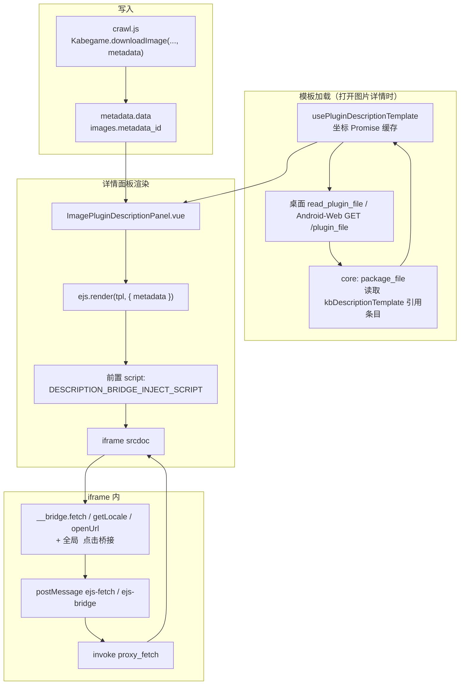

# 插件详情 EJS：模板加载、渲染与 iframe 桥接

本文描述画廊「图片详情」中 `templates/description.ejs` 的**全链路**：从爬虫写入 `metadata`、前端拉取模板字符串、EJS 渲染、注入 `__bridge` 写入 `iframe srcdoc`，到 iframe 内通过 `postMessage` 调用 `proxy_fetch`。

## 总览

---

## 一、数据：`metadata` 从哪里来

- 爬虫在 `download_image` 的 opts 里传入 **`metadata`**（任意 JSON，由插件自行约定结构）。
- 后端在 Rhai/WebView 入口写入 `metadata` 表，后续 `images` / `task_failed_images` 只保存 `metadata_id`。
- 详情区按需加载 metadata 后，EJS 接收 `ejs.render(tpl, { metadata, plugin_version })`：`metadata` 为写入时的 JSON，`plugin_version` 为写入时插件的 packed 版本。
- **冻结模板**：CLI `plugin run --freeze-template` 在任务冻结时（`freeze_task`）读一次包内 `kbDescriptionTemplate`，放进 `TaskParams.frozen_template`；`Task::insert_metadata` 把它写进本任务每行 `metadata.template`，与 `plugin_id` / `plugin_version` 一起盖章。开关只在内存中经 `CrawlTaskRequest` 传递，不入任务记录，前端不提供。内建插件没有包文件，dry-run 不写 metadata，都不冻结。

详见 [DOWNLOADER_FLOW.md](../downloader-tasks/DOWNLOADER_FLOW.md)、[crawler/V8_RUNTIME.md](../crawler/V8_RUNTIME.md) 中 `downloadImage` / `metadata` 说明。

---

## 二、模板加载：何时、如何拿到 `.ejs` 字符串

1. **包内路径**：由 `packageJson.kbDescriptionTemplate` 指定，不依赖固定文件名。
2. **后端**：列表只下发清单；桌面 `read_plugin_file` 或 Android / Web `/plugin_file/<id>/<path>?v=<version>` 经核心 `package_file` 白名单和版本校验后从 kgpg 读取。模板源码不常驻 `Plugin`。
3. **前端**：`services/pluginFiles.ts::usePluginDescriptionTemplate` 在面板用到插件时获取模板，按插件坐标缓存 Promise；失败移出缓存，更新或删除插件时失效。不同版本、商店源和导入预览各自隔离。
4. **冻结模板优先**：`get_image_metadata_full` 返回行的 `template`（`images://id_<id>/metadata_full`）。面板并行获取它和插件模板，不等前者为空再去拉后者；最终模板为「冻结模板非空 ? 冻结模板 : 插件模板」，有冻结模板时不等插件模板加载完。插件模板只在 `pluginStore.plugins`（已安装列表）里按 `image.pluginId` 查找，所以 `--id` 测试 id 的图片只能靠冻结模板渲染。
5. **展示**：加载完成前不渲染 iframe，也不回退展示原始 metadata；完成后有模板则渲染，无模板则显示 metadata 键值。切换图片后忽略旧请求的晚到结果。
6. **冻结模板的生命周期**：它随 metadata 行按 id 不可变。开启「去重时更新元数据」时，去重命中会把旧图改挂到本次新建的 metadata 行，data 与模板一起被覆盖；本次未冻结时模板随之清空。metadata 迁移把冻结模板原样带到新行，插件升级后不跟着更新（见 [METADATA_MIGRATION.md](../crawler/METADATA_MIGRATION.md)）。前端 metadata 缓存按 metadataId，改挂后自然失效。

完整文件出口与缓存契约见 [PLUGIN_FILE_ENDPOINT.md](PLUGIN_FILE_ENDPOINT.md)。

---

## 三、渲染：`ImagePluginDescriptionPanel.vue` 与 `srcdoc`

**文件**：[apps/kabegame/src/components/common/ImagePluginDescriptionPanel.vue](../../apps/kabegame/src/components/common/ImagePluginDescriptionPanel.vue)

1. **显示条件**：`image.pluginId` 存在，且 `metadata` 经 `isRenderableMetadata` 判断非空；且能取到非空模板字符串。
2. **渲染**：
  - `body = ejs.render(tpl, { metadata }, { rmWhitespace: false })`
   - **CSP（生产 / WKWebView）**：Tauri 会为父文档注入 `script-src` 哈希，子文档 `about:srcdoc` 继承后内联脚本会被拒。应用层使用**固定 nonce**（常量 `kabegame-ejs-bridge`，与 `tauri.conf.json` 中 `script-src` 的 `'nonce-kabegame-ejs-bridge'` 一致），为 bridge 与 EJS 产出中所有 `' + body`（`body` 内 `<script>` 同样注入 nonce）
   - **内层 CSP**（`DESCRIPTION_CSP`，前置在文档最前）：`default-src 'none'; script-src 'unsafe-inline' 'nonce-kabegame-ejs-bridge'; style-src 'unsafe-inline'; img-src https: http: data: blob:; media-src https: http: data: blob:; font-src data:; connect-src 'none'; frame-src about:; form-action 'none'; base-uri 'none'`。它与父页策略取交集（父页的 nonce 要求仍在，所以注入 nonce 的逻辑保留）：`connect-src 'none'` 关掉 `fetch` / XHR / WebSocket / beacon；`frame-src about:` 只放嵌套的 `srcdoc` / `about:blank` 子 frame（如 `kabegame-server` 模板把来源页面快照放进 `sandbox=""` 的 srcdoc iframe），`file:` 与 http(s) frame 被拒；元素级远程 `` / CSS 背景图照常；`blob:` 由同一文档创建，`img-src blob:` 放行。
   - 注入脚本定义 **`window.__bridge.fetch`**、**`getLocale`**、**`getPluginData`**、**`getCache`**、**`setCache`**、**`openUrl`**，并全局监听 iframe 内 `<a>` 点击（见下节）。
3. **展示**：`iframe :srcdoc="descriptionSrcdoc"`，`sandbox="allow-scripts allow-popups allow-popups-to-escape-sandbox"`——**不带 `allow-same-origin`**，iframe 是 opaque origin：`window.parent.document` / `parent.__TAURI_INTERNALS__` 为 `SecurityError`，也不继承应用页的 `CanDisplay(file:)`（桌面图库媒体走 `file://` 后应用页有这项能力，见 [WPE_IMPORT.md](../wpe/WPE_IMPORT.md)）；`localStorage` 等同源存储不可用（模板没有用到，跨次缓存走 `__bridge.getCache` / `setCache`）。与宿主只经 `postMessage` 通信，两侧 `targetOrigin` 都是 `"*"`，父页按 `event.source === iframe.contentWindow` 认来源。保留 `allow-popups*`：模板常见 `target=_blank` / `window.open`，桥的 `openUrl` 兜底也在。
4. **不经 DOMPurify**：信任已安装插件包内容；恶意模板风险见文末「安全说明」。
5. **无模板时**：若 `metadata` 可展示但无 `description.ejs`，走 **`showRawMetadata`**，以键值形式展示原始 `metadata`（不经过 EJS）。

**注入脚本**：正文 [descriptionBridgeInject.body.js](../../apps/kabegame/src/components/common/descriptionBridgeInject.body.js)（勿与 `descriptionBridgeInjectScript.ts` 同名 `.js`，避免 Bun 等把对 `.ts` 的解析指到无导出的 IIFE）；[descriptionBridgeInjectScript.ts](../../apps/kabegame/src/components/common/descriptionBridgeInjectScript.ts) 内 **`import … from '…/descriptionBridgeInject.body.js?raw'`** 导出 `DESCRIPTION_BRIDGE_INJECT_SCRIPT`，供 [ImagePluginDescriptionPanel.vue](../../apps/kabegame/src/components/common/ImagePluginDescriptionPanel.vue) 使用。

---

## 四、iframe 内：`__bridge` 与 `postMessage`

### 4.1 `__bridge.fetch`

1. 插件模板内调用 **`__bridge.fetch(url, options)`**，`options` 可含 **`headers`**（键值均为字符串）、**`json`**（布尔）：
   - **`json: true`**：宿主 **`invoke('proxy_fetch', …)`** 返回 `{ base64, contentType }`，注入脚本将 body **UTF-8 解码**后 **`JSON.parse`**，Promise resolve **已解析的 JSON 对象**（适用于 Pixiv/PixAI 等 JSON API）。
   - **未设 `json` 或 `json: false`**：resolve **`{ base64, contentType }`**，由插件自行 `atob` / `Blob` 等处理（例如带 `Referer: https://www.pixiv.net/` 的 `i.pximg.net/user-profile` 头像）。
2. iframe 向 **`window.parent`** 发送 `{ type: 'ejs-fetch', id, url, options }`。
3. 父窗口 **`ImageDetailContent`** 在 `window` 上监听 `message`：
   - 处理 `type === 'ejs-fetch'`；
   - **`event.source === descriptionIframeRef.contentWindow`**，避免其它来源冒充。
4. 父窗口 **`invoke('proxy_fetch', { url, headers })`**（Rust `reqwest` GET，无浏览器 CORS；IPC 上响应体为 Base64 编码，见 `proxy.rs`）。
5. 向 iframe **`postMessage({ type: 'ejs-fetch-response', id, data | error })`**，注入脚本中的 Promise 随之 resolve/reject。

**Tauri 命令**：[src-tauri/kabegame/src/commands/proxy.rs](../../src-tauri/kabegame/src/commands/proxy.rs) → `proxy_fetch`。单响应体积上限约 **3MB**（`PROXY_FETCH_BYTES_MAX`）。

### 4.2 `__bridge.getLocale` / `__bridge.getPluginData` / `__bridge.getCache` / `__bridge.setCache` / `__bridge.openUrl` / 全局 `<a>` 点击桥接

1. **`getLocale()`**：iframe 发送 `{ type: 'ejs-bridge', id, action: 'getLocale' }`；父窗口回 **`{ type: 'ejs-bridge-response', id, data }`**，`data` 为应用当前 i18n locale 字符串（如 `en`、`zh`、`ja`、`zhtw`）。
2. **`getPluginData()`**：iframe 发送 `{ type: 'ejs-bridge', id, action: 'getPluginData' }`；父窗口用当前图片的 `image.pluginId` 调用只读命令 `get_plugin_data`，回 **`{ type: 'ejs-bridge-response', id, data }`**。iframe 不能指定 plugin id，也没有写入 API。测试 id 运行写入的插件数据也记在测试 id 下，冻结模板因此能读到。
3. **`getCache(key)` / `setCache(key, data)`**：iframe 发送 `{ type: 'ejs-bridge', id, action: 'getCache' | 'setCache', key, data? }`；父窗口按当前图片的 `image.pluginId` 给 `key` 加插件作用域后读写宿主 IndexedDB + LRU 缓存。iframe 不能跨插件读取缓存。
4. **`openUrl(url)`**：iframe 发送 `{ type: 'ejs-bridge', id, action: 'openUrl', url }`；父窗口校验 **`http:` / `https:`** 后调用 **`@tauri-apps/plugin-opener` 的 `openUrl`**，成功回 **`{ type: 'ejs-bridge-response', id }`**，失败回 **`error`** 字符串。
5. **全局 `<a>` 点击桥接**：注入脚本在 iframe 文档级监听点击事件，命中 `<a>` 后优先取 `data-url`，否则取 `href`（仅放行 `http` / `https`），再通过 `openUrl` 交给宿主打开。
4. 与 `ejs-fetch` 相同，仅当 **`event.source` 为详情 iframe** 时处理，避免其它窗口冒充。

模板内可用二者实现与主应用语言一致的文案、以及在外部浏览器/系统打开链接（例如 PixAI 标签页）。

---

## 五、插件模板编写要点

- EJS 中通过 **`metadata`**（或 `<% const m = metadata || {} %>`）访问下载时写入的 JSON。
- 模板可把 `metadata` 作为**首屏兜底**，再在 iframe 内通过 **`__bridge.fetch(..., { json: true })`** 拉取最新远端详情，仅**覆盖当前展示 DOM**；这不会回写 `metadata` 表，也不改变数据库中的原始元数据。
- Pixiv 等插件可在模板内继续请求其它 JSON（例如 `GET /ajax/user/{tags.authorId}`），再用 **`json: false`** 的 `__bridge.fetch` 拉 `i.pximg.net/user-profile` 头像字节并转 Blob URL（与评论头像一致）。
- 需要 HTTP 请求时**只能**用 **`__bridge.fetch`**（`json: true` 解析 JSON；否则拿 `{ base64, contentType }`）：内层 CSP 是 `connect-src 'none'`，iframe 内裸 `fetch` / XHR / WebSocket 一律被拒。元素级远程资源（``、CSS `background-image`）不受影响；`<link>` 外链样式表、`@font-face` 远程字体、嵌套 http(s) / `file:` iframe 同样被 CSP 拒绝。
- Pixiv 部分接口带 **`lang`** 查询参数时：应先用 **`__bridge.getLocale()`** 取应用语言，再在模板内映射为 Pixiv 接受的 `ja` / `zh` / `ko` / `en`（与作品页 ajax 一致），例如 `ajax/illust/{id}`、评论根列表等。
- 需要与应用 UI 语言一致时可用 **`__bridge.getLocale()`**。
- 需要读取爬虫提前写入的插件级缓存时可用 **`__bridge.getPluginData()`**；例如 PixAI tag 显示名缓存、米游社 emoji 元数据等。
- 需要避免 iframe 反复桥接或重复网络请求时可用 **`__bridge.getCache(key)` / `setCache(key, data)`**；缓存由宿主 IndexedDB 管理并带 LRU 淘汰，key 会自动按插件隔离。
- 模板中的外链优先直接写 `<a data-url="https://...">` 或 `<a href="https://...">`，由注入脚本统一桥接打开；通常不再需要在模板里手动绑定 `click` 调 `__bridge.openUrl`。
- 可选 `templates/description.ejs`；无则详情区仅展示原始 metadata（若存在）。

示例见本文档历史版本或 [docs/PLUGIN_FORMAT.md](../../docs/PLUGIN_FORMAT.md) 中「templates/description.ejs」小节。

---

## 六、涉及文件速查

| 阶段 | 路径 |
|------|------|
| 下载写入 metadata | 各插件 `crawl.rhai` / `crawl.js`，`kabegame_core` 下载链路 |
| 读 ZIP 模板 | `src-tauri/kabegame-core/src/plugin/package_file.rs`（`read_manifest_text`） |
| 冻结模板 | `crawler/task_scheduler/mod.rs`（`freeze_task`）、`task.rs`（`Task::insert_metadata`）、`storage/images.rs`（`metadata.template`） |
| HTTP / Tauri | 桌面 `read_plugin_file`、Android / Web `/plugin_file`、`proxy_fetch` |
| 前端模板缓存与加载 | `apps/kabegame/src/services/pluginFiles.ts`、`composables/useImageMetadataCache.ts`（冻结模板） |
| EJS 渲染与 iframe | `ImagePluginDescriptionPanel.vue`、`descriptionBridgeInject.body.js`（`?raw`）/`descriptionBridgeInjectScript.ts` |

---

## 安全说明

- 仅应对已安装、可信来源的 `.kgpg` 开放该能力；模板可执行脚本且可通过 `proxy_fetch` 访问任意 URL，后续若需应增加域名白名单或策略限制。
- 隔离面（WPE Phase 6b 收紧）：iframe 为 opaque origin（不带 `allow-same-origin`），碰不到父页 DOM 与 Tauri IPC，也不继承应用页对 `file:` 的显示权；内层 CSP 禁止脚本动态请求与非 `about:` 子 frame，模板唯一的网络出口是 `__bridge.fetch` → `proxy_fetch`。本地 HTTP 服务原有的 `/proxy` 开放代理端点已删除。
- 以后若要把 `img-src` 收紧到 `data: blob:`，需先把直接写远程 `` 的模板改经 `__bridge.fetch`（插件仓库任务）。
